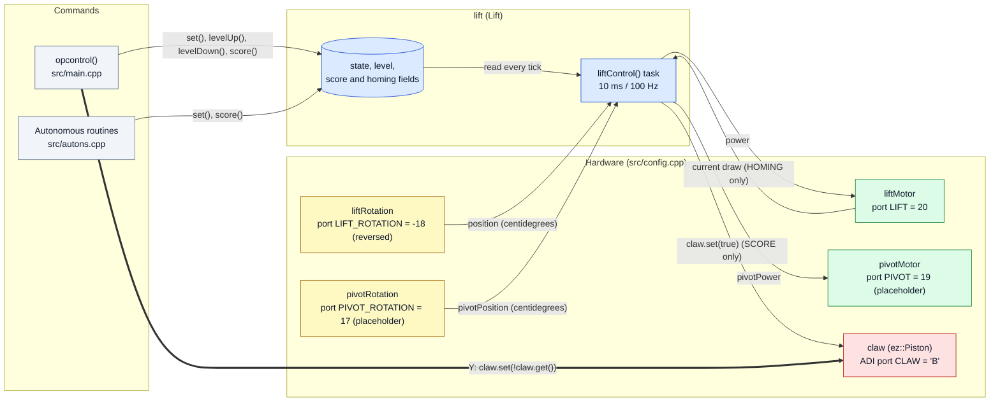
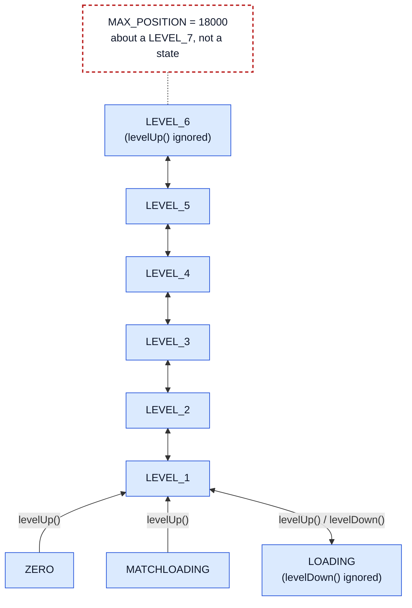
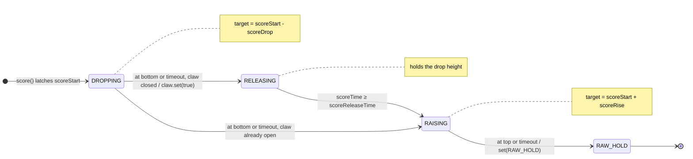
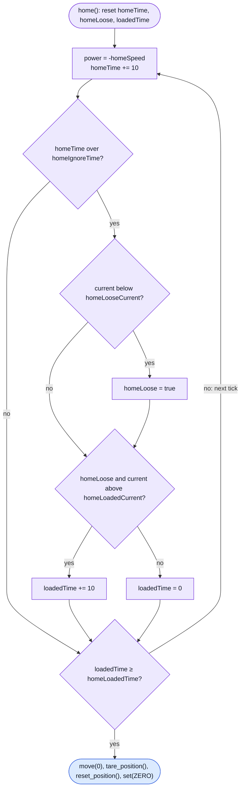
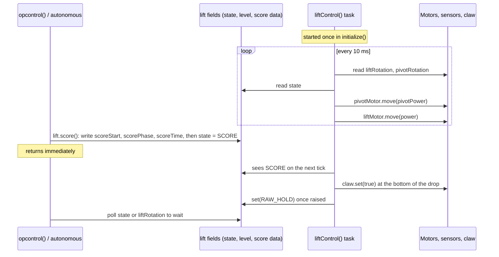
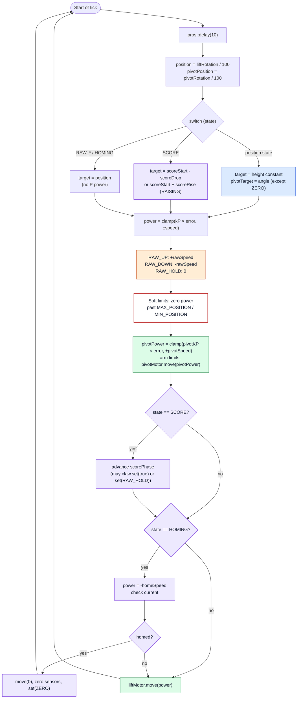

# Lift Implementation

|                       |            |
|:----------------------|:-----------|
| **Target release**    | TBD        |
| **Document status**   | DRAFT      |
| **Document owner**    | TBD        |
| **Designer**          | TBD        |
| **Technical writers** | TBD        |

## ▲ In This Document:

- The `Lift` class structure and finite state machine design
- Lift and arm position control with proportional (P) control
- Soft limits on lift and arm travel
- The automatic score sequence and how it releases the claw
- Current-based homing for a lift with no hard stop
- The background task execution model
- Driver control mapping and autonomous usage
- Parameter reference, tuning methodology, and troubleshooting
- Design history and key design decisions

## ▲ Executive Summary

### Purpose & Need

- The lift carries game objects between the loading height and six scoring levels. It is built from three actuators: a string-winch lift driven by `liftMotor`, a pivoting arm driven by `pivotMotor`, and a pneumatic `claw` that grips and releases the object.
- Each operation needs the three actuators to agree. At a scoring level the arm must be at its scoring angle; at the loading height it must be at its loading angle; and scoring needs the lift to drop, the claw to open, and the lift to rise, in that order.
- The `Lift` class is a **finite state machine (FSM)**: a design where the system is always in exactly one named state, and each state fully defines what the outputs do. One background task turns the current state into motor power for both motors every 10 ms, using P control on two rotation sensors. Scoring and homing are states with their own internal phases, so they run without blocking anything.
- The result is that the driver and autonomous routines command the lift with a single call and never wait on it.

### Why a Finite State Machine?

A naive approach would call `liftMotor.move()` and `pivotMotor.move()` directly from every button handler and every autonomous step. With two motors and a piston, that creates conflicting commands (for example, a routine raising the lift while the driver holds raw down) and leaves no single answer to "what is the lift doing right now?". The FSM removes both problems:

- **One control loop, one source of truth.** `liftControl()` is the only code that commands `liftMotor` and `pivotMotor`. Everything else changes the lift by writing `state` through `set()` or a helper method. The arm angle is part of the state, so the lift and arm can't be sent to mismatched poses.
- **Concurrency safe.** `set()` only writes two fields. The helpers `score()` and `home()` fill in their working variables *before* calling `set()`, so by the time the task sees the new state, its data is ready. Whichever command is written last wins, and the task applies it on its next tick.
- **Extensible.** A new height needs one enum value, one height constant, and one `case`. When we added `MATCHLOADING` (commit `2a4e0ad`), the whole change was 11 added lines across three files.

### Design Evolution

The lift's code changed with the robot. Each row is taken from the commit history of `include/subsystem/lift.hpp` and `src/subsystem/lift.cpp`.

|  **Date**    |  **Commit**  |  **Change**                                                                                                     |  **Reason (source)**                                                                  |
|:-------------|:-------------|:----------------------------------------------------------------------------------------------------------------|:--------------------------------------------------------------------------------------|
| 2026-09-11   | `47975a0`    | Early-season lift: two motors in a `pros::MotorGroup`, claw and arm on pistons, blocking timed macros           | First version                                                                         |
| 2026-09-11   | `38fd2f7`    | Macros made non-blocking: scripts of steps walked by a background task behind a `pros::Mutex`                   | Blocking macros "stalled the whole opcontrol loop, drive included - up to 2850 ms for lower()" (commit message) |
| 2026-10-04   | `8a222ca`    | Rewritten as an FSM with rotation-sensor P control to named heights                                             | "simplify over-complicated mechanism into simple FSM" (commit message)               |
| 2026-10-04   | `1a2fd6c`    | `pros::MotorGroup` replaced by a single `pros::Motor`                                                           | "The lift only has one motor now" (commit message)                                   |
| 2026-10-10   | `2c6e617`    | First `home()`: blocking, drove down until the motor encoder stopped changing for 300 ms, then tared it         | Zero the lift without a limit switch                                                  |
| 2026-10-11   | `d7dd4f3`    | `HOMING` and `SCORE` became FSM states; homing switched to current detection                                    | The string winch has no hard stop, so the motor never stalls (header comment)        |
| 2026-10-11   | `2a4e0ad`    | `MATCHLOADING` state added                                                                                      | New loading pose                                                                      |
| 2026-11-02   | `6cc35a6`    | Arm became a motor with a rotation sensor and three angles; `SCORE` opens the claw (new `RELEASING` phase); the `ROLLERS` state, scoring piston, and claw-intake motor were removed | Robot rewired                                     |

## ▲ Architecture

### External Dependencies

|  **Component**       |  **Type**               |  **Purpose**                                                                                        |
|:---------------------|:------------------------|:----------------------------------------------------------------------------------------------------|
| `pros::Motor`        | Kernel Library          | `liftMotor` and `pivotMotor`: power commands, HOLD brake mode, and (for homing) current draw and velocity |
| `pros::Rotation`     | Kernel Library          | `liftRotation` and `pivotRotation`: position feedback in centidegrees                               |
| `pros::Task`         | Kernel Library          | Runs `liftControl()` in the background, launched in `initialize()`                                  |
| `pros::delay`        | Kernel Library          | Sets the 10 ms loop period                                                                          |
| `ez::Piston`         | EZ-Template             | `claw`: `set()` writes the solenoid, `get()` returns the last state written                         |
| `std::clamp`         | C++ Standard Library    | Limits P-control power to `±speed` and `±pivotSpeed`                                                 |
| `std::abs`, `fabs`, `printf` | C++ Standard Library | Current magnitude, velocity magnitude, and homing telemetry                                      |

### Internal Dependencies

|  **Component**                                                        |  **Type**          |  **Purpose**                                                                                     |
|:----------------------------------------------------------------------|:-------------------|:-------------------------------------------------------------------------------------------------|
| `liftMotor`, `liftRotation`, `pivotMotor`, `pivotRotation`, `claw`    | Global objects     | Constructed in `src/config.cpp` from the port constants and passed to `Lift` by reference         |
| `lift`                                                                | Global object      | The single `Lift` instance (`src/config.cpp`), declared `extern` in `include/config.hpp`          |
| `initialize()`                                                        | Function           | Sets the initial state and starts the lift task (`src/main.cpp`)                                  |
| `opcontrol()`                                                         | Function           | Maps controller buttons to lift calls, and toggles `claw` directly (`src/main.cpp`)               |

The `Lift` class does not depend on any other subsystem. It never commands the intake (See Intake Entry).

### Interfaces

|  **Type**          |  **Name**                                                                                                                                                        |
|:-------------------|:-----------------------------------------------------------------------------------------------------------------------------------------------------------------|
| Component Input    | `LiftState` commands through `set()`, `levelUp()`, `levelDown()`, `score()`, and `home()`; `liftRotation` and `pivotRotation` positions; `liftMotor` current draw (homing only) |
| Component Output   | Power (−127 to 127) to `liftMotor` and `pivotMotor` every 10 ms; `claw.set(true)` during `SCORE`; the public `state`, `level`, and position constants for routines to read |

[Note: Insert diagram here — **"Lift System Block Diagram"**. Draw a left-to-right block diagram in three columns. Left column (grey, "Commands"): "`opcontrol()` — src/main.cpp" and "Autonomous routines — src/autons.cpp". Middle column (blue, "lift (Lift)"): a data store labeled "`state`, `level`, score and homing fields" feeding a process box labeled "`liftControl()` task — 10 ms / 100 Hz". Right column ("Hardware — src/config.cpp"): green motor boxes "`liftMotor` — port `LIFT` = 20" and "`pivotMotor` — port `PIVOT` = 19 (placeholder)"; yellow sensor boxes "`liftRotation` — port `LIFT_ROTATION` = −18 (reversed)" and "`pivotRotation` — port `PIVOT_ROTATION` = 17 (placeholder)"; a red pneumatics box "`claw` (`ez::Piston`) — ADI port `CLAW` = 'B'". Arrows: `opcontrol()` → data store "set(), levelUp(), levelDown(), score()"; routines → data store "set(), score()"; data store → task "read every tick"; task → `liftMotor` "power"; task → `pivotMotor` "pivotPower"; `liftRotation` → task "position (centidegrees)"; `pivotRotation` → task "pivotPosition (centidegrees)"; `liftMotor` → task "current draw (HOMING only)"; task → `claw` "claw.set(true) (SCORE only)"; and a highlighted arrow `opcontrol()` → `claw` "Y: claw.set(!claw.get())". Annotations: "Only the task writes motor power", "The claw is the one output shared with `opcontrol()`".]



## ▲ Design Spec

### Finite State Machine

The `Lift` class defines fourteen states in the `LiftState` enum, plus a three-value `ScorePhase` enum used inside `SCORE`:

```cpp
// include/subsystem/lift.hpp
  enum LiftState { ZERO,
                   MATCHLOADING,
                   LOADING,
                   LEVEL_1,
                   LEVEL_2,
                   LEVEL_3,
                   LEVEL_4,
                   LEVEL_5,
                   LEVEL_6,
                   RAW_UP,
                   RAW_DOWN,
                   RAW_HOLD,
                   HOMING,
                   SCORE };
  enum ScorePhase { DROPPING,
                    RELEASING,
                    RAISING };
```

We group the states three ways:

- **Position states** (`ZERO` through `LEVEL_6`): P control drives the lift to a fixed height, and most of them also set an arm angle.
- **Raw states** (`RAW_UP`, `RAW_DOWN`, `RAW_HOLD`): the driver moves the lift directly at a fixed power, then holds it wherever it stopped.
- **Automatic sequences** (`HOMING`, `SCORE`): multi-step behaviors that end on their own with an automatic transition.

**The enum order is part of the logic.** `set()` treats every value up to `LEVEL_6` as a position state (`state <= LEVEL_6`), and `levelUp()` / `levelDown()` step with `level + 1` and `level - 1`, capped at `LEVEL_6`. The position states must therefore stay first, with `LOADING` directly below `LEVEL_1` and the levels in height order. Adding a level takes three edits: put it straight after the current top level (before `RAW_UP`), add its `case`, and move the top-level checks in `set()` and `levelUp()` to it. `LEVEL_6` was added this way. If a check is missed, the new level is silently skipped by level stepping.

|  **State**       |  **Group**    |  **Lift (`liftMotor`)**                                         |  **Arm (`pivotMotor`)**           |  **Claw**                         |  **Purpose**                                         |
|:-----------------|:--------------|:----------------------------------------------------------------|:----------------------------------|:----------------------------------|:-----------------------------------------------------|
| `ZERO`           | Position      | P to `ZERO_HEIGHT`                                              | Holds last `pivotTarget`          | Unchanged                         | Bottom of travel; initial state; homing ends here    |
| `MATCHLOADING`   | Position      | P to `MATCHLOADING_HEIGHT`                                      | P to `MATCHLOADING_ANGLE`         | Unchanged                         | Match-loading pose                                   |
| `LOADING`        | Position      | P to `LOADING_HEIGHT`                                           | P to `LOADING_ANGLE`              | Unchanged                         | Loading pose; bottom rung of the level ladder        |
| `LEVEL_1`–`LEVEL_6` | Position   | P to `LEVEL_N_HEIGHT`                                           | P to `SCORING_ANGLE`              | Unchanged                         | The six scoring heights                              |
| `RAW_UP`         | Raw           | +`rawSpeed`                                                     | Holds last `pivotTarget`          | Unchanged                         | Driver moves the lift up freely                      |
| `RAW_DOWN`       | Raw           | −`rawSpeed`                                                     | Holds last `pivotTarget`          | Unchanged                         | Driver moves the lift down freely                    |
| `RAW_HOLD`       | Raw           | 0, HOLD brake keeps position                                    | Holds last `pivotTarget`          | Unchanged                         | Hold after raw control or scoring                    |
| `SCORE`          | Automatic     | P to `scoreStart − scoreDrop`, then to `scoreStart + scoreRise` | Holds last `pivotTarget`          | Opened at the bottom if closed    | One-press score                                      |
| `HOMING`         | Automatic     | −`homeSpeed`, open loop                                         | Holds last `pivotTarget`          | Unchanged                         | Find the bottom and re-zero the height sensor        |

"Holds last `pivotTarget`" means the arm is still under P control toward the last angle a position state gave it, so it is actively held rather than left loose. `pivotTarget` starts at 0, which is the arm's pose when the program started. With the current placeholder values, `MATCHLOADING_HEIGHT` and `MATCHLOADING_ANGLE` are both 0, so `MATCHLOADING` is the same lift height as `ZERO` with the arm returned to its starting pose.

> **TODO (owner):** Describe or photograph the arm at `MATCHLOADING_ANGLE`, `SCORING_ANGLE`, and `LOADING_ANGLE` so a reader can see what each pose is for.

The full state diagram, with every transition, is in the State Diagram section of the Lift PRD.

### State Transitions

**External transitions** are made by calling a method on `lift`. None of them block.

- `set(LiftState state)` has no guard. If the new state is a position state, it also records it in `level`.
- `levelUp()` and `levelDown()` step from `level` (the last position state picked), not from `state`. This is why L1 and L2 still work after raw control or scoring.
- `score()` is ignored while the lift is already in `SCORE` or `HOMING`. On entry it latches `scoreStart` (the current height in degrees), sets `scorePhase = DROPPING`, and clears `scoreTime`.
- `home()` is ignored while the lift is already in `HOMING`. On entry it clears `homeTime`, `homeLoose`, `loadedTime`, and `homePrintCounter`.

```cpp
// src/subsystem/lift.cpp
void Lift::set(LiftState state) {
  if (state <= LEVEL_6) level = state;
  this->state = state;
}
```

**Automatic transitions** are made by `liftControl()` itself, and there are exactly two:

- `SCORE` → `RAW_HOLD` once the `RAISING` phase reaches its height or times out.
- `HOMING` → `ZERO` once the motor current shows the string is lifting the lift again.

|  **From**                                   |  **Trigger**                                                                   |  **To**                |  **Notes**                                                     |
|:--------------------------------------------|:-------------------------------------------------------------------------------|:-----------------------|:---------------------------------------------------------------|
| Any                                         | `set(s)`                                                                       | `s`                    | No guard; position states also update `level`                  |
| `level` is `ZERO`, `MATCHLOADING`, or `LOADING` | `levelUp()`                                                                | `LEVEL_1`              | "up from either is LEVEL_1" (code comment)                     |
| `level` is `LEVEL_1`–`LEVEL_5`              | `levelUp()`                                                                    | Next level             |                                                                |
| `level` is `LEVEL_6`                        | `levelUp()`                                                                    | (no change)            | Ignored                                                        |
| `level` is `LEVEL_2`–`LEVEL_6`              | `levelDown()`                                                                  | Previous level         |                                                                |
| `level` is `LEVEL_1`                        | `levelDown()`                                                                  | `LOADING`              |                                                                |
| `level` is `ZERO`, `MATCHLOADING`, or `LOADING` | `levelDown()`                                                              | (no change)            | Ignored                                                        |
| Any except `SCORE`, `HOMING`                | `score()`                                                                      | `SCORE`                | Latches `scoreStart`; `level` unchanged                        |
| Any except `HOMING`                         | `home()`                                                                       | `HOMING`               | Resets the homing counters                                     |
| `SCORE` (`RAISING`)                         | Automatic: `position >= scoreStart + scoreRise - scoreTolerance` or `scoreTime >= scoreMoveTimeout` | `RAW_HOLD` | `level` unchanged                                    |
| `HOMING`                                    | Automatic: current over `homeLoadedCurrent` for `homeLoadedTime` after going loose | `ZERO`             | Both lift encoders zeroed first                                |
| `RAW_UP` / `RAW_DOWN`                       | X and B both released (in `opcontrol()`)                                       | `RAW_HOLD`             | Made by `opcontrol()`, not by the class                        |

#### Level Stepping

[Note: Insert diagram here — **"Level Ladder"**. Draw a vertical ladder, bottom to top: `LOADING`, `LEVEL_1`, `LEVEL_2`, `LEVEL_3`, `LEVEL_4`, `LEVEL_5`, `LEVEL_6` (blue boxes). Connect each neighboring pair with a double-headed arrow; label the up direction "levelUp() (L1)" and the down direction "levelDown() (L2)". Beside `LOADING`, draw `ZERO` and `MATCHLOADING` (blue boxes) with one-way arrows into `LEVEL_1` labeled "levelUp()". Add a small grey tag on `LEVEL_6` reading "levelUp() ignored" and one under `ZERO` / `MATCHLOADING` / `LOADING` reading "levelDown() ignored". Above `LEVEL_6`, draw a dashed red line labeled "`MAX_POSITION` = 18000 (about a LEVEL_7 — not a state)", joined to `LEVEL_6` by a dotted line. Annotation: "Steps from `level`, the last position state picked — raw control and scoring don't move you on the ladder".]



`LOADING` is the bottom rung of the ladder: L2 from `LEVEL_1` goes to `LOADING`, and L2 from `LOADING` does nothing. `ZERO` and `MATCHLOADING` have their own entry points (`home()` / initial state, and the RIGHT button), so the ladder only climbs out of them.

### Control Law

Both motors use the same **proportional (P) control** law: the motor power is proportional to the distance from the target, limited to a maximum. This is the P term of the PID controller used by the drive (See PID Controller Entry).

#### Lift

$$P_{lift} = \operatorname{clamp}\Big(\big\lfloor K_p \,(h_{target} - h)\big\rfloor_0,\ -S,\ S\Big)$$

**Where:**
- $P_{lift}$ is the power sent to `liftMotor` with `move()`, from −127 to 127 (`power`).
- $K_p$ is the proportional gain in power per degree of error (`kP`, default 1.0, placeholder — tune on robot).
- $h_{target}$ is the target height in rotation-sensor degrees (`target`).
- $h$ is the measured height in degrees (`position`). `liftRotation.get_position()` returns centidegrees, so the code divides by 100.
- $S$ is the maximum power while moving to a level (`speed`, default 127).
- $\lfloor x \rfloor_0$ is truncation toward zero, from `static_cast<int>`.

```cpp
// src/subsystem/lift.cpp
    int power = std::clamp(static_cast<int>(kP * (target - position)), -speed, speed);
    if (state == RAW_UP) power = rawSpeed;
    if (state == RAW_DOWN) power = -rawSpeed;
    if (state == RAW_HOLD) power = 0;  // let go - the HOLD brake keeps it where it stopped
```

**Intuition:** far from the target the product is large, so the clamp holds the motor at full `speed`; close to the target the power shrinks in proportion to the error, so the lift slows as it arrives instead of slamming into the height. The table below is computed from the formula with the current values (`kP` = 1.0, `speed` = 127). *Computed from the formula, not measured data.*

|  **Error (degrees)**              |  **kP × error**  |  **After truncation**  |  **Power sent**  |
|:----------------------------------|:-----------------|:-----------------------|:-----------------|
| 1300 (`LOADING` → `LEVEL_1`)      | 1300             | 1300                   | 127              |
| 127                               | 127              | 127                    | 127              |
| 60                                | 60               | 60                     | 60               |
| 10                                | 10               | 10                     | 10               |
| 0.8                               | 0.8              | 0                      | 0                |
| −300 (start of a score drop)      | −300             | −300                   | −127             |

Two consequences follow from the law:

- **A small deadband.** Truncation turns any error smaller than $1 / K_p$ degrees (1° at `kP` = 1.0) into zero power, and with zero power the motor's HOLD brake holds the lift in place.
- **Droop under load.** A P-only controller needs some error to produce the power that holds the lift up against gravity, so the lift can settle slightly below its target. Raising `kP` shrinks that error; raising it too far makes the lift overshoot and oscillate.

#### Arm

$$P_{arm} = \operatorname{clamp}\Big(\big\lfloor K_{p,arm} \,(\theta_{target} - \theta)\big\rfloor_0,\ -S_{arm},\ S_{arm}\Big)$$

**Where:**
- $P_{arm}$ is the power sent to `pivotMotor`, from −127 to 127 (`pivotPower`).
- $K_{p,arm}$ is the arm gain in power per degree of error (`pivotKP`, default 1.0, placeholder — tune on robot).
- $\theta_{target}$ is the target arm angle in degrees (`pivotTarget`).
- $\theta$ is the measured arm angle in degrees (`pivotPosition`, centidegrees divided by 100). 0 is the arm's pose when the program started.
- $S_{arm}$ is the maximum arm power (`pivotSpeed`, default 127).

**Intuition:** the arm law runs in every state, every tick. States that don't set an angle leave `pivotTarget` unchanged, so the arm keeps holding the last angle it was sent to.

### Safety Limits

```cpp
// src/subsystem/lift.cpp
    // Never drive past the ends of travel
    if (position >= MAX_POSITION && power > 0) power = 0;
    if (position <= MIN_POSITION && power < 0) power = 0;

    int pivotPower = std::clamp(static_cast<int>(pivotKP * (pivotTarget - pivotPosition)), -pivotSpeed, pivotSpeed);
    if (pivotPosition >= PIVOT_MAX_ANGLE && pivotPower > 0) pivotPower = 0;
    if (pivotPosition <= PIVOT_MIN_ANGLE && pivotPower < 0) pivotPower = 0;
```

A **soft limit** is a limit enforced in software: past it, the code refuses to drive further in that direction, but still allows power back toward the safe range so the mechanism can't get stuck.

|  **Limit**                         |  **Default**    |  **Applies to**                         |  **Protects against**                                                              |
|:-----------------------------------|:----------------|:----------------------------------------|:-----------------------------------------------------------------------------------|
| `MAX_POSITION`                     | 18000°          | Lift, every state except `HOMING`       | Driving the lift past the top of its travel                                        |
| `MIN_POSITION`                     | −10°            | Lift, every state except `HOMING`       | Driving below the bottom, where the string winds the other way and raises the lift |
| `PIVOT_MAX_ANGLE`                  | 200°            | Arm, every state                        | Swinging the arm past its mechanical range                                         |
| `PIVOT_MIN_ANGLE`                  | −20°            | Arm, every state                        | Swinging the arm past its mechanical range                                         |
| `scoreMoveTimeout`                 | 1000 ms         | Each `SCORE` move                       | A score that never reaches its height (stuck or drooping) and never ends          |

The lift limits are checked **after** the raw overrides, so they also stop raw control, but **before** the `HOMING` override, so homing ignores them. Homing has to drive below the old zero to find the real bottom.

**How the lift limits were chosen:**
- `MIN_POSITION` is −10°, just under `ZERO_HEIGHT`. Holding B stops at the bottom instead of unwinding the string, re-winding it the other way, and raising the lift again. The 10° margin keeps the limit from stopping `ZERO` short of its own target.
- `MAX_POSITION` is 18000°, about where a seventh level would be. The levels from `LEVEL_1` to `LEVEL_5` are on average about 2500° apart ((13000 − 2950) / 4 = 2512.5), so `LEVEL_6_HEIGHT` is set to 13000 + 2500 = 15500 and the limit to 15500 + 2500 = 18000. That leaves one level's worth of travel above the highest state for raw control and the score rise, but no more. There is no `LEVEL_7` state.

The arm limits are placeholders. `MAX_POSITION` is calculated from placeholder heights, so recalculate it whenever the heights are tuned.

> **TODO (owner):** Check that the lift can't reach its physical top before 18000°. If it can, lower `MAX_POSITION` to just below the top.

`HOMING` has no timeout (the header says so: "There's no timeout"). It runs until the current signature appears or another state is set.

### Score Sequence

**Purpose:** one press of LEFT places an object. The lift drops onto the scoring element, the claw lets go, and the lift rises clear.

The header comment describes the sequence:

> Score - drops scoreDrop degrees below where the lift is, then if the claw is closed, opens it and waits scoreReleaseTime ms for it to let go (already open skips the wait). Then goes up to scoreRise above where it started and holds there (RAW_HOLD - L1 / L2 still step from the old level). Each move counts as done within scoreTolerance degrees, or after scoreMoveTimeout ms so it can't get stuck. The arm stays at its angle the whole time. Any other lift button cancels it.

|  **Phase**     |  **Lift Target**             |  **Action**                                         |  **Exit Condition**                                                                          |  **Next**                                                          |
|:---------------|:-----------------------------|:----------------------------------------------------|:---------------------------------------------------------------------------------------------|:-------------------------------------------------------------------|
| `DROPPING`     | `scoreStart - scoreDrop`     | P control drives down                               | `position <= scoreStart - scoreDrop + scoreTolerance`, or `scoreTime >= scoreMoveTimeout`    | `RELEASING` (calls `claw.set(true)`), or `RAISING` if the claw was already open |
| `RELEASING`    | `scoreStart - scoreDrop`     | Holds the drop height while the claw opens          | `scoreTime >= scoreReleaseTime`                                                              | `RAISING`                                                          |
| `RAISING`      | `scoreStart + scoreRise`     | P control drives up                                 | `position >= scoreStart + scoreRise - scoreTolerance`, or `scoreTime >= scoreMoveTimeout`    | Leaves `SCORE`: `set(RAW_HOLD)`                                    |

Constants involved: `scoreDrop` = 300°, `scoreRise` = 700°, `scoreReleaseTime` = 200 ms (placeholder), `scoreTolerance` = 30° (placeholder), `scoreMoveTimeout` = 1000 ms. `scoreTime` resets to 0 at each phase change. With these values the sequence can take at most about 2200 ms (1000 + 200 + 1000), computed from the constants.

The sequence ends in `RAW_HOLD`, 700° above where it started, rather than returning to a level. The code comment gives the reason: "going back to a level would just drop it back down to that height". Because `score()` doesn't change `level`, L1 and L2 still step from the level the lift was at before scoring.

The claw check uses `claw.get()`, which returns the last value written to the piston (by `opcontrol()` or by `SCORE`), not a sensor reading.

[Note: Insert diagram here — **"Score Sequence"**. Draw a left-to-right state diagram inside a purple frame labeled `SCORE`. Entry arrow from the left labeled "score(): latch scoreStart, scorePhase = DROPPING, scoreTime = 0". Three purple phase nodes: `DROPPING` (target `scoreStart − scoreDrop`), `RELEASING` (target `scoreStart − scoreDrop`, `claw.set(true)`), `RAISING` (target `scoreStart + scoreRise`). Arrows: `DROPPING` → `RELEASING` "at bottom or timeout, claw closed"; `DROPPING` → `RAISING` "at bottom or timeout, claw already open" (curved, skipping `RELEASING`); `RELEASING` → `RAISING` "scoreTime ≥ scoreReleaseTime"; `RAISING` → exit to an orange `RAW_HOLD` node "at top or timeout". Below the diagram, draw a lift-height-vs-time sketch: start at `scoreStart`, drop by `scoreDrop`, flat during `RELEASING`, rise to `scoreStart + scoreRise`; shade a ±`scoreTolerance` band around each target. Annotation: "Ends 700° above where it started, holding in `RAW_HOLD`".]



### Homing Sequence

**Purpose:** every height is measured from where the lift was when the program started. If the program starts with the lift above the bottom, every level is off by that amount. Homing finds the real bottom and re-zeroes the sensor.

**Physical reasoning.** The usual way to home a mechanism is to drive it into a hard stop and wait for the motor to stall. The header comment explains why that can't work here:

> Homing - the lift hangs on a string wound around the axle, so there's no hard stop. Driving down unwinds the string; once it's loose the axle spins freely and the motor barely draws any current. Keep going and the string wraps the other way and starts picking the lift back up - the motor feels the lift's weight and its current jumps. That jump is the bottom.

The comment also records the measurements behind the thresholds:

|  **Condition (at power −45)**         |  **Current draw**  |  **Motor speed**  |
|:--------------------------------------|:-------------------|:------------------|
| String loose, axle spinning freely    | 50–105 mA          | about 84 RPM      |
| String re-wound, lifting the lift     | 220–350 mA         | about 70 RPM      |

*Source: the comment in `include/subsystem/lift.hpp` ("Measured at -45").* "The speed only drops ~15% but the current triples, so we watch the current." The thresholds `homeLooseCurrent` (130 mA) and `homeLoadedCurrent` (160 mA) both sit between the two bands, and `homeSpeed` (45) matches the power the measurements were taken at.

The phases are not an enum. They are implied by `homeTime`, `homeLoose`, and `loadedTime`:

|  **Phase**       |  **Action**                                                        |  **Exit Condition**                                     |  **Next**        |
|:-----------------|:-------------------------------------------------------------------|:--------------------------------------------------------|:-----------------|
| Ignore start     | Drive down at −`homeSpeed`; ignore the current                     | `homeTime > homeIgnoreTime` (100 ms)                    | Wait for loose   |
| Wait for loose   | Keep driving down; watch the current                               | Current < `homeLooseCurrent` → `homeLoose = true`       | Wait for load    |
| Wait for load    | `loadedTime += 10` while current > `homeLoadedCurrent`, else reset to 0 | `loadedTime >= homeLoadedTime` (50 ms)             | Zero             |
| Zero             | `move(0)`, `tare_position()`, `reset_position()`, `set(ZERO)`      | Immediate                                               | `ZERO`           |

The "wait for loose" step matters because a lift that starts high descends with gravity helping it, so the current is low; the comment notes this ("the string's loose (or the lift is dropping)"). Only a current rise **after** that low period counts as the bottom. Requiring `homeLoadedTime` of continuous high current filters out single-tick spikes.

Every 50 ms, homing prints a line to the terminal for tuning:

```txt
homing rpm: <velocity>  current: <mA> mA  loose: <0|1>  loadedTime: <ms>
```

and prints `homed` when it finishes.

> **TODO (owner):** `home()` is not mapped to any button. The DOWN + LEFT combo in `opcontrol()` (`src/main.cpp:345-350`) is commented out, and LEFT now starts `score()`. Pick a free combo, or call `lift.home()` at the start of a routine. Consider adding a timeout so a missed signature can't leave the lift driving down indefinitely.

[Note: Insert diagram here — **"Homing Current Signature"**. Draw a flowchart of one homing tick, top to bottom, inside a purple frame labeled `HOMING`: start node "home(): reset homeTime, homeLoose, loadedTime" → "power = −homeSpeed, homeTime += 10" → decision "homeTime > homeIgnoreTime?" (no → skip to the final check) → decision "current < homeLooseCurrent?" (yes → "homeLoose = true") → decision "homeLoose and current > homeLoadedCurrent?" (yes → "loadedTime += 10", no → "loadedTime = 0") → decision "loadedTime ≥ homeLoadedTime?" (no → loop back to the next tick; yes → end node "move(0), tare_position(), reset_position(), set(ZERO)"). Beside the flowchart, draw a current-vs-time sketch with horizontal dashed lines at 130 mA (`homeLooseCurrent`) and 160 mA (`homeLoadedCurrent`), a shaded band at 50–105 mA labeled "string loose", a shaded band at 220–350 mA labeled "lifting the lift", a grey region over the first 100 ms labeled "ignored", and a marker where the current has stayed above 160 mA for 50 ms labeled "homed". Label the sketch *Illustrative shape, not a measured trace.*]



### Background Task Model

The lift task is started once, in `initialize()`, after the objects it uses have been constructed:

```cpp
// src/main.cpp
  liftMotor.tare_position();
  lift.state = Lift::ZERO;
  // Started here rather than at static init - chassis, lift and intake live in
  // config.cpp now, and a file scope task could run before their constructors do.
  ezScreenTask = new pros::Task(ez_screen_task);
  liftTask = new pros::Task([] { lift.liftControl(); });
  intakeTask = new pros::Task([] { intake.intakeControl(); });
```

- **Loop period.** `liftControl()` calls `pros::delay(10)` at the top of every iteration, so it runs every 10 ms (100 Hz), plus the time the loop body takes.
- **Callers never block.** Every public method only writes fields and returns. The task picks up the new state on its next tick, within about 10 ms.
- **The task outlives each match period.** It is started in `initialize()`, not in `autonomous()` or `opcontrol()`, so the state carries over between them. Whatever state autonomous leaves the lift in is still being held when driver control starts.
- **Last writer wins.** PROS tasks are preemptive, and there is no mutex. Both `opcontrol()` and the task itself (for the two automatic transitions) call `set()`. If they write at the same moment, the later write wins; held buttons (X and B) are re-applied every driver tick, so a driver command always takes over within one tick.
- **Timers count ticks.** `scoreTime`, `homeTime`, and `loadedTime` add 10 per iteration and treat it as 10 ms. If the delay ever changes, these increments must change with it.

`initialize()` also tares the motor's built-in encoder. Position control doesn't use it; `liftControl()` resets `liftRotation`, which is the sensor every height is measured with.

[Note: Insert diagram here — **"Lift Task Interaction"**. Draw a sequence diagram with four lanes, left to right: "opcontrol() / autonomous" (grey), "lift fields: state, level, score data" (blue), "liftControl() task" (blue), "Motors, sensors, claw" (green). Show a repeating frame labeled "every 10 ms" in which the task reads both rotation sensors, reads `state`, and writes `pivotMotor` and `liftMotor` power. Below it, show `opcontrol()` calling `lift.score()`, which writes `scoreStart`, `scorePhase`, `scoreTime`, then `state = SCORE`, and returns immediately (annotate "returns immediately"). The task then sees `SCORE` on its next tick, calls `claw.set(true)` at the bottom, and later calls `set(RAW_HOLD)`. Finish with the routine polling `state` or `liftRotation` to wait. Annotation: "The caller never waits on the task — it only writes fields."]



## ▲ Implementation Overview

### File Structure

```txt
include/
├── config.hpp              # extern declarations: liftMotor, liftRotation, pivotMotor, pivotRotation, claw, lift
└── subsystem/
    └── lift.hpp            # Lift class: LiftState and ScorePhase enums, tunables, heights, angles, limits

src/
├── config.cpp              # Port constants (LIFT, LIFT_ROTATION, PIVOT, PIVOT_ROTATION, CLAW) and object construction
├── main.cpp                # initialize() starts liftTask; opcontrol() maps the lift and claw buttons
├── autons.cpp              # Autonomous routines that command the lift
└── subsystem/
    └── lift.cpp            # liftControl(), set(), levelUp(), levelDown(), home(), score()
```

### Key API

|  **Function / Member**                                                   |  **Parameters**              |  **Description**                                                                                         |
|:-------------------------------------------------------------------------|:-----------------------------|:---------------------------------------------------------------------------------------------------------|
| `Lift(liftMotor, liftRotation, pivotMotor, pivotRotation, claw)`         | Hardware references          | Stores the references. Doesn't touch the hardware.                                                       |
| `liftControl()`                                                          | None                         | Task body. Sets HOLD brakes, zeroes both rotation sensors, then loops forever. Run it only in its task.   |
| `set(LiftState state)`                                                   | `state`: target state        | Switches state immediately. Position states also update `level`.                                         |
| `levelUp()`                                                              | None                         | Goes one level above `level`; from `ZERO`, `MATCHLOADING`, or `LOADING` goes to `LEVEL_1`. Ignored at `LEVEL_6`. |
| `levelDown()`                                                            | None                         | Goes one level below `level`; `LEVEL_1` goes to `LOADING`. Ignored at `LOADING` and below.               |
| `score()`                                                                | None                         | Starts the score sequence from the current height. Ignored during `SCORE` and `HOMING`.                  |
| `home()`                                                                 | None                         | Starts homing. Ignored during `HOMING`.                                                                  |
| `state`                                                                  | `LiftState`                  | The current state. Read it to see what the lift is doing; write it only through `set()`.                 |
| `level`                                                                  | `LiftState`                  | The last position state picked. Used by `levelUp()` / `levelDown()`.                                     |
| `liftRotation`, `pivotRotation`                                          | References                   | Public, so routines can read the height or angle to wait for a move to finish.                          |
| `ZERO_HEIGHT` … `LEVEL_6_HEIGHT`, `*_ANGLE`                              | `double`                     | Public targets, so routines can compare the sensor against them.                                        |
| `speed`, `rawSpeed`, `kP`, `pivotSpeed`, `pivotKP`                       | `int` / `double`             | Control tunables (see Parameter Reference).                                                              |

### Driver Control Mapping

The code uses the PROS shorthand `DIGITAL_*`, which is the same as `pros::E_CONTROLLER_DIGITAL_*`.

|  **Button**                  |  **Condition**                               |  **Call**                          |  **Effect**                                                           |
|:-----------------------------|:---------------------------------------------|:-----------------------------------|:----------------------------------------------------------------------|
| `DIGITAL_L1`                 | New press                                    | `lift.levelUp()`                   | Up one level                                                          |
| `DIGITAL_L2`                 | New press                                    | `lift.levelDown()`                 | Down one level                                                        |
| `DIGITAL_A`                  | New press                                    | `lift.set(Lift::LOADING)`          | Lift to `LOADING_HEIGHT`, arm to `LOADING_ANGLE`                      |
| `DIGITAL_RIGHT`              | New press                                    | `lift.set(Lift::MATCHLOADING)`     | Lift to `MATCHLOADING_HEIGHT`, arm to `MATCHLOADING_ANGLE`            |
| `DIGITAL_X`                  | Hold                                         | `lift.set(Lift::RAW_UP)`           | Raw up at `rawSpeed`, re-applied every tick                           |
| `DIGITAL_B`                  | Hold (X not held)                            | `lift.set(Lift::RAW_DOWN)`         | Raw down at `rawSpeed`, re-applied every tick                         |
| X and B                      | Released, while state is `RAW_UP` / `RAW_DOWN` | `lift.set(Lift::RAW_HOLD)`       | Holds where it stopped                                                |
| `DIGITAL_LEFT`               | New press                                    | `lift.score()`                     | Score sequence                                                        |
| `DIGITAL_Y`                  | New press                                    | `claw.set(!claw.get())`            | Toggles the claw and prints the raw lift and arm positions            |
| `DIGITAL_DOWN` + `DIGITAL_LEFT` | —                                         | `lift.home()` (commented out)      | Not mapped                                                            |

The button-map comment above `opcontrol()` matches the code. Within one driver tick, LEFT is read first, then L1, L2, A, and RIGHT, then X and B; so while X or B is held, it overrides every other lift button. Pressing Y prints `liftRotation.get_position()` and `pivotRotation.get_position()` in **centidegrees**; divide by 100 to compare them with the constants.

Two other parts of the program are kept off these buttons. EZ-Template's curve-adjust buttons are disabled in `initialize()` because their defaults (LEFT/RIGHT and Y/A) overlap the lift and claw. `ez_template_extras()` is commented out in `opcontrol()`; if it is turned back on while not connected to a competition switch, X also toggles the PID tuner and B + DOWN runs the autonomous routine.

### Usage Examples

**Driver control:** the lift section of `opcontrol()`:

```cpp
// src/main.cpp
    // Score - LEFT drops the lift a bit, opens the claw, and goes back up.  Only on a new
    // press, so holding it doesn't start another drop once it's done.
    if (controller.get_digital_new_press(DIGITAL_LEFT))
      lift.score();
    // ...
    // Lift levels - L1 / L2 step up / down a level, A drops straight to LOADING
    if (controller.get_digital_new_press(DIGITAL_L1))
      lift.levelUp();
    if (controller.get_digital_new_press(DIGITAL_L2))
      lift.levelDown();
    if (controller.get_digital_new_press(DIGITAL_A))
      lift.set(Lift::LOADING);
    if (controller.get_digital_new_press(DIGITAL_RIGHT))
      lift.set(Lift::MATCHLOADING);

    // Raw lift - hold X / B to move it freely, let go and it holds right there
    if (controller.get_digital(DIGITAL_X)) {
      lift.set(Lift::RAW_UP);
    } else if (controller.get_digital(DIGITAL_B)) {
      lift.set(Lift::RAW_DOWN);
    } else if (lift.state == Lift::RAW_UP || lift.state == Lift::RAW_DOWN) {
      lift.set(Lift::RAW_HOLD);
    }

    // Claw - Y opens it if it's closed, closes it if it's open
    if (controller.get_digital_new_press(DIGITAL_Y)){
      claw.set(!claw.get());
      std::cout << "Lift position: " << liftRotation.get_position() << "  Pivot position: " << pivotRotation.get_position() << std::endl;
    }
```

**Autonomous:** the lift has no built-in wait, so a routine that needs the lift in place before continuing polls the rotation sensor against the target. `driver_side_three_pin()` in `src/autons.cpp` uses this pattern:

```cpp
// src/autons.cpp
  lift.set(Lift::ZERO);
  double target = lift.ZERO_HEIGHT;
  double tolerance = 25.0;  // degrees

  while (std::abs((lift.liftRotation.get_position() / 100.0) - target) > tolerance) {
    pros::delay(10);
  }
```

> **TODO (owner):** `driver_side_three_pin()` still uses `Lift::ROLLERS`, `clawPivot`, and `clawIntake` (`src/autons.cpp:381-429`), which were removed in `6cc35a6`. The routine does not compile against the current `Lift` header and needs to be updated for the new arm.

*Example usage (not taken from autons.cpp).* A full raise-score-return sequence against the current API, with a timeout on each wait so a stuck lift can't hang the routine:

```cpp
// Example usage (not taken from autons.cpp)
lift.set(Lift::LEVEL_2);                           // starts raising while the drive moves
chassis.pid_odom_set({{-51, 0}, fwd, 90}, false);
chassis.pid_wait_quick();

int waited = 0;                                    // wait for the height, at most 1500 ms
while (std::abs(lift.liftRotation.get_position() / 100.0 - lift.LEVEL_2_HEIGHT) > 25.0 && waited < 1500) {
  pros::delay(10);
  waited += 10;
}

lift.score();                                      // drop, open the claw, rise
while (lift.state == Lift::SCORE)                  // SCORE always ends on its own (move timeouts)
  pros::delay(10);

lift.set(Lift::LOADING);                           // back down for the next object
```

> **TODO (owner):** If routines keep repeating this polling loop, add a `waitUntilSettled(timeout)` method to `Lift` (the early-season lift had a `waitUntilDone()`).

### State Behavior Summary

|  **State**                          |  **Lift**                                        |  **Arm**                 |  **Ends**                                    |
|:------------------------------------|:-------------------------------------------------|:-------------------------|:---------------------------------------------|
| `ZERO`                              | Holds `ZERO_HEIGHT`                              | Holds last angle         | On command                                   |
| `MATCHLOADING`                      | Holds `MATCHLOADING_HEIGHT`                      | `MATCHLOADING_ANGLE`     | On command                                   |
| `LOADING`                           | Holds `LOADING_HEIGHT`                           | `LOADING_ANGLE`          | On command                                   |
| `LEVEL_1`–`LEVEL_6`                 | Holds `LEVEL_N_HEIGHT`                           | `SCORING_ANGLE`          | On command                                   |
| `RAW_UP` / `RAW_DOWN`               | ±`rawSpeed`                                      | Holds last angle         | Button released → `RAW_HOLD`                 |
| `RAW_HOLD`                          | 0, HOLD brake                                    | Holds last angle         | On command                                   |
| `SCORE`                             | Drop, release, rise                              | Holds last angle         | Automatically → `RAW_HOLD`                   |
| `HOMING`                            | −`homeSpeed` until the current jumps             | Holds last angle         | Automatically → `ZERO`                       |

## ▲ Data Structures

**Hardware ports and construction.** Port signs reverse a device: `LIFT_ROTATION` is negative so the lift's reading increases as it rises.

```cpp
// src/config.cpp
constexpr int LIFT = 20;  // was LIFT_L when the lift had two motors - check this is the one left
constexpr int LIFT_ROTATION = -18;

constexpr int PIVOT = 19;           // PLACEHOLDER
constexpr int PIVOT_ROTATION = 17;  // PLACEHOLDER

constexpr char CLAW = 'B';
// ...
// lift + pivoting arm
pros::Motor liftMotor(LIFT);
pros::Rotation liftRotation(LIFT_ROTATION);
pros::Motor pivotMotor(PIVOT);
pros::Rotation pivotRotation(PIVOT_ROTATION);

// claw - true is open.  opcontrol toggles it directly, and the lift opens it while scoring.
// If it's backwards, make this ez::Piston claw(CLAW, true) - that flips the output.
ez::Piston claw(CLAW);

Lift lift(liftMotor, liftRotation, pivotMotor, pivotRotation, claw);
```

> **TODO (owner):** Confirm `LIFT = 20` is the lift motor that remains (the code comment asks for this check), and replace the placeholder `PIVOT` and `PIVOT_ROTATION` ports with the real ones.

**Hardware references and state.** The class holds references, so it controls the objects built in `config.cpp` rather than copies.

```cpp
// include/subsystem/lift.hpp
  pros::Motor& liftMotor;
  pros::Rotation& liftRotation;
  pros::Motor& pivotMotor;
  pros::Rotation& pivotRotation;
  ez::Piston& claw;  // true is open.  SCORE opens it - opcontrol toggles it the rest of the time
  LiftState state = ZERO;
  LiftState level = ZERO;  // last ZERO..LEVEL_6 picked, so levelUp/levelDown still work after raw
```

**Control constants.**

```cpp
// include/subsystem/lift.hpp
  int speed = 127;     // max power moving to a level
  int rawSpeed = 127;  // power for RAW_UP / RAW_DOWN - lower it to make raw slower
  double kP = 1.0;     // power per degree of error  (PLACEHOLDER)

  int pivotSpeed = 127;    // max power moving to an angle
  double pivotKP = 1.0;    // power per degree of error  (PLACEHOLDER)
  double pivotTarget = 0;  // starts at 0 so the arm stays put until a state gives it an angle
```

**Homing constants and working variables.** The first five are tunables; the last four are reset by `home()` and updated by the loop.

```cpp
// include/subsystem/lift.hpp
  int homeSpeed = 45;
  int homeLooseCurrent = 130;   // mA
  int homeLoadedCurrent = 160;  // mA
  int homeLoadedTime = 50;      // ms
  int homeIgnoreTime = 100;     // ms - only delays when it starts looking, it's not a timeout
  int homeTime = 0;             // ms since homing started
  bool homeLoose = false;       // has the string gone loose yet
  int loadedTime = 0;
  int homePrintCounter = 0;
```

**Score constants and working variables.** `scorePhase`, `scoreStart`, and `scoreTime` are set by `score()` and advanced by the loop.

```cpp
// include/subsystem/lift.hpp
  double scoreDrop = 300;       // degrees, same units as the heights below
  double scoreRise = 700;       // degrees above the starting position it ends at
  int scoreReleaseTime = 200;   // ms  (PLACEHOLDER)
  double scoreTolerance = 30;   // degrees  (PLACEHOLDER)
  int scoreMoveTimeout = 1000;  // ms
  ScorePhase scorePhase = DROPPING;
  double scoreStart = 0;  // where it was when score() was called
  int scoreTime = 0;      // ms in the current phase
```

**Position tables and limits.** Heights and angles are in rotation-sensor degrees, measured from the pose at program start.

```cpp
// include/subsystem/lift.hpp
  // Heights in rotation sensor degrees.  PLACEHOLDERS - tune on the robot
  double ZERO_HEIGHT = 0;
  double MATCHLOADING_HEIGHT = 0;
  double LOADING_HEIGHT = 1650;
  double LEVEL_1_HEIGHT = 2950;
  double LEVEL_2_HEIGHT = 5200;
  double LEVEL_3_HEIGHT = 7200;
  double LEVEL_4_HEIGHT = 9200;
  double LEVEL_5_HEIGHT = 13000;
  double LEVEL_6_HEIGHT = 15500;  // LEVEL_5 + 2500, the average step from LEVEL_1 to LEVEL_5
  // The lift never drives past these.  HOMING ignores them - it has to go below the old zero.
  double MIN_POSITION = -10;     // just under ZERO_HEIGHT, so raw down stops before the string re-winds
  double MAX_POSITION = 18000;   // about where a LEVEL_7 would be (LEVEL_6 + 2500) - redo if the heights change

  // Arm angles in rotation sensor degrees, 0 is where the arm is when the program starts.
  // PLACEHOLDERS - tune on the robot, keep MATCHLOADING_ANGLE < SCORING_ANGLE < LOADING_ANGLE
  double MATCHLOADING_ANGLE = 0;
  double SCORING_ANGLE = 90;
  double LOADING_ANGLE = 180;
  // The arm never drives past these  (PLACEHOLDERS - tune on the robot)
  double PIVOT_MIN_ANGLE = -20;
  double PIVOT_MAX_ANGLE = 200;
```

## ▲ Parameter Reference

All constants are public members of `Lift` in `include/subsystem/lift.hpp`. Heights and angles are in rotation-sensor degrees.

|  **Parameter**           |  **Default**  |  **Unit**                 |  **Effect**                                                                                               |  **Status**    |
|:-------------------------|:--------------|:--------------------------|:----------------------------------------------------------------------------------------------------------|:---------------|
| `speed`                  | 127           | Power (0–127)             | Maximum lift power while moving to a level. Lower it to slow every level move.                            | Tuned          |
| `rawSpeed`               | 127           | Power (0–127)             | Lift power in `RAW_UP` / `RAW_DOWN`. Lower it for finer manual control.                                   | Tuned          |
| `kP`                     | 1.0           | Power per degree          | Lift gain. Higher reaches and holds the height more tightly; too high overshoots and oscillates.          | Placeholder    |
| `pivotSpeed`             | 127           | Power (0–127)             | Maximum arm power.                                                                                        | Tuned          |
| `pivotKP`                | 1.0           | Power per degree          | Arm gain. Same trade-off as `kP`.                                                                         | Placeholder    |
| `homeSpeed`              | 45            | Power (0–127)             | Homing drive power (applied downward). Changing it changes the currents, so re-measure the thresholds.   | Tuned          |
| `homeLooseCurrent`       | 130           | mA                        | Below this, the string counts as loose. Must stay above the loose band (50–105 mA).                       | Tuned          |
| `homeLoadedCurrent`      | 160           | mA                        | Above this (after loose), the string counts as lifting. Lower stops sooner; keep it above `homeLooseCurrent`. | Tuned       |
| `homeLoadedTime`         | 50            | ms                        | How long the current must stay high. Higher rejects more spikes but homes later.                          | Tuned          |
| `homeIgnoreTime`         | 100           | ms                        | Start-up period when the current is ignored. Not a timeout.                                              | Tuned          |
| `scoreDrop`              | 300           | Degrees                   | How far `SCORE` drops before releasing.                                                                   | Tuned          |
| `scoreRise`              | 700           | Degrees                   | How far above the start `SCORE` ends.                                                                     | Tuned          |
| `scoreReleaseTime`       | 200           | ms                        | Wait for the claw to open before rising. Too short pulls the object back up.                              | Placeholder    |
| `scoreTolerance`         | 30            | Degrees                   | How close a score move must get to count as done. Too small and moves end only by timeout.                | Placeholder    |
| `scoreMoveTimeout`       | 1000          | ms                        | Longest a single score move may take.                                                                     | Tuned          |
| `ZERO_HEIGHT`            | 0             | Degrees                   | Target for `ZERO`.                                                                                        | Placeholder    |
| `MATCHLOADING_HEIGHT`    | 0             | Degrees                   | Target for `MATCHLOADING`.                                                                                | Placeholder    |
| `LOADING_HEIGHT`         | 1650          | Degrees                   | Target for `LOADING`.                                                                                     | Placeholder    |
| `LEVEL_1_HEIGHT`         | 2950          | Degrees                   | Target for `LEVEL_1`.                                                                                     | Placeholder    |
| `LEVEL_2_HEIGHT`         | 5200          | Degrees                   | Target for `LEVEL_2`.                                                                                     | Placeholder    |
| `LEVEL_3_HEIGHT`         | 7200          | Degrees                   | Target for `LEVEL_3`.                                                                                     | Placeholder    |
| `LEVEL_4_HEIGHT`         | 9200          | Degrees                   | Target for `LEVEL_4`.                                                                                     | Placeholder    |
| `LEVEL_5_HEIGHT`         | 13000         | Degrees                   | Target for `LEVEL_5`.                                                                                     | Placeholder    |
| `LEVEL_6_HEIGHT`         | 15500         | Degrees                   | Target for `LEVEL_6`. Calculated as `LEVEL_5_HEIGHT` + 2500 (the average level step); not measured yet.   | Placeholder    |
| `MIN_POSITION`           | −10           | Degrees                   | Lower soft limit for the lift: raw down stops just under `ZERO_HEIGHT`. Lower lets the string re-wind.    | Tuned          |
| `MAX_POSITION`           | 18000         | Degrees                   | Upper soft limit for the lift, about where a `LEVEL_7` would be (`LEVEL_6_HEIGHT` + 2500). Recalculate when the heights change. | Placeholder |
| `MATCHLOADING_ANGLE`     | 0             | Degrees                   | Arm target for `MATCHLOADING`. Keep below `SCORING_ANGLE`.                                                | Placeholder    |
| `SCORING_ANGLE`          | 90            | Degrees                   | Arm target for `LEVEL_1`–`LEVEL_6`.                                                                       | Placeholder    |
| `LOADING_ANGLE`          | 180           | Degrees                   | Arm target for `LOADING`. Keep above `SCORING_ANGLE`.                                                     | Placeholder    |
| `PIVOT_MIN_ANGLE`        | −20           | Degrees                   | Lower soft limit for the arm.                                                                             | Placeholder    |
| `PIVOT_MAX_ANGLE`        | 200           | Degrees                   | Upper soft limit for the arm.                                                                             | Placeholder    |

## ▲ Implementation Explainer

### Section I. Construction and Hardware

The constructor only stores the five references. It doesn't touch the hardware; all hardware setup happens in `liftControl()` once the task starts.

```cpp
// src/subsystem/lift.cpp
Lift::Lift(pros::Motor& liftMotor, pros::Rotation& liftRotation, pros::Motor& pivotMotor,
           pros::Rotation& pivotRotation, ez::Piston& claw)
    : liftMotor(liftMotor), liftRotation(liftRotation), pivotMotor(pivotMotor),
      pivotRotation(pivotRotation), claw(claw) {}
```

The objects themselves are built in `src/config.cpp` from the port constants (see Data Structures). `claw` is shared: the lift receives it so `SCORE` can open it, and `opcontrol()` toggles the same object.

### Section II. Task Start and Initialization

`initialize()` sets `state` to `ZERO` and starts the task (see Background Task Model). The first thing `liftControl()` does is set both motors to HOLD brake mode and zero both rotation sensors.

```cpp
// src/subsystem/lift.cpp
void Lift::liftControl() {
  liftMotor.set_brake_mode(pros::E_MOTOR_BRAKE_HOLD);
  pivotMotor.set_brake_mode(pros::E_MOTOR_BRAKE_HOLD);
  liftRotation.reset_position();   // the lift starts sitting at ZERO_HEIGHT
  pivotRotation.reset_position();  // the arm's angles are measured from where it starts
```

HOLD brake mode makes the motor actively hold its position whenever it is sent zero power. This is what keeps the lift up in `RAW_HOLD`, and inside the 1° deadband of every position state. Zeroing the sensors here is why the lift must be at the bottom, and the arm at its starting pose, when the program starts.

### Section III. Loop Structure and Sensor Reads

```cpp
// src/subsystem/lift.cpp
  while (true) {
    pros::delay(10);
    double position = liftRotation.get_position() / 100.0;        // centidegrees -> degrees
    double pivotPosition = pivotRotation.get_position() / 100.0;  // centidegrees -> degrees

    double target = position;  // raw states get no P power
```

The delay is at the top of the loop, so the `continue` in the homing branch (Section VIII) still waits 10 ms before the next tick. Both sensors are read once per tick, and every later decision in that tick uses the same two readings. `target` defaults to the current position, so any state that doesn't set a target produces zero error and zero P power.

### Section IV. Per-State Target Selection

The switch picks the lift target, and the arm target where the state has one. Excerpt trimmed: `LEVEL_2` through `LEVEL_6` repeat the `LEVEL_1` pattern with their own height constant.

```cpp
// src/subsystem/lift.cpp
    switch (state) {
      case ZERO:
        target = ZERO_HEIGHT;
        break;
      case MATCHLOADING:
        target = MATCHLOADING_HEIGHT;
        pivotTarget = MATCHLOADING_ANGLE;
        break;
      case LOADING:
        target = LOADING_HEIGHT;
        pivotTarget = LOADING_ANGLE;
        break;
      case LEVEL_1:
        target = LEVEL_1_HEIGHT;
        pivotTarget = SCORING_ANGLE;
        break;
      // ... LEVEL_2 to LEVEL_6: LEVEL_N_HEIGHT, SCORING_ANGLE
      case SCORE:
        target = scorePhase == RAISING ? scoreStart + scoreRise : scoreStart - scoreDrop;
        break;
      case RAW_UP:
      case RAW_DOWN:
      case RAW_HOLD:
      case HOMING:
        break;
    }
```

`pivotTarget` is a member variable, not a local, so it keeps its value between ticks. That is how every state that doesn't set it ends up holding the last angle. In `SCORE`, both `DROPPING` and `RELEASING` use the drop target, so the lift holds the drop height while the claw opens.

**Key Design Decisions:**
1. The arm angle is chosen by the state, so the driver never has to position the arm separately.
2. `ZERO` leaves the arm alone ("The arm holds its last angle through the raw states, HOMING and ZERO", header comment), so finishing homing doesn't swing the arm.

### Section V. Control Law and Raw Overrides

```cpp
// src/subsystem/lift.cpp
    int power = std::clamp(static_cast<int>(kP * (target - position)), -speed, speed);
    if (state == RAW_UP) power = rawSpeed;
    if (state == RAW_DOWN) power = -rawSpeed;
    if (state == RAW_HOLD) power = 0;  // let go - the HOLD brake keeps it where it stopped
```

P power is computed for every state, then the raw states replace it. In the raw states and `HOMING` the P power is already 0 (target equals position), so the overrides are what actually drive the lift. See Control Law for the math.

### Section VI. Soft Limits and the Arm

```cpp
// src/subsystem/lift.cpp
    // Never drive past the ends of travel
    if (position >= MAX_POSITION && power > 0) power = 0;
    if (position <= MIN_POSITION && power < 0) power = 0;

    int pivotPower = std::clamp(static_cast<int>(pivotKP * (pivotTarget - pivotPosition)), -pivotSpeed, pivotSpeed);
    if (pivotPosition >= PIVOT_MAX_ANGLE && pivotPower > 0) pivotPower = 0;
    if (pivotPosition <= PIVOT_MIN_ANGLE && pivotPower < 0) pivotPower = 0;
    pivotMotor.move(pivotPower);
```

Each limit only blocks power that pushes further out, so the mechanism can always be driven back into range. The arm is written here, before any of the special-state logic, so it is commanded on every tick, including the tick that finishes homing.

**Key Design Decisions:**
1. The lift limits sit after the raw overrides, so they stop the driver too.
2. They sit before the `HOMING` override, so homing can go below the old zero.

### Section VII. The Score Sequence

```cpp
// src/subsystem/lift.cpp
    if (state == SCORE) {
      scoreTime += 10;

      if (scorePhase == DROPPING) {
        if (position <= scoreStart - scoreDrop + scoreTolerance || scoreTime >= scoreMoveTimeout) {
          if (claw.get()) {
            scorePhase = RAISING;  // already open - nothing to wait for
          } else {
            claw.set(true);
            scorePhase = RELEASING;
          }
          scoreTime = 0;
        }
      } else if (scorePhase == RELEASING) {
        // Give the claw time to let go before pulling away
        if (scoreTime >= scoreReleaseTime) {
          scorePhase = RAISING;
          scoreTime = 0;
        }
      } else {
        // Done once it's up - hold right there, since going back to a level would just drop
        // it back down to that height
        if (position >= scoreStart + scoreRise - scoreTolerance || scoreTime >= scoreMoveTimeout)
          set(RAW_HOLD);
      }
    }
```

This block runs after the power for this tick has been computed, so a phase change takes effect on the **next** tick's target. Each move ends either by position (within `scoreTolerance`) or by time (`scoreMoveTimeout`), so the sequence always finishes even if the lift can't reach a target. On the tick that `set(RAW_HOLD)` is called, `power` still holds the `RAISING` P power and is sent at the end of the loop; `RAW_HOLD` applies from the next tick.

**Key Design Decisions:**
1. The claw opens only if it was closed, so scoring with an already-open claw skips the release wait.
2. The sequence ends in `RAW_HOLD` instead of a level, so the lift doesn't fall back onto the object it just placed.

### Section VIII. The Homing Sequence

```cpp
// src/subsystem/lift.cpp
    if (state == HOMING) {
      power = -homeSpeed;
      homeTime += 10;

      int current = std::abs(liftMotor.get_current_draw());  // mA
      if (++homePrintCounter % 5 == 0)  // every 50ms, for tuning
        printf("homing rpm: %.1f  current: %d mA  loose: %d  loadedTime: %d\n",
               fabs(liftMotor.get_actual_velocity()), current, homeLoose, loadedTime);

      // The current reads 0 before the motor starts and spikes while it speeds up, so
      // don't look at it until that's over
      if (homeTime > homeIgnoreTime) {
        // String's loose - from here on, a current jump means it's lifting the lift
        if (current < homeLooseCurrent) homeLoose = true;

        if (homeLoose && current > homeLoadedCurrent) {
          loadedTime += 10;
        } else {
          loadedTime = 0;
        }
      }

      if (loadedTime >= homeLoadedTime) {
        printf("homed\n");
        liftMotor.move(0);
        liftMotor.tare_position();
        liftRotation.reset_position();
        set(ZERO);
        continue;
      }
    }

    liftMotor.move(power);
  }
}
```

Homing overrides `power` after the soft limits, so it is the one state that can drive below `MIN_POSITION`. When it finishes, it stops the motor, zeroes both the motor encoder and the rotation sensor at the true bottom, switches to `ZERO`, and skips the final `move(power)` with `continue`. From the next tick, `ZERO` holds the lift at height 0, which is now the real bottom. For every other state, the last line sends the tick's lift power.

### Section IX. Public API Methods

```cpp
// src/subsystem/lift.cpp
void Lift::levelUp() {
  // MATCHLOADING and LOADING are picked with their own buttons - up from either is LEVEL_1
  LiftState next = level < LEVEL_1 ? LEVEL_1 : static_cast<LiftState>(level + 1);
  if (next <= LEVEL_6) set(next);
}

void Lift::levelDown() {
  if (level > LOADING) set(static_cast<LiftState>(level - 1));
}

void Lift::home() {
  if (state == HOMING) return;  // already homing - holding the buttons shouldn't restart it
  homeTime = 0;
  homeLoose = false;
  loadedTime = 0;
  homePrintCounter = 0;
  set(HOMING);
}

void Lift::score() {
  if (state == SCORE || state == HOMING) return;  // don't stack drops or cut homing short
  scoreStart = liftRotation.get_position() / 100.0;  // centidegrees -> degrees
  scorePhase = DROPPING;
  scoreTime = 0;
  set(SCORE);
}
```

`levelUp()` and `levelDown()` do arithmetic on the enum, which is why the enum order matters (see Finite State Machine). `home()` and `score()` reset their working variables **before** calling `set()`, so the task never sees the new state with stale data. `score()` reads the sensor directly instead of using the task's `position`, because it runs in the caller's task.

**Key Design Decisions:**
1. `score()` refuses to start during `HOMING`, so a stray LEFT press can't cut homing short and leave the sensor un-zeroed.
2. `home()` refuses to restart itself, so holding a homing combo doesn't keep resetting the counters.

## ▲ Control Loop Flowchart

**Flowchart Instructions:**
Create a top-to-bottom flowchart of **one iteration** of `liftControl()`:

1. Start node "Start of tick" → process "pros::delay(10)".
2. Process "position = liftRotation ÷ 100; pivotPosition = pivotRotation ÷ 100".
3. Decision "switch (state)" with three branches: "position state" → "target = height constant; pivotTarget = angle (except ZERO)"; "SCORE" → "target = scoreStart − scoreDrop, or scoreStart + scoreRise when RAISING"; "RAW_* / HOMING" → "target = position (no P power)". All three merge.
4. Process "power = clamp(kP × (target − position), ±speed)".
5. Process "RAW_UP: +rawSpeed · RAW_DOWN: −rawSpeed · RAW_HOLD: 0".
6. Process "Lift soft limits: zero power past MAX_POSITION / MIN_POSITION".
7. Process "pivotPower = clamp(pivotKP × error, ±pivotSpeed); arm limits; pivotMotor.move(pivotPower)".
8. Decision "state == SCORE?" → yes: process "advance scorePhase (may call claw.set(true) or set(RAW_HOLD))".
9. Decision "state == HOMING?" → yes: process "power = −homeSpeed; check current" → decision "homed?" → yes: process "move(0), zero sensors, set(ZERO)" → back to "Start of tick" (skips step 10).
10. Process "liftMotor.move(power)" → back to "Start of tick".

Use the doc's color coding: blue for the position-state branch, orange for the raw override step, purple for the `SCORE` and `HOMING` blocks, red outline for the soft-limit step, green for the two `move()` outputs.
Add annotations: "The arm is written before the special states, so it moves every tick", "Homing overrides power after the soft limits", "`continue` skips the final move() only on the tick homing finishes".



## ▲ Tuning Methodology

Tune in this order. Each step depends on the ones before it. Have the robot on a stand or with room to move, and be ready to disable it.

### Step 1: Verify Sensor Directions and Zero

1. Start the program with the lift at the bottom and the arm in its starting pose.
2. Lower `rawSpeed` (for example to 40) for the first test. Hold X: the lift must go **up**, and the lift position printed by Y must **increase**.
3. If X lowers the lift, flip the sign of `LIFT` in `src/config.cpp` and repeat the check. If the lift rises but the reading decreases, flip the sign of `LIFT_ROTATION`.
4. Lower `pivotSpeed` for the first arm test and press A (`LOADING_ANGLE`). The arm must move toward the loading pose and stop. If it swings the other way and keeps going, positive power is decreasing the reading: flip the sign of `PIVOT` or `PIVOT_ROTATION`.

**Done when:** positive power raises the lift and increases its reading, and the same holds for the arm. With a reversed sensor, P control pushes away from the target and the soft limits can't stop it.

### Step 2: Set the Soft Limits

1. `MIN_POSITION` is already set to −10, just under `ZERO_HEIGHT`, so raw down stops before the string re-winds. Leave it there unless raw down stops visibly above the bottom after homing.
2. `MAX_POSITION` is 18000, the calculated `LEVEL_7` height. Raise the lift slowly with X to the highest safe point, press Y, and divide the printed lift position by 100. If that reading is below 18000, set `MAX_POSITION` just below the reading.
3. For the arm, read the angle at each end of its safe range. With no program running, the V5 Brain's device screen shows the rotation sensor live; subtract the reading at the arm's starting pose. Set `PIVOT_MIN_ANGLE` and `PIVOT_MAX_ANGLE` just inside that range.

**Done when:** holding X or B stops at the limits, and the driver can still move back.

### Step 3: Tune `kP`

1. Start at the current value (1.0). Switch between `LOADING` and `LEVEL_1` with A and L1.
2. If the lift overshoots or bounces at the target, lower `kP`. If it stops short or sags below the target, raise `kP` in small steps.
3. Press Y once the lift has settled and compare the reading to the target to see the remaining error.

**Done when:** the lift settles without oscillating, and the remaining error is smaller than `scoreTolerance`.

### Step 4: Tune `pivotKP`

Repeat Step 3 for the arm, switching between `MATCHLOADING` (RIGHT), `LOADING` (A), and a level (L1) to cover all three angles. Lower `pivotKP` if the arm swings past the angle and bounces; raise it if the arm stops short under the weight of an object.

### Step 5: Set the Heights

1. For each position, drive the lift there with X and B, press Y, and divide the printed lift position by 100.
2. Write the values into `LOADING_HEIGHT`, `LEVEL_1_HEIGHT` … `LEVEL_6_HEIGHT`, and `MATCHLOADING_HEIGHT`.
3. Keep the levels in ascending order, because `levelUp()` and `levelDown()` assume each level is above the previous one.
4. Recalculate `MAX_POSITION` as one average level step above `LEVEL_6_HEIGHT` (average step = (`LEVEL_5_HEIGHT` − `LEVEL_1_HEIGHT`) / 4), then repeat the Step 2 check against the physical top.

### Step 6: Set the Arm Angles

Set `MATCHLOADING_ANGLE`, `SCORING_ANGLE`, and `LOADING_ANGLE`, keeping `MATCHLOADING_ANGLE < SCORING_ANGLE < LOADING_ANGLE` as the header requires. After each change, command the state, let the arm settle, and press Y to read the pivot position (÷ 100) to confirm.

### Step 7: Tune the Score Sequence

1. Raise `scoreDrop` until the object seats fully on the scoring element at the bottom of the drop.
2. Watch the claw during `RELEASING`. Raise `scoreReleaseTime` until the claw is fully open before the lift starts rising.
3. Raise `scoreRise` until the claw clears the object at the end.
4. If the lift pauses for about one second at the bottom or top of a score, the move is ending by `scoreMoveTimeout` instead of by position. Raise `kP` (Step 3) or `scoreTolerance`.

### Step 8: Tune the Homing Thresholds

1. Temporarily map `lift.home()` to a free button, open the PROS terminal over USB, and start homing from a few different heights.
2. Read the `homing rpm / current / loose / loadedTime` lines (every 50 ms). Find the current while the string is loose and while it is lifting the lift.
3. Set `homeLooseCurrent` above the loose band and `homeLoadedCurrent` below the lifting band, with `homeLooseCurrent < homeLoadedCurrent`.
4. If homing finishes before the bottom (a false trigger), raise `homeLoadedCurrent` or `homeLoadedTime`. If it never finishes, lower `homeLoadedCurrent`, keeping it above the loose current.
5. If you change `homeSpeed`, repeat this step; the currents in the header comment were measured at power 45.

### Common Tuning Issues

|  **Symptom**                                          |  **Likely Cause**                                              |  **Solution**                                                              |
|:------------------------------------------------------|:---------------------------------------------------------------|:---------------------------------------------------------------------------|
| Lift settles a little below every level               | P-only droop under gravity                                     | Raise `kP` in small steps, or raise the height constants slightly          |
| Lift bounces around the target                        | `kP` too high                                                  | Lower `kP`                                                                 |
| Score pauses about 1 s at the bottom or top           | Move ends by `scoreMoveTimeout`; error never gets within `scoreTolerance` | Raise `kP` or `scoreTolerance`                                  |
| Object comes back up with the claw                    | `scoreReleaseTime` too short, or `scoreDrop` too small         | Raise `scoreReleaseTime`; raise `scoreDrop`                                |
| Homing stops partway down                             | `homeLoadedCurrent` or `homeLoadedTime` too low                | Raise it; check the telemetry for spikes                                   |
| Homing never stops                                    | `homeLoadedCurrent` above the lifting current, or `homeLooseCurrent` below the loose current | Re-measure with telemetry and move the thresholds into the gap |
| Arm drifts when carrying an object                    | `pivotKP` too low                                              | Raise `pivotKP`                                                            |

## ▲ Troubleshooting

### The Lift Runs Away When Sent to a Level

**Symptoms:** pressing L1 or A sends the lift (or arm) the wrong way at full power, and it doesn't stop at the target.

**Causes:**
- The rotation sensor is reversed relative to the motor, so positive power decreases the reading and the error keeps growing.
- The sensor was swapped to a different port and the sign wasn't carried over.

**Solutions:** disable the robot, then fix the sign as in Tuning Step 1.

```cpp
// src/config.cpp - flip the sensor sign so the reading increases as the lift rises
constexpr int LIFT_ROTATION = 18;   // was -18
```

### The Lift Doesn't Move at All

**Symptoms:** no button moves the lift; the Y print shows a constant position.

**Causes:**
- The lift task isn't running (the `liftTask` line in `initialize()` was removed or moved).
- `LIFT` or `LIFT_ROTATION` doesn't match the wiring (the config comment asks to confirm `LIFT = 20`).
- The position reading is already past `MAX_POSITION` or below `MIN_POSITION`, so the soft limit zeroes the power in that direction.
- The robot is disabled by the field or competition switch.

**Solutions:** confirm `liftTask = new pros::Task([] { lift.liftControl(); });` runs in `initialize()`; check the ports on the V5 Brain's device screen; press Y and compare the printed position (÷ 100) with the limits.

### Raw Down Stops Above the Bottom

**Symptoms:** holding B stops the lift before it reaches the bottom, and the Y print shows a lift position near −1000 (−10° once divided by 100).

**Causes:**
- The program started with the lift above the bottom, so that height became 0 and the real bottom now reads below `MIN_POSITION` (−10°). The soft limit is doing its job, but with the wrong zero.

**Solutions:** run `lift.home()` (once it is mapped to a button) to re-zero at the true bottom; homing ignores the soft limits. Otherwise restart the program with the lift at the bottom. Don't lower `MIN_POSITION` to get past this: once the string is unwound, driving further down winds it the other way and raises the lift.

```cpp
// include/subsystem/lift.hpp
  double MIN_POSITION = -10;     // just under ZERO_HEIGHT, so raw down stops before the string re-winds
```

### Every Level Is Off by the Same Amount

**Symptoms:** all heights are too high (or too low) by a similar amount, and it changes from run to run.

**Causes:**
- The program started with the lift above the bottom. `liftControl()` zeroes `liftRotation` at start-up, so the starting height became 0.
- The arm equivalent: the arm wasn't in its starting pose, so every angle is offset.

**Solutions:** start the program with the lift at the bottom and the arm in its starting pose, or run `lift.home()` (once it is mapped) to re-zero the lift at the true bottom.

### Homing Never Finishes

**Symptoms:** after `home()`, the lift keeps driving down, unwinds, and rises again without stopping; the terminal never prints `homed`.

**Causes:**
- `homeLoose` never becomes true because the current never drops below `homeLooseCurrent`.
- The lifting current never stays above `homeLoadedCurrent` for `homeLoadedTime`.
- `homeSpeed` was changed, which changes both currents.

**Solutions:** press any lift button to cancel (any `set()` leaves `HOMING`; LEFT does not). Then read the telemetry and adjust the thresholds as in Tuning Step 8.

### The Claw Does the Opposite of What Is Expected

**Symptoms:** Y opens the claw when it should close it, or `SCORE` closes the claw at the bottom instead of opening it.

**Causes:**
- The solenoid tubing is reversed, so `true` closes the claw instead of opening it.

**Solutions:** flip the output in software, as the config comment describes:

```cpp
// src/config.cpp
ez::Piston claw(CLAW, true);  // reversed: set(true) now drives the solenoid low
```

### L1 or L2 Jumps to an Unexpected Level

**Symptoms:** after raw control or a score, L1 goes to a level far from where the lift is.

**Causes:**
- This is intended. `levelUp()` and `levelDown()` step from `level`, the last position state picked, not from the current height. Raw control and `SCORE` don't change `level`.

**Solutions:** pick a preset (A or RIGHT) or step from the remembered level. If the driver prefers stepping from the current height, `levelUp()` would need to find the nearest level to `liftRotation` instead.

## ▲ Key Design Decisions

### 1. A State Machine Instead of Macros

We chose a sensor-based FSM over timed macros because:
- **Closed loop:** the lift drives to a measured height, so the same command ends at the same height whatever the battery level or load.
- **Non-blocking without locks:** callers only write a state, so no mutex or cancel logic is needed. The earlier scripted-macro design needed both.
- **Natural driver override:** any new state replaces the current one on the next tick.

### 2. Rotation Sensors for Height and Angle

We chose `pros::Rotation` sensors over the motor encoders because:
- **They measure the mechanism directly:** the readings don't change when a motor is swapped or re-geared. The lift went from two motors to one without changing its height feedback.
- **One zero point:** both sensors are zeroed together when the task starts, and homing re-zeroes the lift sensor at the true bottom.

### 3. P-Only Control With a HOLD Brake

We chose P control over a full PID loop because:
- **One gain per motor:** `kP` and `pivotKP` are the only control constants, which keeps on-robot tuning short.
- **The HOLD brake covers the deadband:** inside 1° of the target, power truncates to 0 and the motor's HOLD brake keeps the lift still.
- **The trade-off is droop:** without an integral term, the lift can settle slightly below the target under load. Raising `kP` shrinks it.

### 4. Current-Based Homing Instead of Stall Detection

We chose to detect the current signature over waiting for the motor to stop because:
- **There is no hard stop:** the string winch keeps turning past the bottom, so a "stopped moving" check (the first homing, commit `2c6e617`) has nothing to detect.
- **The current is the clearer signal:** per the header comment, the speed drops only about 15% when the string starts lifting, while the current roughly triples.
- **It runs in the background:** as a state, homing no longer blocks the caller like the first blocking `home()` did.

### 5. A Motor-Driven Arm Instead of a Piston

We chose a motor with a rotation sensor for the arm (commit `6cc35a6`) because:
- **Three poses:** the arm needs `MATCHLOADING_ANGLE`, `SCORING_ANGLE`, and `LOADING_ANGLE`, and a piston has only two positions.
- **Same control law as the lift:** the arm reuses P control, soft limits, and the same task.

### 6. Score Ends in `RAW_HOLD` and Keeps `level`

We chose to hold in place after scoring because:
- **It doesn't drop back:** "going back to a level would just drop it back down to that height" (code comment).
- **Stepping still works:** `level` is unchanged, so L1 and L2 continue from the level the driver was at before scoring.

## ▲ Integration with Existing Documentation

**Intake:** the lift uses the same pattern as the Intake: a class with a state enum, a `set()` method, and a control loop in its own PROS task, both started in `initialize()`. The two are independent. An earlier version of `SCORE` ran the intake in reverse while rising; the current lift never commands the intake.

**Driver Control:** the lift shares the controller with the drive. EZ-Template's curve-adjust buttons are disabled in `initialize()` because their defaults overlap A, Y, LEFT, and RIGHT. `ez_template_extras()` would also use X (PID tuner) and B + DOWN (run autonomous) if turned back on.

**PID Controller:** the lift and arm use only the proportional term of the controller described in the PID Controller Entry, with no integral or derivative term and no exit conditions.

**Autonomous Motion Algorithms:** because the lift runs in its own task, a routine can start a lift move and a drive motion together (see Usage Examples). The routine is responsible for waiting on the lift when the next step depends on its height.

## ▲ Alignment with PRD Goals

|  **Goal**                                                                                    |  **Implementation**                                                                                                     |  **Status**      |
|:---------------------------------------------------------------------------------------------|:------------------------------------------------------------------------------------------------------------------------|:-----------------|
| The lift reaches and holds each named height when commanded                                  | Position states set `target` in the `liftControl()` switch; P control plus the HOLD brake holds it. Heights and `kP` are placeholders. | ⚠️ Partial       |
| The arm moves to the angle that matches the lift state                                       | Position states set `pivotTarget`; the arm law runs every tick. Angles, `pivotKP`, and the `PIVOT` / `PIVOT_ROTATION` ports are placeholders. | ⚠️ Partial |
| The driver can step between scoring levels with one press per level                          | `levelUp()` / `levelDown()` on L1 / L2 (new press), stepping from `level`                                               | ✅ Met           |
| The driver can move the lift freely and have it hold where released                          | X / B set `RAW_UP` / `RAW_DOWN`; release sets `RAW_HOLD` with the HOLD brake                                            | ✅ Met           |
| One press scores a game object                                                               | `score()` on LEFT runs `DROPPING` → `RELEASING` → `RAISING` → `RAW_HOLD` with move timeouts. `scoreReleaseTime` and `scoreTolerance` are placeholders. | ⚠️ Partial |
| The lift can find its true bottom without a limit switch                                     | `HOMING` detects the current signature and zeroes both encoders. Not mapped to a button, and there is no timeout.      | ⚠️ Partial       |
| The lift and arm never drive past their ends of travel                                       | Soft-limit checks exist for both. `MIN_POSITION` is −10 (just under `ZERO_HEIGHT`) and `MAX_POSITION` is 18000 (about a `LEVEL_7`). `MAX_POSITION` is not yet checked against the physical top, and the arm limits are placeholders. | ⚠️ Partial    |
| The control loop runs on a dedicated background task and does not block the main program     | `liftTask` started in `initialize()`; 10 ms loop; every public method only writes fields                               | ✅ Met           |

## ▲ Key Takeaways

1. **The state is the only command.** Nothing outside `liftControl()` writes lift or arm power. To change what the lift does, call `set()` or a helper; to see what it is doing, read `state`.
2. **Enum order is part of the logic.** Position states must stay first and in height order, because `set()`, `levelUp()`, and `levelDown()` compare and add enum values.
3. **Heights are degrees from power-on.** Both sensors are zeroed when the task starts. Start every run with the lift at the bottom and the arm in its starting pose, or re-zero the lift with homing.
4. **There is no hard stop at the bottom.** Past the bottom, the string winds the other way and raises the lift. Homing uses this on purpose. Everywhere else, `MIN_POSITION` (−10) stops the lift just under zero.
5. **The arm holds its last angle.** Only `MATCHLOADING`, `LOADING`, and the levels set an angle. `ZERO`, the raw states, `SCORE`, and `HOMING` keep the arm where it was.
6. **Timers count loop ticks.** `scoreTime`, `homeTime`, and `loadedTime` add 10 per tick. Change them together with the 10 ms delay.
7. **Placeholders must be tuned before competition.** Most heights, angles, gains, and limits are marked `PLACEHOLDER` in the header. Follow the Tuning Methodology in order.

## ▲ Tests & Performance Analysis

[Note to LLM: IGNORE. This section will be handled separately.]

## ▲ Issues

[Note to LLM: IGNORE. This section will be handled separately.]

## ▲ Version History

[Note to LLM: IGNORE. This section will be handled separately.]
