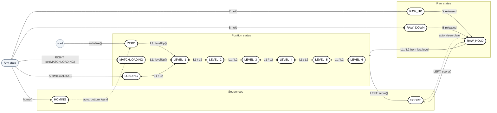
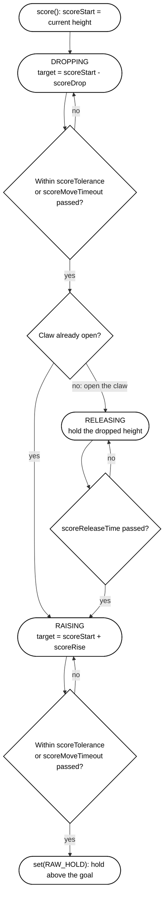
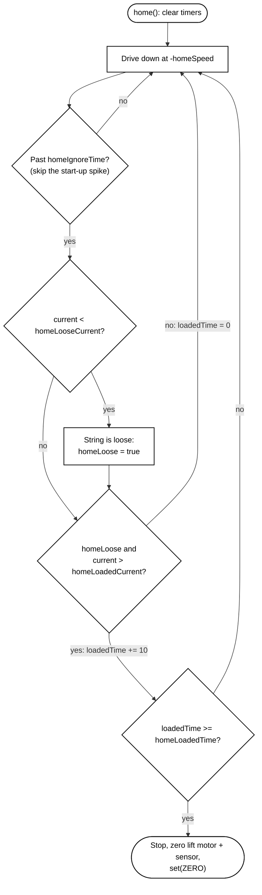
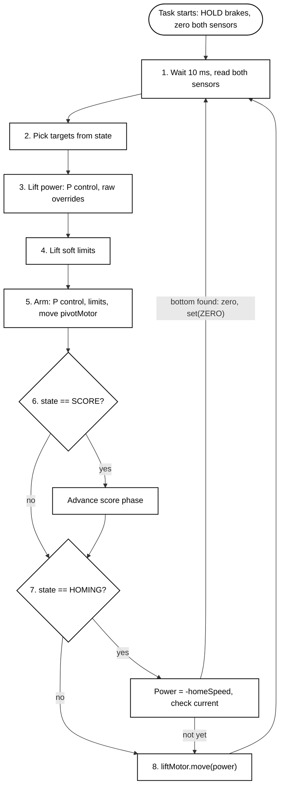

# Lift Notebook Pages

This file plans the Lift section of the engineering notebook, page by page. It follows the format of the Intake section (notebook pages 572 to 580) and gives the text, tables, code, diagrams and pictures for each page. The full source material is in `Lift PRD.md` and `Lift Implementation.md` in this folder; this file is the notebook version of that material.

Layout notes are in quote blocks (`>`). Everything else is page content and can be copied directly.

## ▲ How the Intake Section Is Built

| Notebook page | Header | Contents | How it presents the subsystem | Lift pages |
|:--|:--|:--|:--|:--|
| Divider | "Part 1: Intake Subsystem", salmon background | ▲ In This Section: 1X, 1A, 1B, 1C | Table of contents for the part | 1 |
| 572 | **1X** · Problem Statement · **IDENTIFY** (green) | ▲ Primary Issue, ▲ Stateful System, picture | Describes the hardware (one motor and what it picks up), then maps each hardware action to a state | 2-4 |
| 573 | **1A** · Planning & Product Requirements · **PLAN** (olive) | ▲ Objective, ▲ Success Metrics (Goal / Metric) | Defines what "working" means, with one measurable metric per goal | 5-7 |
| 574 | Title only | ▲ Requirements (Requirement / Importance / Notes), ▲ State Diagram | Each state is an ellipse with its motor value inside (`intakeSpeed = 127`) | 8-12 |
| 575 | **1B** · Overall Implementation · **IMPLEMENT** (maroon) | ▲ In This Document, ▲ Executive Summary (Purpose & Need, Why Finite State Machine? with a./b.), picture box | Explains the reasoning behind the code structure before showing any code | 13 |
| 576 | Title only | ▲ Architecture (External Dependencies table), ▲ Implementation Explainer → ◈ Finite State Machine, picture box | Lists the libraries used, then shows the enum | 14-15 |
| 577 | "Src Explainer Cont." tab | ◈ Control Loop, picture box | One bullet, then the whole loop in one code box | 16-22 |
| 578 | "Src Explainer Cont." tab | ◈ State Transitions (with a callout box), ◈ Background Task Execution, picture box | Shows the setter, then how the task is launched | 23-26 |
| 580 | **1C** · Review Process · **TEST & ITERATE** (blue) | ▲ Tests & Performance Analysis (Test / Status / Result), Procedure, ▲ PRD Alignment (Description / Implementation / Status) | One driver-control test with a numbered procedure. Alignment rows restate the Requirements as questions ("Working FSM?") | 27-30 |

**Layout conventions to keep on every Lift page:**

| Element | Convention |
|:--|:--|
| **Header** | The dark-red badge with the section code (2X, 2A, 2B, 2C) and the colored phase tag appear only on the **first page of each phase**. Continuation pages show only the title and subtitle |
| **Footer** | "Season-Long Implementation", the page number and the author |
| **Section markers** | ▲ for page-level sections and ◈ for each code topic under the Implementation Explainer. Explainer continuation pages carry the "Src Explainer Cont." tab |
| **Tables** | First column shaded yellow. `HIGH` importance highlighted red. Status cells shaded green once a test passes or a requirement is met |
| **Code** | Code names in green monospace. Each explainer topic opens with bullets, followed by the code box |
| **Callouts** | A pink-bordered box beside a code box explains a specific line, as on page 578 |
| **Picture box** | A rounded frame with a grey diagonal line marks an empty picture slot. Each 1B page ends with one |

**Writing rules for these pages:**

1. The reader already knows the **mechanical design** of the cascade lift and pivot arm from the build section. These pages explain **how the systems work together** and how the code controls them, and they do not repeat the mechanical design.
2. Each page moves from **basics to detail**: what each part of the system does, how it interacts with the others, and then the specific values and code. A term is defined **the first time it appears**, and no page relies on a later page.
3. Anything that happens in sequence (procedures, the score and homing sequences, the scoring cycle) is written as a **numbered list** with one action per step.
4. Each bullet bolds the **one or two phrases that carry its point**, so a reader skimming the bold text can still follow the page. List lead-ins, phase names and new terms at their definition (such as **pose**) are also bold.
5. Whole sentences are not bolded, except the first Objective bullet, which matches the Intake page. Code names are not bolded because the green monospace already sets them apart. In tables, bold only the key phrase in the first column and at most one phrase in each other cell.
6. The writing is **formal**: no contractions, no conversational asides, and no dashes used as sentence punctuation.

## ▲ Intake Errors to Avoid

The following items on the Intake pages do not match the intake code (`src/subsystem/intake.cpp`, `include/subsystem/intake.hpp`). They should be corrected in the Intake section and not copied into the Lift section.

| Page | Issue | Correction |
|:--|:--|:--|
| 574, 576 | The text says "four states" | The enum has three: `INTAKE`, `OUTTAKE`, `STOP` |
| 573 | Refers to "flex wheels", "blocks" and "Both motors" from last season | Describe the current intake: **one motor with one `speed`** |
| 575 | Refers to "two hardware stages" and "scoring" | Same as above |
| 577 | Refers to `bottomSpeed` / `topSpeed` | Replace with `speed` |
| 577 | The loop excerpt does not match the source | The real loop has `pros::delay(10)` at the top and none of the excerpt's comments |
| 577 | The `STOP` comment says the motor holds | The intake's brake mode is never set, so it uses the PROS default, **coast** |
| 578 | `set()` shows `int speed = 127` in the definition | The default value is in the header, not the definition |
| 578 | The task is shown as a file-scope `pros::Task intakeControl{...}` | The real code starts it in `initialize()`: `intakeTask = new pros::Task([] { intake.intakeControl(); });` |
| 578, 580 | Page numbering skips 579 | Renumber the pages |
| 572 | The picture shows an older robot | Replace it with a photo of this season's intake |

## ▲ Adapting the Format for the Lift

The Intake is one motor with three states, each of which sets a speed. The Lift has two motors, two rotation sensors, a pneumatic claw and fourteen states. Each Lift state is either a **pose** (a lift height paired with an arm angle) or a **behavior** such as free movement, scoring or homing. The Intake page layout cannot hold this without changes, but the Lift section keeps the Intake's structure wherever possible and adds pages only where the extra complexity requires them.

**Structure:** the Lift stays as one part with the same four phases (2X, 2A, 2B, 2C).

- The lift, arm and claw share **one class** (`Lift`), one `state` variable and one task. Splitting them into three parts would describe three state machines that do not exist, and every pose would be split across two parts.
- The pages separate the mechanisms in three ways instead:
  - Success Metrics, Tests and Alignment rows are **grouped by mechanism** in a fixed order: Lift, Arm, Claw & Score, Safety, Whole System.
  - Continuation tabs **name the mechanism**, for example "Src Explainer Cont. · Arm".
  - Each step of the control loop gets **its own ◈ section**, in loop order.

| Intake | Lift | Approach in these pages |
|:--|:--|:--|
| One mechanism that works on its own | Three mechanisms whose behavior depends on each other | 2X explains **how the mechanisms work together** through one scoring cycle, then the software constraints, before introducing code (pages 2-4) |
| No control theory | Closed-loop P control | 2A explains **open loop, closed loop and P control** before the metrics refer to them (page 5) |
| One design | Three control designs this season | A **decision matrix** (page 6) |
| 3 states, each with a speed inside its ellipse | 14 states, each a pose or a behavior | Ellipses contain the **state name only** (page 9), and a **Pose Table** lists each state's height and angle (page 10) |
| No multi-step behavior | `SCORE` and `HOMING` run in phases | Each has a **step list and diagram** in 2A (pages 11, 12) and a code page in 2B (pages 21, 22) |
| Whole loop in one code box (about 20 lines) | Loop of about 130 lines | A **Loop Roadmap** (page 16) outlines one 10 ms pass, and each step then has a page showing only its lines |
| One setter | `set()`, `levelUp()`, `levelDown()`, `score()`, `home()` | One ◈ State Transitions page (23) |
| One speed constant | About 35 tunable constants, many of them placeholders | A **Tuning Constants** page (26) |
| One test | Eight behaviors to verify | A grouped test table (27), a **Before Testing** checklist (28), one procedure per test (28, 29) and a **Next Iteration** list (30) |

**Reducing the page count:**

- Merge pages 17 and 18 by trimming the target switch to `ZERO`, `LEVEL_1` and `SCORE`.
- Remove the picture boxes on code pages 18, 19 and 23.
- Move Tuning Constants (page 26) to an appendix.

Keep the 2X pages (2-4), the Control Approach page (5), the Pose Table (10) and the sequence pages (11, 12). Later pages depend on them.

## ▲ Page Plan

Continue the page numbering from the Intake section. If the Lift follows the Intake directly, the divider is the next page and 2X starts after it.

| Page | Badge / tab | Title / Subtitle | Contents |
|:--|:--|:--|:--|
| 1 | Divider | Part 2: Lift Subsystem | In This Section |
| 2 | 2X · IDENTIFY | Problem Statement | Primary Issue, How the Mechanisms Work Together |
| 3 | | Problem Statement | Stateful System, Why a Single State Machine |
| 4 | | Problem Statement | Software Constraints |
| 5 | 2A · PLAN | Planning & Product Requirements | Objective, Choosing a Control Approach |
| 6 | | Planning & Product Requirements | Decision Matrix, Our Choice |
| 7 | | Planning & Product Requirements | Success Metrics |
| 8 | | Planning & Product Requirements | Requirements |
| 9 | | Planning & Product Requirements | State Diagram |
| 10 | | Planning & Product Requirements | Pose Table |
| 11 | | Planning & Product Requirements | SCORE Sequence |
| 12 | | Planning & Product Requirements | HOMING Sequence |
| 13 | 2B · IMPLEMENT | Overall Implementation | In This Document, Executive Summary |
| 14 | | Overall Implementation | Architecture |
| 15 | | Overall Implementation | Implementation Explainer: ◈ Finite State Machine |
| 16 | Src Explainer Cont. | Overall Implementation | ◈ Control Loop Roadmap |
| 17 | Src Explainer Cont. · Lift & Arm | Overall Implementation | ◈ Reading the Sensors |
| 18 | Src Explainer Cont. · Lift & Arm | Overall Implementation | ◈ Target Selection |
| 19 | Src Explainer Cont. · Lift | Overall Implementation | ◈ Lift Power & Soft Limits |
| 20 | Src Explainer Cont. · Arm | Overall Implementation | ◈ Arm Control |
| 21 | Src Explainer Cont. · Claw & Score | Overall Implementation | ◈ Score Sequence |
| 22 | Src Explainer Cont. · Homing | Overall Implementation | ◈ Homing |
| 23 | Src Explainer Cont. | Overall Implementation | ◈ State Transitions |
| 24 | Src Explainer Cont. | Overall Implementation | ◈ Driver Controls |
| 25 | Src Explainer Cont. | Overall Implementation | ◈ Background Task Execution |
| 26 | | Overall Implementation | Tuning Constants |
| 27 | 2C · TEST & ITERATE | Review Process | Tests & Performance Analysis |
| 28 | | Review Process | Before Testing, Procedures T1 to T4 |
| 29 | | Review Process | Procedures T5 to T8 |
| 30 | | Review Process | PRD Alignment, Next Iteration |

---

## Page 1: Part Divider

> Same layout as the Intake divider: salmon background, large title and an "▲ In This Section:" list. The subtitle line under the title is new; it shows that this part covers three mechanisms.

# Part 2: Lift Subsystem

**Lift · Pivot Arm · Claw**

**▲ In This Section:**
**2X. Problem Statement**
**2A. Planning & Product Requirements**
**2B. Overall Implementation**
**2C. Process Review**

---

## Page 2: 2X · Problem Statement

> **Header:** badge `2X` · "Lift Subsystem" · subtitle "Problem Statement" · tag **IDENTIFY** (green)
>
> The build section already covers the mechanical design of the cascade lift and pivot arm. This page describes only how the mechanisms interact and what the code can measure.

### ▲ Primary Issue

- The **lift subsystem** carries game objects from the loading position to the goals and places them.
- It combines **three mechanisms** that must work together: the cascade lift, the pivot arm and the claw.
- We need a way to **control all three** from a programming standpoint.
- We also want a **clean implementation**. Because the lift is a stateful system, it should follow the conventions of a **finite state machine (FSM)**, as the Intake does.

### ▲ How the Mechanisms Work Together

- The code controls each mechanism through **one actuator** and, where possible, reads its position from a **sensor**:

| Mechanism | Controlled by | Feedback to the code |
|:--|:--|:--|
| **Cascade lift** | Lift motor | Lift rotation sensor (height) |
| **Pivot arm** | Pivot motor | Arm rotation sensor (angle) |
| **Claw** | Pneumatic piston | None. The code tracks the **last command** sent |

- The steps below follow one game object through a **scoring cycle**:

1. **Load.** The lift and arm move to the **loading height and angle** with the claw open. After the object is loaded, the driver **closes the claw**.
2. **Raise.** The lift rises to one of **six scoring levels** while the arm turns to the **scoring angle**.
3. **Score.** The lift drops slightly onto the goal, the claw opens, and the lift rises clear. This is the **drop, open, rise** sequence.
4. **Return.** The lift and arm move **back to the loading position** for the next object.

- Every step moves the lift and the arm together. A lift height combined with its matching arm angle is called a **pose**. Matchloading uses the same cycle with **its own pose**.

> **Picture box** (to the right of the list, where the Intake picture is): the lift with the two rotation sensors and the claw labeled, since these are the parts the code reads from or controls directly.

---

## Page 3: 2X · Problem Statement (cont.)

> **Header:** title and subtitle only

### ▲ Stateful System

- **From a hardware standpoint, the lift could perform the following:**
  - **Hold a pose:** bottom, matchloading, loading, or Levels 1 to 6
  - **Move freely** while the driver holds a button, then **hold** where it stops
  - **Score:** the drop, open, rise sequence from page 2
  - **Find the bottom** of its travel automatically, a process called **homing**
- To hold position, the motor uses its **HOLD brake**. At zero power, the motor resists being turned and the lift does not slide down.
- From a software standpoint, each action becomes **one or more finite states**:

| Hardware action | States |
|:--|:--|
| **Hold a pose** | Position states: `ZERO`, `MATCHLOADING`, `LOADING`, `LEVEL_1` to `LEVEL_6` |
| **Move freely, then hold** | Raw states: `RAW_UP`, `RAW_DOWN`, `RAW_HOLD` |
| **Score** | `SCORE` |
| **Find the bottom** | `HOMING` |

- The lift is in **one state at any moment**, and the driver changes the state **with a button**.

### ▲ Why a Single State Machine

1. The simplest design would give each mechanism **its own state machine**: one each for the lift, the arm and the claw.
2. However, every step of the scoring cycle moves the lift and the arm together. With separate machines, the driver would need **two button presses per move** and could leave the arm at the **wrong angle** for the current height.
3. A **single machine** avoids this problem. Each position state is a pose, which means one state sets both the lift height and the arm angle, and a mismatched pose **cannot be commanded**.
4. The claw remains under **driver control**, since the driver closes it on each object. The state machine opens it only **during scoring**, where the timing matters.

---

## Page 4: 2X · Problem Statement (cont.)

> **Header:** title and subtitle only

### ▲ Software Constraints

- Three properties of the hardware determine how the code must be written:

1. **No hard stop at the bottom**
   - The cascade does not stop the motor when the lift bottoms out. If the motor keeps turning, the string **winds in the opposite direction** and **raises the lift again**.
   - The code must therefore stop the motor itself using a **soft limit**: a position beyond which the program will not drive the motor.
2. **No limit switch**
   - No sensor reports when the lift reaches the bottom. The motor does report its **current draw**, which measures how hard it is working, in milliamps (mA).
   - While the string is slack, the current stays low. Once the string winds the other way and begins lifting the lift, the current **jumps**. Homing uses this jump to **find the bottom**.
3. **Positions are measured from the starting point**
   - The rotation sensors read 0 **wherever they are when the program starts**.
   - The lift must start **at the bottom** and the arm in its starting pose; otherwise every height is offset. Homing can correct the lift's zero if it is wrong.

> **Picture box:** the lift at its lowest point with the string direction marked, to illustrate constraint 1.

---

## Page 5: 2A · Planning & Product Requirements

> **Header:** badge `2A` · "Lift Subsystem" · subtitle "Planning & Product Requirements" · tag **PLAN** (olive)
>
> This page comes before Success Metrics because the metrics and requirements refer to P control and background tasks, which are explained here.

### ▲ Objective

- **The lift system carries game objects between the loading height and six scoring levels, and places them, during both driver control and autonomous.**
- It must reach the **same height every time**, hold that height against gravity, and respond to a new command **within 10 ms**.
- Because three mechanisms must agree and scoring and homing are **multi-step sequences**, the lift is implemented as a **finite state machine (FSM)** in which each position state sets the lift height and arm angle together.

### ▲ Choosing a Control Approach

1. **Open loop.** The motor runs for a **set time**, and the code assumes the lift reached its target. This is simple, but a low battery or a heavy object causes the same run time to cover **less distance**.
2. **Closed loop.** The code **measures** the lift with the rotation sensor, compares the reading to the target height, and keeps powering the motor until the two match. The same command then **ends at the same height** every time.
3. **P (proportional) control** is the simplest form of closed-loop control.
   - The difference between the target height and the current height is the **error**.
   - Motor power equals the error multiplied by a **gain** called `kP`.
   - Far from the target, the power is high. Near the target, it drops, and the lift **slows as it arrives**.
4. **Blocking and background execution**
   - If the program waits for the lift to arrive, nothing else runs, and the driver **cannot drive**.
   - PROS can run several loops at the same time; each one is called a **task**. When the lift loop runs in its own **background task**, no other code has to wait for the lift.

---

## Page 6: 2A · Decision Matrix

> **Header:** title and subtitle only. The Intake section has no decision matrix because the intake was designed once; the lift went through three control designs this season. The columns use the concepts from page 5.

### ▲ Lift Control Decision Matrix

- The three designs used this season are compared on the factors that matter **during a match**.

| Approach | Blocks the Drive? | Height Feedback | Driver Override | Code Complexity |
|:--|:--|:--|:--|:--|
| **Blocking timed macros** | Yes. Each macro called `pros::delay()` inline and stalled `opcontrol()`, up to 2850 ms for `lower()` | None (**open loop**). Moves were timed (`MACRO_TIME_MS = 1300` for full travel) | None until the macro returned | Low |
| **Non-blocking scripted macros** | No. A **background task** stepped through a script | None (**open loop**). Same timings as the blocking version | Manual input cancelled the running macro | High: step scripts, a `pros::Mutex`, `cancel()`, `busy()`, `waitUntilDone()` |
| **Sensor-based FSM (chosen)** | No. `set()` writes a state and returns; a **background task** does the work | Rotation sensor, with **P control** to named heights | A new state **replaces the old one immediately** | Medium: one `switch` in one loop |

### ▲ Our Choice: Sensor-Based FSM

1. The macros were **open loop**. They ran the motor for a fixed time, and the same macro could stop at a **different height** from one match to the next.
2. The scripted version removed the blocking but **kept the timing**. It also needed a mutex and cancel logic to coordinate the driver with the script.
3. The FSM **measures the lift** and drives it to a target, so the same command always ends at the same height. The driver or an autonomous routine sets one state, and a single loop converts it into motor power every 10 ms.
4. Scoring and homing still require ordered steps, so they are implemented as **states with their own phases**.

> **Picture box (optional):** the old macro code beside the new `set()` call, to show the reduction in code.

---

## Page 7: 2A · Success Metrics

> **Header:** title and subtitle only. The group rows (Lift, Arm, and so on) span both columns and are bold and unshaded. Pages 27 and 30 use the same groups in the same order.

### ▲ Success Metrics

- Each goal describes what the **driver or an autonomous routine needs**. Each metric describes how it is **verified in the code or on the robot**.

| Goal | Metric |
|:--|:--|
| **Lift** | |
| The lift **reaches and holds** each pose height when commanded | Each position state drives the lift to its height with **P control** and holds it there |
| The driver can **step between levels** with one press per level | L1 / L2 (`levelUp()` / `levelDown()`) move **exactly one level** per press, even after raw control or scoring |
| The driver can **move the lift freely** and have it hold where released | Holding X / B moves the lift at `rawSpeed`. Releasing **holds it in place** (`RAW_HOLD`) |
| **Arm** | |
| The **arm moves to the angle** that matches the lift's pose | Loading → `LOADING_ANGLE`, matchloading → `MATCHLOADING_ANGLE`, every level → `SCORING_ANGLE`. Other states **hold the last angle** |
| **Claw & Score** | |
| **One press scores** a game object | LEFT (`score()`) drops, opens the claw, rises clear and holds. Every move has a **time limit** |
| **Safety** | |
| The lift can **find its true bottom** without a limit switch | Homing (`home()`) detects the **current jump** when the string winds the other way, then zeros the sensor |
| The lift and arm **never drive past their ends of travel** | **Soft limits** cut any power that would drive the lift or arm past its limits |
| **Whole System** | |
| The control loop **never blocks** the main program | `liftControl()` runs in its own **background task** 100 times per second, and every command **returns immediately** |

---

## Page 8: 2A · Requirements

> **Header:** title and subtitle only. Highlight `HIGH` in red as on the Intake page, and give `MEDIUM` a lighter highlight (orange or yellow) so the two levels are distinct.

### ▲ Requirements

- Each requirement is a **feature the code must have** to meet the Success Metrics. `HIGH` means the lift **cannot be used in a match** without it.

| Requirement | Importance | Notes |
|:--|:--|:--|
| **Finite state machine** with fourteen states | HIGH | Position: `ZERO`, `MATCHLOADING`, `LOADING`, `LEVEL_1` to `LEVEL_6`. Raw: `RAW_UP`, `RAW_DOWN`, `RAW_HOLD`. Sequences: `SCORE`, `HOMING` |
| **Dedicated background** control task | HIGH | `liftControl()` runs in its own task, so lift commands **never block** driving or autonomous |
| **Closed-loop control** for lift and arm | HIGH | P control on each rotation sensor, with power capped at a maximum |
| **Arm angle tied** to the lift state | HIGH | Each position state sets **both** the height and the arm angle |
| **One-press** level stepping | HIGH | `levelUp()` / `levelDown()` step through `LOADING` and `LEVEL_1` to `LEVEL_6` |
| **Raw control** with hold | HIGH | Hold a button to move at `rawSpeed`. Release to hold with the **HOLD brake** |
| **One-press score** sequence | HIGH | `score()` drops, opens the claw, rises, then holds |
| **Soft limits** on lift and arm | HIGH | Power past a limit is set to zero. Power **back toward the range** is still allowed |
| **Current-based homing** | MEDIUM | `home()` finds the bottom without a limit switch. Implemented, but **not yet assigned to a button** |
| **Pneumatic claw** integration | MEDIUM | The driver toggles the claw. `SCORE` opens it automatically |
| **Autonomous** uses the same commands | MEDIUM | Routines call the same `set()` and `score()` as driver control. There is **no wait helper** yet |

---

## Page 9: 2A · State Diagram

> **Header:** title and subtitle only.
>
> **Drawing the diagram in the notebook style:**
> - Use white ellipses with black outlines and black arrows, like the Intake diagram on page 574.
> - Write **only the state name** in each ellipse. Fourteen states leave no room for values, so those go in the Pose Table on page 10.
> - Arrange the states in three labeled groups. Raw states go on the left (`RAW_UP` top, `RAW_HOLD` middle, `RAW_DOWN` bottom). Position states go in the center from bottom to top: `ZERO` and `MATCHLOADING` side by side, then `LOADING` and `LEVEL_1` through `LEVEL_6`. Sequences go on the right (`SCORE` upper, `HOMING` lower).
> - Add a small **"Any state"** node on the far left instead of drawing fourteen copies of the same arrow.
> - The Mermaid version below is laid out horizontally for screen readability. Redraw it in portrait for the page.

### ▲ State Diagram

1. The program starts in `ZERO`.
2. **Position states** (center) are the poses from page 2. L1 and L2 move up and down the column **one level per press**.
3. **Raw states** (left) provide free movement. Holding X or B enters them from **any state**, and releasing the button switches to `RAW_HOLD`.
4. **Sequences** (right) run their steps automatically. The **dashed arrows** are the only transitions the program makes on its own, when a sequence finishes.
5. Any other lift button **cancels `SCORE`**. L1 and L2 always step from the **last level selected**, even after raw control or scoring.



---

## Page 10: 2A · Pose Table

> **Header:** title and subtitle only. This table holds the values that the Intake diagram placed inside each ellipse.

### ▲ Pose Table

1. Each **position state** is a pose: it sets one lift height and one arm angle.
2. The other states are **behaviors**. They set the lift power directly or run a sequence, and the arm **holds its last angle**.
3. Heights and angles are in **rotation sensor degrees**, measured from where the lift and arm were when the program started (page 4).
4. Every height and angle below is a **placeholder** until it is tuned on the robot.

| State | Group | Lift target | Arm target |
|:--|:--|:--|:--|
| `ZERO` | Position | `ZERO_HEIGHT` = 0 | Holds last angle |
| `MATCHLOADING` | Position | `MATCHLOADING_HEIGHT` = 0 | `MATCHLOADING_ANGLE` = 0 |
| `LOADING` | Position | `LOADING_HEIGHT` = 1650 | `LOADING_ANGLE` = 180 |
| `LEVEL_1` | Position | `LEVEL_1_HEIGHT` = 2950 | `SCORING_ANGLE` = 90 |
| `LEVEL_2` | Position | `LEVEL_2_HEIGHT` = 5200 | `SCORING_ANGLE` = 90 |
| `LEVEL_3` | Position | `LEVEL_3_HEIGHT` = 7200 | `SCORING_ANGLE` = 90 |
| `LEVEL_4` | Position | `LEVEL_4_HEIGHT` = 9200 | `SCORING_ANGLE` = 90 |
| `LEVEL_5` | Position | `LEVEL_5_HEIGHT` = 13000 | `SCORING_ANGLE` = 90 |
| `LEVEL_6` | Position | `LEVEL_6_HEIGHT` = 15500 | `SCORING_ANGLE` = 90 |
| `RAW_UP` | Raw | None (power +`rawSpeed`) | Holds last angle |
| `RAW_DOWN` | Raw | None (power -`rawSpeed`) | Holds last angle |
| `RAW_HOLD` | Raw | None (power 0, held by the HOLD brake) | Holds last angle |
| `SCORE` | Sequence | Start height minus `scoreDrop`, then start height plus `scoreRise` | Holds last angle |
| `HOMING` | Sequence | None (power -`homeSpeed` until the bottom is found) | Holds last angle |

- The soft limits are `MIN_POSITION` = -10, slightly below `ZERO_HEIGHT`, and `MAX_POSITION` = 18000.
- The levels are about **2500 degrees apart** on average. 18000 (`LEVEL_6_HEIGHT` + 2500) is therefore approximately where a **seventh level** would be.

> **Picture box:** a vertical scale of the lift's travel marking every height from the table, with `MIN_POSITION` and `MAX_POSITION` as red lines. Photos of the lift at three heights beside it are an alternative.

---

## Page 11: 2A · SCORE Sequence

> **Header:** title and subtitle only. This page and the next have no Intake equivalent. Draw the diagram in the same ellipse style as page 9; the diamonds are checks the program makes every 10 ms.

### ▲ SCORE Sequence

- Scoring is step 3 of the scoring cycle (page 2), performed **automatically after one press** of LEFT. The arm **holds its angle** throughout.

1. **Record the start.** `score()` saves the lift's current height as `scoreStart`.
2. **Drop.** The lift lowers by `scoreDrop` onto the goal.
3. **Release.** The claw opens, and the lift **waits** for `scoreReleaseTime` while the claw lets go. If the claw is **already open**, this step is skipped.
4. **Raise.** The lift rises to `scoreRise` **above the start height**, clear of the goal.
5. **Hold.** The lift switches to `RAW_HOLD` and **stays at that height**. Returning to a level preset would lower it back onto the goal.

- A move counts as complete when the lift is within `scoreTolerance` of its target or when `scoreMoveTimeout` has passed. The timeout **prevents any step from stalling** the sequence.



---

## Page 12: 2A · HOMING Sequence

> **Header:** title and subtitle only

### ▲ HOMING Sequence

- Homing finds the bottom using the **current jump** described on page 4. At power 45, the motor draws **50 to 105 mA** while the string is slack and **220 to 350 mA** while it is lifting the lift.

1. **Drive down slowly** at `homeSpeed`.
2. **Ignore the start-up spike.** During the first `homeIgnoreTime`, the current reads 0 and then spikes as the motor accelerates, so the code does not check it yet.
3. **Wait for slack.** When the current drops below `homeLooseCurrent`, the string is slack.
4. **Wait for the jump.** After that, a current above `homeLoadedCurrent` **held continuously** for `homeLoadedTime` means the string has wound the other way and is lifting the lift. The lift is at the bottom.
5. **Stop and zero.** The code stops the motor, **resets the lift height to 0** and switches to `ZERO`.



---

## Page 13: 2B · Overall Implementation

> **Header:** badge `2B` · "Lift Subsystem" · subtitle "Overall Implementation" · tag **IMPLEMENT** (maroon)

### ▲ In This Document

- The `Lift` class structure and its **fourteen-state** finite state machine
- How **one control loop** converts the state into lift and arm power every 10 ms
- The code behind the **score** and **homing** sequences
- The commands `set()`, `levelUp()`, `levelDown()`, `score()` and `home()`, and the **driver controls**
- **Background task** execution and the **tuning constants**

### ▲ Executive Summary

#### Purpose & Need

- The lift performs **four kinds of work** (holding a pose, moving freely, scoring and homing) using **three mechanisms**: the lift motor, the arm motor and the claw piston.
- Instead of scattered motor calls, the system is a **finite state machine (FSM)** that **separates intent from action**. Intent is which state the lift should be in; action is what the motors do in that state.

#### Why Finite State Machine?

- A simpler approach would call `liftMotor.move()` and `pivotMotor.move()` from each button handler. This leads to **conflicting commands** between the two motors and **no single record** of what the lift is doing. The FSM addresses both problems:
  1. Only `liftControl()` commands the motors. All other code **only sets the state**.
  2. `set()` writes a field and returns. A button press or autonomous call therefore **never waits** for the lift to arrive.
  3. Each position state holds **both targets**, which keeps the height and arm angle matched.
  4. Scoring and homing are **states with phases**. They run inside the same loop instead of **blocking the program** as the old macros did.

> **Picture box:** the lift at `LOADING` beside the lift at `LEVEL_3`, showing a single state change moving both the height and the arm angle.

---

## Page 14: 2B · Architecture

> **Header:** title and subtitle only

### ▲ Architecture

#### External Dependencies

- The lift code uses **four library classes**: three for the devices and one for the task.

| Component | Type | Purpose |
|:--|:--|:--|
| `pros::Motor` | Kernel Library | **Motor control** for the lift (`liftMotor`) and the arm (`pivotMotor`) |
| `pros::Rotation` | Kernel Library | **Height and angle** readings (`liftRotation`, `pivotRotation`) |
| `ez::Piston` | EZ-Template Library | Opens and closes the **claw** (`claw`). `true` is open |
| `pros::Task` | Kernel Library | Runs `liftControl()` as a **background task** |

#### Hardware Configuration

1. Each device is declared **once**, in `config.cpp`, with the port it is plugged into.
2. A **negative port number** reverses the device. The lift sensor is reversed so that its reading **increases as the lift rises**.
3. The devices are **passed into the `Lift` constructor**, and the class itself contains no port numbers. Changing a port only requires editing `config.cpp`.

| Constant | Port | Device | Notes |
|:--|:--|:--|:--|
| `LIFT` | 20 | Lift motor | |
| `LIFT_ROTATION` | -18 | Lift rotation sensor | **Reversed** |
| `PIVOT` | 19 | Arm motor | Placeholder |
| `PIVOT_ROTATION` | 17 | Arm rotation sensor | Placeholder |
| `CLAW` | `'B'` | Claw solenoid (ADI port) | |

```cpp
// lift + pivoting arm
pros::Motor liftMotor(LIFT);
pros::Rotation liftRotation(LIFT_ROTATION);
pros::Motor pivotMotor(PIVOT);
pros::Rotation pivotRotation(PIVOT_ROTATION);

// claw - true is open.  opcontrol toggles it directly, and the lift opens it while scoring.
// If it's backwards, make this ez::Piston claw(CLAW, true) - that flips the output.
ez::Piston claw(CLAW);

Lift lift(liftMotor, liftRotation, pivotMotor, pivotRotation, claw);
```

---

## Page 15: 2B · Implementation Explainer

> **Header:** title and subtitle only

### ▲ Implementation Explainer

#### ◈ Finite State Machine

1. The `Lift` class lists the **fourteen states** from page 3 in the `LiftState` enumeration (enum), in three groups: position, raw and sequences.

```cpp
  enum LiftState { ZERO,
                   MATCHLOADING,
                   LOADING,
                   LEVEL_1,
                   LEVEL_2,
                   LEVEL_3,
                   LEVEL_4,
                   LEVEL_5,
                   LEVEL_6,
                   RAW_UP,
                   RAW_DOWN,
                   RAW_HOLD,
                   HOMING,
                   SCORE };
```

2. In C++, enum names are **numbered from 0** in the order listed: `ZERO` is 0, `LOADING` is 2, `LEVEL_6` is 8 and `SCORE` is 13.
3. The position states come first, **in height order**. This allows the code to check for a position state with `state <= LEVEL_6` and to step one level with `level + 1`.

> **Callout beside the enum:** "New levels must be added directly after `LEVEL_6`; otherwise level stepping breaks."

4. Scoring has its own phases in a second enum, matching the drop, release and raise steps on page 11.

```cpp
  enum ScorePhase { DROPPING,
                    RELEASING,
                    RAISING };
```

5. Two fields track the FSM. `state` is **what the lift is doing now**, and `level` is the **last position state selected**. After raw control, `state` is `RAW_HOLD`; without `level`, the L1 button would have no way to determine the next level.

```cpp
  LiftState state = ZERO;
  LiftState level = ZERO;  // last ZERO..LEVEL_6 picked, so levelUp/levelDown still work after raw
```

> **Picture box:** the enum with the three groups bracketed and labeled with the group names from page 9.

---

## Page 16: 2B · ◈ Control Loop Roadmap

> **Header:** title and subtitle only, with the "Src Explainer Cont." tab. The Intake shows its whole loop in one code box. The Lift loop is about 130 lines, so this page outlines one pass and pages 17 to 22 each cover one step.

#### ◈ Control Loop Roadmap

1. `liftControl()` runs **continuously** in its background task from startup until the program ends.
2. Every 10 ms, the loop reads the sensors once, calculates the power for both motors and sends it. One pass is called a **tick**.
3. Each tick runs the steps below **in this order**, and every step uses the sensor readings taken at the start of the tick.

| Step | Action | Explained on |
|:--|:--|:--|
| 1 | Wait 10 ms, read the lift and arm sensors | ◈ Reading the Sensors (p. 17) |
| 2 | Select the lift and arm targets for the state | ◈ Target Selection (p. 18) |
| 3 | Lift power: P control, then raw overrides | ◈ Lift Power & Soft Limits (p. 19) |
| 4 | Lift soft limits | ◈ Lift Power & Soft Limits (p. 19) |
| 5 | Arm power, arm soft limits, move the arm | ◈ Arm Control (p. 20) |
| 6 | Advance the score phase | ◈ Score Sequence (p. 21) |
| 7 | Homing override and bottom check | ◈ Homing (p. 22) |
| 8 | Move the lift motor | ◈ Homing (p. 22) |

4. The order affects behavior in two places:
   - The soft limits (step 4) run **after** the raw overrides (step 3). Raw control therefore **cannot exceed** the ends of travel.
   - Homing (step 7) runs **after** the soft limits. It is the **only state that can drive below** the bottom limit, which it must do to find the true bottom.



---

## Page 17: 2B · ◈ Reading the Sensors

> **Header:** title and subtitle only, with the "Src Explainer Cont. · Lift & Arm" tab

#### ◈ Reading the Sensors

Before the loop starts, the code:

1. Sets both motors to the **HOLD brake** (page 3), which holds the lift and arm in place at zero power.
2. **Zeros both rotation sensors**, so every height and angle is measured from the starting position.

At the start of every tick, the code:

3. **Waits 10 ms**, which sets the loop rate at 100 ticks per second.
4. **Reads each sensor once**. The sensors report **centidegrees** (hundredths of a degree), and each reading is divided by 100 to convert it to degrees.

```cpp
void Lift::liftControl() {
  liftMotor.set_brake_mode(pros::E_MOTOR_BRAKE_HOLD);
  pivotMotor.set_brake_mode(pros::E_MOTOR_BRAKE_HOLD);
  liftRotation.reset_position();   // the lift starts sitting at ZERO_HEIGHT
  pivotRotation.reset_position();  // the arm's angles are measured from where it starts

  while (true) {
    pros::delay(10);
    double position = liftRotation.get_position() / 100.0;        // centidegrees -> degrees
    double pivotPosition = pivotRotation.get_position() / 100.0;  // centidegrees -> degrees
```

> **Picture box:** the mounting locations of the two rotation sensors on the lift and the arm.

---

## Page 18: 2B · ◈ Target Selection

> **Header:** title and subtitle only, with the "Src Explainer Cont. · Lift & Arm" tab

#### ◈ Target Selection

1. The loop uses two targets: `target` is the height the lift should be at **during this tick**, and `pivotTarget` is the angle the arm should be at.
2. The `switch` statement **converts the state into a pose** by setting the targets from the Pose Table (page 10).
3. `target` starts at the **current position**. Raw and homing states leave it unchanged; their error is therefore zero, and **P control adds no power**.
4. `pivotTarget` is a **class field** rather than a loop variable, and it keeps its value between ticks. States that do not set it **keep the last angle**.

```cpp
    double target = position;  // raw states get no P power
    switch (state) {
      case ZERO:
        target = ZERO_HEIGHT;
        break;
      // ... MATCHLOADING: MATCHLOADING_HEIGHT, MATCHLOADING_ANGLE
      case LOADING:
        target = LOADING_HEIGHT;
        pivotTarget = LOADING_ANGLE;
        break;
      case LEVEL_1:
        target = LEVEL_1_HEIGHT;
        pivotTarget = SCORING_ANGLE;
        break;
      // ... LEVEL_2 to LEVEL_6: LEVEL_N_HEIGHT, SCORING_ANGLE
      case SCORE:
        target = scorePhase == RAISING ? scoreStart + scoreRise : scoreStart - scoreDrop;
        break;
      case RAW_UP:
      case RAW_DOWN:
      case RAW_HOLD:
      case HOMING:
        break;
    }
```

> **Callout beside `case SCORE`:** "The score target depends on the phase: below the start height while dropping or releasing, and above it while raising."
>
> Lines marked `// ...` were trimmed to save space. The trimmed cases follow the same pattern.

---

## Page 19: 2B · ◈ Lift Power & Soft Limits

> **Header:** title and subtitle only, with the "Src Explainer Cont. · Lift" tab

#### ◈ Lift Power & Soft Limits

The lift power is calculated with the P control from page 5:

1. Calculate the **error**: target - position.
2. Multiply the error by `kP` to get the power.
3. **Cap the power** between -`speed` and +`speed`. Motor power ranges from -127 to 127.
4. In raw states, **replace the power**. `RAW_UP` and `RAW_DOWN` use a fixed `rawSpeed`, and `RAW_HOLD` sends 0 so that the HOLD brake holds the lift.
5. **Apply the soft limits**. Past a limit, only power that pushes **further out of range** is set to zero. The driver can always move the lift back into range.

```cpp
    int power = std::clamp(static_cast<int>(kP * (target - position)), -speed, speed);
    if (state == RAW_UP) power = rawSpeed;
    if (state == RAW_DOWN) power = -rawSpeed;
    if (state == RAW_HOLD) power = 0;  // let go - the HOLD brake keeps it where it stopped

    // Never drive past the ends of travel
    if (position >= MAX_POSITION && power > 0) power = 0;
    if (position <= MIN_POSITION && power < 0) power = 0;
```

> **Callout (worked example):** "Moving from `LOADING` to `LEVEL_1`, the error is 2950 - 1650 = 1300°. Multiplying by `kP` (1.0) gives 1300, which is capped at 127. The lift runs at full power until it is within 127° of the target and then slows down."

| Limit | Value | Reason |
|:--|:--|:--|
| `MAX_POSITION` | 18000° | Approximately where a **seventh level** would be (`LEVEL_6_HEIGHT` + 2500, the average step between levels). This leaves one level of travel for raw control and the score rise |
| `MIN_POSITION` | -10° | Slightly below `ZERO_HEIGHT`, so raw down stops **before the string winds the other way** |

> **Picture box:** the lift at its highest safe point with the 18000° reading. Take this photo after `MAX_POSITION` has been checked against the physical top.

---

## Page 20: 2B · ◈ Arm Control

> **Header:** title and subtitle only, with the "Src Explainer Cont. · Arm" tab

#### ◈ Arm Control

1. The arm uses the **same P control** as the lift (page 19), with its own gain `pivotKP`, maximum power `pivotSpeed` and soft limits.
2. `pivotTarget` starts at 0, and the arm sensor was zeroed at the arm's starting position. The arm therefore **holds its starting pose** until a state assigns it an angle.
3. The arm is driven **before** the score and homing steps (steps 6 and 7 on page 16), so it **keeps its angle** during both.

```cpp
  int pivotSpeed = 127;    // max power moving to an angle
  double pivotKP = 1.0;    // power per degree of error  (PLACEHOLDER)
  double pivotTarget = 0;  // starts at 0 so the arm stays put until a state gives it an angle
```

```cpp
    int pivotPower = std::clamp(static_cast<int>(pivotKP * (pivotTarget - pivotPosition)), -pivotSpeed, pivotSpeed);
    if (pivotPosition >= PIVOT_MAX_ANGLE && pivotPower > 0) pivotPower = 0;
    if (pivotPosition <= PIVOT_MIN_ANGLE && pivotPower < 0) pivotPower = 0;
    pivotMotor.move(pivotPower);
```

| Angle | Value | Used by |
|:--|:--|:--|
| `MATCHLOADING_ANGLE` | 0° | `MATCHLOADING` |
| `SCORING_ANGLE` | 90° | `LEVEL_1` to `LEVEL_6` |
| `LOADING_ANGLE` | 180° | `LOADING` |
| `PIVOT_MIN_ANGLE` / `PIVOT_MAX_ANGLE` | -20° / 200° | Arm soft limits |

- All arm values are **placeholders** until they are tuned on the robot. Keep the angles in the order `MATCHLOADING_ANGLE` < `SCORING_ANGLE` < `LOADING_ANGLE`.

> **Picture box:** one photo with the arm drawn at its three angles (matchloading, scoring and loading).

---

## Page 21: 2B · ◈ Score Sequence

> **Header:** title and subtitle only, with the "Src Explainer Cont. · Claw & Score" tab

#### ◈ Score Sequence

The code below implements the steps on page 11, with one branch per phase:

1. On every tick in `SCORE`, `scoreTime` increases by 10 ms. It resets to 0 at the start of each phase.
2. In `DROPPING` (step 2), the phase ends when the lift is near the dropped height or the timeout has passed. If the claw is closed, the code **opens it** and moves to `RELEASING`. If the claw is already open, the code moves **directly to `RAISING`**.
3. In `RELEASING` (step 3), the code waits for `scoreReleaseTime`, then moves to `RAISING`.
4. In `RAISING` (steps 4 and 5), the phase ends when the lift is near the raised height or the timeout has passed. The code then **switches to `RAW_HOLD`**.

```cpp
    if (state == SCORE) {
      scoreTime += 10;

      if (scorePhase == DROPPING) {
        if (position <= scoreStart - scoreDrop + scoreTolerance || scoreTime >= scoreMoveTimeout) {
          if (claw.get()) {
            scorePhase = RAISING;  // already open - nothing to wait for
          } else {
            claw.set(true);
            scorePhase = RELEASING;
          }
          scoreTime = 0;
        }
      } else if (scorePhase == RELEASING) {
        // Give the claw time to let go before pulling away
        if (scoreTime >= scoreReleaseTime) {
          scorePhase = RAISING;
          scoreTime = 0;
        }
      } else {
        // Done once it's up - hold right there, since going back to a level would just drop
        // it back down to that height
        if (position >= scoreStart + scoreRise - scoreTolerance || scoreTime >= scoreMoveTimeout)
          set(RAW_HOLD);
      }
    }
```

> **Callout with the score constants:** `scoreDrop` = 300°, `scoreRise` = 700°, `scoreReleaseTime` = 200 ms (placeholder), `scoreTolerance` = 30° (placeholder), `scoreMoveTimeout` = 1000 ms.
>
> **Picture box:** three frames from one score: lowered onto the goal, claw open, and risen clear.

---

## Page 22: 2B · ◈ Homing

> **Header:** title and subtitle only, with the "Src Explainer Cont. · Homing" tab

#### ◈ Homing

The code below implements the steps on page 12:

1. In `HOMING`, `power` is **overridden** to -`homeSpeed`. This happens **after the soft limits** (page 16), which is why homing can drive below the bottom limit.
2. The code reads the motor current every tick, in mA.
3. The current is not checked until `homeTime` passes `homeIgnoreTime`, which **skips the start-up spike**.
4. The first time the current drops below `homeLooseCurrent`, the string is marked **slack** (`homeLoose`).
5. While the string has been slack and the current is above `homeLoadedCurrent`, `loadedTime` increases by 10 ms per tick. Any tick below that threshold **resets it to 0**, and the jump must therefore be **sustained**.
6. When `loadedTime` reaches `homeLoadedTime`, the code stops the motor, **zeros the lift motor's encoder and the lift rotation sensor**, and switches to `ZERO`. `continue` skips the rest of the loop for that tick.
7. On every other tick, the loop ends by sending `power` to the lift motor (step 8 on page 16).

```cpp
    if (state == HOMING) {
      power = -homeSpeed;
      homeTime += 10;

      int current = std::abs(liftMotor.get_current_draw());  // mA
      // ... prints rpm and current every 50 ms, for tuning

      // The current reads 0 before the motor starts and spikes while it speeds up, so
      // don't look at it until that's over
      if (homeTime > homeIgnoreTime) {
        // String's loose - from here on, a current jump means it's lifting the lift
        if (current < homeLooseCurrent) homeLoose = true;

        if (homeLoose && current > homeLoadedCurrent) {
          loadedTime += 10;
        } else {
          loadedTime = 0;
        }
      }

      if (loadedTime >= homeLoadedTime) {
        printf("homed\n");
        liftMotor.move(0);
        liftMotor.tare_position();
        liftRotation.reset_position();
        set(ZERO);
        continue;
      }
    }

    liftMotor.move(power);
```

> **Callout with the homing constants:** `homeSpeed` = 45, `homeIgnoreTime` = 100 ms, `homeLooseCurrent` = 130 mA, `homeLoadedCurrent` = 160 mA, `homeLoadedTime` = 50 ms.
>
> **Picture box:** a graph of current (mA) against time for one homing run, using the printed values, with the slack and lifting ranges shaded. The graph provides the measured basis for the homing thresholds.

---

## Page 23: 2B · ◈ State Transitions

> **Header:** title and subtitle only, with the "Src Explainer Cont." tab

#### ◈ State Transitions

1. Every state change goes through `set()`, which writes the new state. If the new state is a **position state** (`<= LEVEL_6`, page 15), `set()` also stores it in `level`.
2. `levelUp()` and `levelDown()` step from `level` rather than `state`. This is why L1 and L2 **still work after raw control or scoring**.
   - Stepping up from `ZERO`, `MATCHLOADING` or `LOADING` goes to `LEVEL_1`. Stepping up at `LEVEL_6` has no effect.
   - Stepping down stops at `LOADING`.
3. `score()` prepares the sequence: it saves the start height, resets the phase and timer, and calls `set(SCORE)`. It has **no effect while scoring or homing** is already in progress.
4. `home()` prepares homing in the same way. It clears the homing timers and has no effect if homing is already running.

```cpp
void Lift::set(LiftState state) {
  if (state <= LEVEL_6) level = state;
  this->state = state;
}

void Lift::levelUp() {
  // MATCHLOADING and LOADING are picked with their own buttons - up from either is LEVEL_1
  LiftState next = level < LEVEL_1 ? LEVEL_1 : static_cast<LiftState>(level + 1);
  if (next <= LEVEL_6) set(next);
}

void Lift::levelDown() {
  if (level > LOADING) set(static_cast<LiftState>(level - 1));
}
```

> **Callout beside `set()`, in the same style as the Intake's:** "A simple setter. It only writes fields; the control loop picks up the new state on its next tick, within 10 ms."

```cpp
void Lift::score() {
  if (state == SCORE || state == HOMING) return;  // don't stack drops or cut homing short
  scoreStart = liftRotation.get_position() / 100.0;  // centidegrees -> degrees
  scorePhase = DROPPING;
  scoreTime = 0;
  set(SCORE);
}
```

---

## Page 24: 2B · ◈ Driver Controls

> **Header:** title and subtitle only, with the "Src Explainer Cont." tab

#### ◈ Driver Controls

1. `opcontrol()` checks the controller in a loop about every 10 ms and calls the lift commands.
2. The code reads buttons in two ways:
   - `get_digital_new_press()` is true **only on the first tick** of a press, and holding the button triggers the command once. The presets, L1 / L2, LEFT and Y use this.
   - `get_digital()` is true **on every tick** the button is held, and raw control continues for as long as the button is held. X and B use this.
3. The buttons map to these commands:

| Button | Action | Command |
|:--|:--|:--|
| **L1 / L2** | Up / down one level | `levelUp()` / `levelDown()` |
| **A** | Loading pose | `set(LOADING)` |
| **RIGHT** | Matchloading pose | `set(MATCHLOADING)` |
| **X / B** (hold) | Raw up / down; release to hold | `RAW_UP` / `RAW_DOWN` → `RAW_HOLD` |
| **LEFT** | Score | `score()` |
| **Y** | Toggle the claw and print the lift and arm positions (centidegrees) | `claw.set(!claw.get())` |
| **DOWN + LEFT** | Home | `home()`, **currently commented out** |

4. Releasing X or B switches to `RAW_HOLD` **only if the lift is in a raw state** (`RAW_UP` or `RAW_DOWN`). Without that check, every tick with X and B released would **cancel the current state**.

```cpp
    // Raw lift - hold X / B to move it freely, let go and it holds right there
    if (controller.get_digital(DIGITAL_X)) {
      lift.set(Lift::RAW_UP);
    } else if (controller.get_digital(DIGITAL_B)) {
      lift.set(Lift::RAW_DOWN);
    } else if (lift.state == Lift::RAW_UP || lift.state == Lift::RAW_DOWN) {
      lift.set(Lift::RAW_HOLD);
    }
```

> **Picture box:** controller diagram with the lift buttons labeled.

---

## Page 25: 2B · ◈ Background Task Execution

> **Header:** title and subtitle only, with the "Src Explainer Cont." tab

#### ◈ Background Task Execution

1. A task is a loop that PROS runs **alongside other loops** (page 5). `opcontrol()` and autonomous also run as tasks.
2. The lift has **its own task**. Its control loop never waits for driver control, and driver control never waits for it.
3. The task is started **once, in `initialize()`**, after the devices in `config.cpp` have been constructed, and it runs for the rest of the program.

```cpp
  // Started here rather than at static init - chassis, lift and intake live in
  // config.cpp now, and a file scope task could run before their constructors do.
  ezScreenTask = new pros::Task(ez_screen_task);
  liftTask = new pros::Task([] { lift.liftControl(); });
  intakeTask = new pros::Task([] { intake.intakeControl(); });
```

> **Picture box:** a timeline with three rows (opcontrol, lift task, intake task) running in parallel, showing that no code waits on the lift.

---

## Page 26: 2B · Tuning Constants

> **Header:** title and subtitle only. The Intake has one speed constant; the Lift has a constant for every height, angle, gain, limit and timing. The Status column follows the `PLACEHOLDER` markers in `include/subsystem/lift.hpp` and should be kept up to date.

### ▲ Tuning Constants

- Every number the lift uses is a **named constant** in `lift.hpp`. Tuning the lift **changes these values**; the control logic stays the same.
- A **placeholder** is a starting estimate that has not yet been measured on the robot.

| Group | Constant | Value | Effect of increasing it | Status |
|:--|:--|:--|:--|:--|
| **Lift control** | `kP` | 1.0 | Arrives faster; too high a value overshoots and oscillates | Placeholder |
| | `speed` | 127 | Faster preset moves | Set |
| | `rawSpeed` | 127 | Faster raw moves | Set |
| **Arm control** | `pivotKP` | 1.0 | Arm arrives faster; too high a value swings past the angle | Placeholder |
| | `pivotSpeed` | 127 | Faster arm moves | Set |
| **Heights** | `ZERO_HEIGHT`, `MATCHLOADING_HEIGHT` | 0, 0 | Raises that pose | Placeholder |
| | `LOADING_HEIGHT` | 1650 | Raises the loading pose | Placeholder |
| | `LEVEL_1_HEIGHT` to `LEVEL_6_HEIGHT` | 2950, 5200, 7200, 9200, 13000, 15500 | Raises that level. `LEVEL_6` is calculated as `LEVEL_5` + 2500 | Placeholder |
| **Angles** | `MATCHLOADING_ANGLE`, `SCORING_ANGLE`, `LOADING_ANGLE` | 0, 90, 180 | Rotates that pose further | Placeholder |
| **Limits** | `MIN_POSITION` | -10 | Lets raw down go lower. Below 0, the string can wind the other way | Set |
| | `MAX_POSITION` | 18000 | Lets the lift go higher. Calculated as a seventh level from placeholder heights | Recalculate after tuning |
| | `PIVOT_MIN_ANGLE`, `PIVOT_MAX_ANGLE` | -20, 200 | Widens the arm's range | Placeholder |
| **Score** | `scoreDrop`, `scoreRise` | 300, 700 | Drops deeper / ends higher | Set |
| | `scoreReleaseTime` | 200 ms | Longer wait for the claw to let go | Placeholder |
| | `scoreTolerance` | 30° | Moves count as complete sooner | Placeholder |
| | `scoreMoveTimeout` | 1000 ms | Longer wait before a blocked move gives up | Set |
| **Homing** | `homeSpeed` | 45 | Homes faster. The current ranges were measured at 45 | Set from measurements |
| | `homeLooseCurrent`, `homeLoadedCurrent` | 130, 160 mA | Changes the thresholds for slack and lifting | Set from measurements |
| | `homeLoadedTime`, `homeIgnoreTime` | 50, 100 ms | Requires a longer current jump / skips a longer start-up | Set |

---

## Page 27: 2C · Review Process

> **Header:** badge `2C` · "Lift Subsystem" · subtitle "Review Process" · tag **TEST & ITERATE** (blue)
>
> The lift has not been tested yet. Leave Status as "Not yet tested" and Result blank until each test is run. Then enter "Passing as of MM/DD" and the result, as on the Intake page, and shade passing rows green.

### ▲ Tests & Performance Analysis

- Each test corresponds to **one Success Metric** (page 7), using the same groups. The procedures are on pages 28 and 29.

| # | Test Description | Status | Result |
|:--|:--|:--|:--|
| | **Lift** | | |
| T1 | Each preset (`LOADING`, `MATCHLOADING`, `LEVEL_1` to `LEVEL_6`) **reaches its height** and holds it without sagging | Not yet tested | |
| T2 | L1 / L2 step **exactly one level** per press, including immediately after raw control and after scoring | Not yet tested | |
| T3 | Holding X / B moves the lift; releasing **holds it** without drifting | Not yet tested | |
| | **Arm** | | |
| T4 | The arm **reaches the matching angle** at `LOADING`, `MATCHLOADING` and every level | Not yet tested | |
| | **Claw & Score** | | |
| T5 | LEFT **scores a held object**: drop, open, rise | Not yet tested | |
| | **Safety** | | |
| T6 | The lift **stops at both soft limits**, and the driver can still move it back | Not yet tested | |
| T7 | Homing from a raised start **stops at the true bottom** and zeros the sensor | Blocked: `home()` is not assigned to a button | |
| | **Whole System** | | |
| T8 | The lift changes states while the robot drives, with **no drive lag** | Not yet tested | |

---

## Page 28: 2C · Before Testing & Procedures T1 to T4

> **Header:** title and subtitle only. As with the Intake, these tests run in driver control without autonomous code.

### ▲ Before Testing

1. Start the program with the lift **at the bottom** and the arm in its starting pose (page 4).
2. Press Y to print the lift and arm positions. The values are in **centidegrees**; divide by 100 to get degrees.
3. Y **also toggles the claw**. Press it a second time if the claw needs to stay in its current position.
4. **Set the pass margins** before testing and keep them the same between runs. The margins below (±30° for the lift and ±5° for the arm) are suggested values.

### ▲ Procedures

**T1 Preset heights**
1. Press A, wait for the lift to settle, and press Y. Record the reading divided by 100.
2. Repeat for RIGHT, then press L1 six times to reach `LEVEL_1` through `LEVEL_6`, taking a reading at each.
3. Wait 5 s at each height and press Y again to check for sag.
4. **Pass:** every reading is within **±30°** of its target (the same margin as `scoreTolerance`) and does not change by more than that while holding.

**T2 Level stepping**
1. From `LOADING`, press L1 three times. The lift should be at `LEVEL_3`.
2. Hold X for one second, release it, then press L1. The lift should go to **`LEVEL_4`**, not one level above the raw position.
3. Press LEFT to score, then press L2. The lift should go to **`LEVEL_3`**.
4. **Pass:** every press moves **exactly one level** from the last level selected.

**T3 Raw control**
1. Hold X for one second, release it, and press Y twice (once for the reading, once to restore the claw).
2. Wait 10 s and press Y twice again.
3. Repeat with B.
4. **Pass:** the lift moves while the button is held, and the two readings **match within ±30°**.

**T4 Arm angles**
1. Press A, then RIGHT, then L1, pressing Y after each to read the arm angle.
2. **Pass:** the readings are within **±5°** of `LOADING_ANGLE`, `MATCHLOADING_ANGLE` and `SCORING_ANGLE` respectively.

---

## Page 29: 2C · Procedures T5 to T8

> **Header:** title and subtitle only

### ▲ Procedures (cont.)

**T5 Score**
1. Close the claw on an object at `LOADING`, then press L1 to reach a level.
2. Press LEFT. The lift should drop, the claw should open, and the lift should rise clear.
3. Repeat **15 times**, as in the Intake test.
4. **Pass:** the object is released onto the goal **every time**, and the lift ends above its start height without dropping back.

**T6 Soft limits**
1. Lower `rawSpeed` for this test.
2. Hold X until the lift stops, then press Y twice. The reading should be close to **18000°**. If the lift reaches its **physical top first**, release X and lower `MAX_POSITION` (Next Iteration item 4).
3. Hold B until the lift stops. The reading should be close to **-10°**, with the string still wound in the correct direction.
4. At each end, press the opposite button to confirm that the lift **moves back**.
5. **Pass:** the lift stops at both limits without hitting anything and can always move back.

**T7 Homing** (after `home()` is assigned to a button)
1. Start the program with the lift **partway up**, so that its zero is incorrect.
2. Start homing and watch the terminal for the current readings and `homed`.
3. Press Y twice. The reading should be **about 0**.
4. **Pass:** homing stops at the true bottom **without winding the string the other way**, and the lift reads about 0.

**T8 Parallel control**
1. Drive forward while pressing L1, A and LEFT.
2. **Pass:** the drive **never pauses or stutters** while the lift moves, which confirms that the lift task runs in parallel.

---

## Page 30: 2C · PRD Alignment & Next Iteration

> **Header:** title and subtitle only
>
> As on the Intake page, each row restates a **Requirement** from page 8 as a question. These statuses are based on a review of the code on 2026-11-03, not on robot testing. Update them as the tests on page 27 pass.

### ▲ PRD Alignment

| Description | Implementation | Status |
|:--|:--|:--|
| **Working FSM?** | Fourteen states, with one loop setting both motors from the state | Met |
| **Background control task?** | `liftControl()` runs in its own task, started in `initialize()` | Met |
| **Closed-loop control** for lift and arm? | P control on both rotation sensors. `kP` and `pivotKP` are **placeholders** | Partial |
| **Arm angle tied** to lift state? | Every position state except `ZERO` sets `pivotTarget`. Arm ports and angles are **placeholders** | Partial |
| **One-press level stepping?** | `levelUp()` / `levelDown()` on L1 / L2, stepping from `level` | Met |
| **Raw control with hold?** | X / B set `RAW_UP` / `RAW_DOWN`; release sets `RAW_HOLD` | Met |
| **One-press score?** | `score()` on LEFT. `scoreReleaseTime` and `scoreTolerance` are **placeholders** | Partial |
| **Soft limits?** | `MIN_POSITION` -10, `MAX_POSITION` 18000. The 18000 value has **not been checked** against the physical top, and the arm limits are placeholders | Partial |
| **Current-based homing?** | Implemented, but **not assigned to a button** and has no timeout | Partial |
| **Claw integration?** | Y toggles the claw. `SCORE` opens it automatically | Met |
| **Autonomous** through the same commands? | Routines call `set()` and `score()`. There is no wait helper, and **`autons.cpp` does not compile** yet | Partial |

### ▲ Next Iteration

1. **Fix `autons.cpp`.** It still references `clawPivot`, `clawIntake` and `Lift::ROLLERS`, which no longer exist, and the project does not build.
2. **Assign `home()` to a button** and run T7. The DOWN + LEFT combination is written in `opcontrol()` but commented out.
3. **Tune the placeholders** in the order given in `Lift Implementation.md`: ports and signs, soft limits, `kP`, `pivotKP`, heights and angles.
4. **Check `MAX_POSITION` against the physical top.** Once the heights are tuned, recalculate it as one average level step above `LEVEL_6_HEIGHT`.
5. **Add a wait-until-arrived helper** for autonomous, so that each routine does not need its own wait loop.
6. **Add a homing timeout**, so that a missed current jump cannot drive the lift down indefinitely.

---

## ▲ Pictures to Take

| Page | Picture |
|:--|:--|
| 2 | The lift with the two rotation sensors and the claw labeled |
| 4 | The lift at its lowest point with the string direction marked |
| 10 | Lift travel scale with every height and both limits |
| 13 | Lift at `LOADING` beside the lift at `LEVEL_3` |
| 15 | Enum with the three state groups bracketed |
| 17 | Mounting locations of the two rotation sensors |
| 19 | Lift at its highest safe point (after the `MAX_POSITION` check) |
| 20 | Arm at its three angles |
| 21 | Three frames from one score |
| 22 | Current-against-time graph of one homing run |
| 24 | Controller with the lift buttons labeled |
| 25 | Timeline of the three tasks running in parallel |
