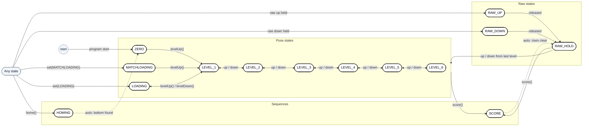
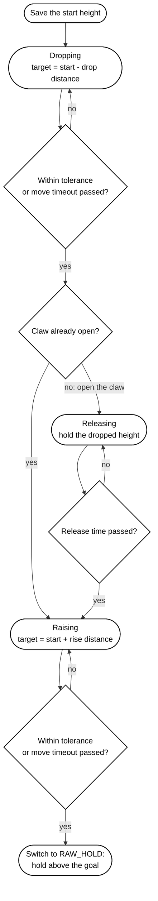
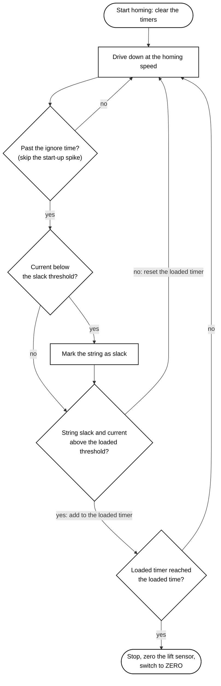
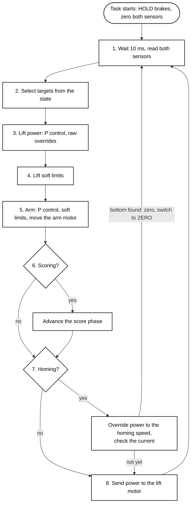

# Lift Notebook Pages

This file plans the Lift section of the engineering notebook, page by page. It follows the format of the Intake section (notebook pages 572 to 580) and gives the text, tables, code, diagrams and pictures for each page.

- The full source material is in `Lift PRD.md` and `Lift Implementation.md` in this folder.
- Layout notes are in quote blocks (`>`). Everything else is page content and can be copied directly.

## ▲ How the Intake Section Is Built

| Notebook page | Header | Sections | Lift pages |
|:--|:--|:--|:--|
| Divider | "Part 1: Intake Subsystem", salmon background | ▲ In This Section: 1X, 1A, 1B, 1C | 1 |
| 572 | **1X** · Problem Statement · **IDENTIFY** (green) | ▲ Primary Issue, ▲ Stateful System, picture | 2, 3 |
| 573 | **1A** · Planning & Product Requirements · **PLAN** (olive) | ▲ Objective, ▲ Success Metrics (Goal / Metric) | 4, 5 |
| 574 | Title only | ▲ Requirements (Requirement / Importance / Notes), ▲ State Diagram | 6 to 10 |
| 575 | **1B** · Overall Implementation · **IMPLEMENT** (maroon) | ▲ In This Document, ▲ Executive Summary (Purpose & Need, Why Finite State Machine? with a./b.) | 11, 12 |
| 576 | Title only | ▲ Architecture (External Dependencies), ▲ Implementation Explainer → ◈ Finite State Machine | 13, 14 |
| 577 | "Src Explainer Cont." tab | ◈ Control Loop | 15 to 21 |
| 578 | "Src Explainer Cont." tab | ◈ State Transitions (with a callout box), ◈ Background Task Execution | 22 to 24 |
| 580 | **1C** · Review Process · **TEST & ITERATE** (blue) | ▲ Tests & Performance Analysis (Test / Status / Result) with a Procedure, ▲ PRD Alignment (Description / Implementation / Status) | 25 to 28 |

**The Intake introduces each name in a fixed order, and the Lift follows it:**

1. **572** describes the hardware and its actions in words, with **no code names**. The actions "translate to a finite state machine" without naming the states.
2. **573** states what the intake does, how it works with the claw, and why it is an FSM. Code names appear **with a description**, for example "A simple state setter, set()".
3. **574** is where the **state names first appear**, each with the action it defines. The diagram follows the Requirements.
4. **575** explains the reasoning behind the code structure **before showing any code**.
5. **576** lists the libraries, then **refers back** to the states from 1A ("the aforementioned states").
6. **577** introduces each data field with **what it represents** before the code box.
7. **578** describes what the setter does, then how the task is launched.
8. **580** gives one driver-control test with a numbered procedure. The alignment rows **restate the Requirements as questions** ("Working FSM?").

**Layout conventions to keep on every Lift page:**

| Element | Convention |
|:--|:--|
| **Header** | Dark-red badge (2X, 2A, 2B, 2C) and colored phase tag on the **first page of each phase** only. Other pages show the title and subtitle |
| **Footer** | "Season-Long Implementation", the page number and the author |
| **Section markers** | ▲ marks page-level sections; ◈ marks each code topic in the Implementation Explainer. Explainer continuation pages carry the "Src Explainer Cont." tab |
| **Tables** | First column shaded yellow. `HIGH` importance highlighted red. Status cells shaded green once a test passes or a requirement is met |
| **Code** | Code names in green monospace. Each explainer topic opens with bullets, followed by the code box |
| **Callouts** | A pink-bordered box beside a code box explains a specific line, as on page 578 |
| **Picture box** | A rounded frame with a grey diagonal line marks an empty picture slot. Each 1B page ends with one |

**Writing rules for these pages:**

1. The Lift uses **the same ▲ and ◈ sections as the Intake**, in the same order. Content without an Intake equivalent goes **under the closest Intake section** as a sub-heading.
2. The reader already knows the **mechanical design** of the cascade lift and pivot arm from the build section. These pages explain **how the systems work together** and how the code controls them.
3. Each page moves from **basics to detail**, and no page relies on a later page.
4. Every name is **introduced before it is used**, in the order above. The Lift's state names first appear in the Requirements (page 6).
5. Every value **states its source**: measured on the robot, calculated, set on a given date, or a placeholder estimate.
6. Text is kept in **short pieces** so that each page is easy to read:
   - A bullet has at most two sentences. Longer explanations become sub-bullets or numbered steps.
   - Table cells stay short. Details that do not fit go in a list below the table.
   - Splitting text never removes information.
7. Anything that happens in sequence is a **numbered list** with one action per step.
8. Each bullet bolds the **one or two phrases that carry its point**. List lead-ins, phase names and new terms at their definition (such as **pose**) are also bold.
   - Whole sentences are not bolded, except the first Objective bullet, which matches the Intake page.
   - Code names are not bolded.
9. The writing is **formal**: no contractions, no conversational asides, and no dashes used as sentence punctuation.

## ▲ Intake Errors to Avoid

The following items on the Intake pages do not match the intake code (`src/subsystem/intake.cpp`, `include/subsystem/intake.hpp`). They should be corrected in the Intake section and not copied into the Lift section.

| Page | Issue | Correction |
|:--|:--|:--|
| 574, 576 | The text says "four states" | The enum has three: `INTAKE`, `OUTTAKE`, `STOP` |
| 573 | Refers to "flex wheels", "blocks" and "Both motors" from last season | Describe the current intake: **one motor with one `speed`** |
| 575 | Refers to "two hardware stages" and "scoring" | Same as above |
| 577 | Refers to `bottomSpeed` / `topSpeed` | Replace with `speed` |
| 577 | The loop excerpt does not match the source | The real loop has `pros::delay(10)` at the top and none of the excerpt's comments |
| 577 | The `STOP` comment says the motor holds | The brake mode is never set, so it uses the PROS default, **coast** |
| 578 | `set()` shows `int speed = 127` in the definition | The default value is in the header, not the definition |
| 578 | The task is shown as a file-scope `pros::Task intakeControl{...}` | The real code starts it in `initialize()`: `intakeTask = new pros::Task([] { intake.intakeControl(); });` |
| 578, 580 | Page numbering skips 579 | Renumber the pages |
| 572 | The picture shows an older robot | Replace it with a photo of this season's intake |

## ▲ Adapting the Format for the Lift

The Intake is one motor with three states, each of which sets a speed. The Lift has two motors, two rotation sensors, a pneumatic claw and fourteen states.

- The Lift keeps **every Intake section**, and several sections run over more than one page.
- Content with **no Intake equivalent** is placed under the closest Intake section:

| Lift content | Placed under | Page | Reason |
|:--|:--|:--|:--|
| How the lift, arm and claw **work together** (scoring cycle, poses) | ▲ Objective | 4 | The Intake Objective states what the intake does and how it loads the claw |
| The three **hardware constraints** | ▲ Primary Issue | 2 | They are part of the problem the code must solve |
| **Pose Table** | ▲ State Diagram | 8 | Replaces the motor speeds the Intake writes inside each ellipse |
| **SCORE and HOMING** step diagrams | ▲ State Diagram | 9, 10 | Each is one state with several steps |
| **Development history** and design comparison | ▲ Executive Summary → Why Finite State Machine? | 12 | The Intake compares the FSM to a naive approach; the lift went through two earlier designs |
| **Hardware configuration** (ports) | ▲ Architecture | 13 | Lists the devices the code depends on, next to the libraries |
| **Loop outline** and one page per loop step | ◈ Control Loop | 15 to 21 | The loop is about 130 lines, so it is shown one step at a time |
| **Driver controls** | ◈ State Transitions | 23 | The buttons are how the driver triggers each transition |
| **Before Testing** checklist and eight procedures | ▲ Tests & Performance Analysis → Procedure | 26, 27 | The Intake has one test and one procedure |
| **Remaining work** | ▲ PRD Alignment → Remaining Work | 28 | The Intake has no Partial rows |

**Structure:** the Lift stays as one part with the same four phases (2X, 2A, 2B, 2C).

- The lift, arm and claw share **one class**, one state variable and one task.
  - Splitting them into three parts would describe three state machines that do not exist.
  - Every pose would also be split across two parts.
- Within the shared sections, the mechanisms are kept apart in three ways:
  - Success Metrics and Tests are **grouped by mechanism** in a fixed order: Lift, Arm, Claw & Score, Safety, Whole System.
  - Continuation tabs **name the mechanism**, for example "Src Explainer Cont. · Arm".
  - Each step of the control loop gets **its own page** under ◈ Control Loop, in loop order.

**Reducing the page count:**

- Merge pages 16 and 17 by trimming the target switch to `ZERO`, `LEVEL_1` and `SCORE`.
- Remove the picture boxes on pages 17, 18 and 22.
- Move the notes under the design comparison on page 12 into a callout.

## ▲ Page Plan

Continue the page numbering from the Intake section. If the Lift follows the Intake directly, the divider is the next page and 2X starts after it.

| Page | Badge / tab | Subtitle | Sections |
|:--|:--|:--|:--|
| 1 | Divider | | Part 2: Lift Subsystem, In This Section |
| 2 | 2X · IDENTIFY | Problem Statement | ▲ Primary Issue |
| 3 | | Problem Statement | ▲ Stateful System |
| 4 | 2A · PLAN | Planning & Product Requirements | ▲ Objective |
| 5 | | Planning & Product Requirements | ▲ Success Metrics |
| 6 | | Planning & Product Requirements | ▲ Requirements |
| 7 | | Planning & Product Requirements | ▲ State Diagram |
| 8 | | Planning & Product Requirements | ▲ State Diagram (cont.): Pose Table |
| 9 | | Planning & Product Requirements | ▲ State Diagram (cont.): SCORE State |
| 10 | | Planning & Product Requirements | ▲ State Diagram (cont.): HOMING State |
| 11 | 2B · IMPLEMENT | Overall Implementation | ▲ In This Document, ▲ Executive Summary |
| 12 | | Overall Implementation | ▲ Executive Summary (cont.): Development History |
| 13 | | Overall Implementation | ▲ Architecture |
| 14 | | Overall Implementation | ▲ Implementation Explainer: ◈ Finite State Machine |
| 15 | Src Explainer Cont. | Overall Implementation | ◈ Control Loop |
| 16 | Src Explainer Cont. · Lift & Arm | Overall Implementation | ◈ Control Loop: Step 1, Reading the Sensors |
| 17 | Src Explainer Cont. · Lift & Arm | Overall Implementation | ◈ Control Loop: Step 2, Target Selection |
| 18 | Src Explainer Cont. · Lift | Overall Implementation | ◈ Control Loop: Steps 3 and 4, Lift Power and Soft Limits |
| 19 | Src Explainer Cont. · Arm | Overall Implementation | ◈ Control Loop: Step 5, Arm Control |
| 20 | Src Explainer Cont. · Claw & Score | Overall Implementation | ◈ Control Loop: Step 6, Score Phases |
| 21 | Src Explainer Cont. · Homing | Overall Implementation | ◈ Control Loop: Steps 7 and 8, Homing and Lift Output |
| 22 | Src Explainer Cont. | Overall Implementation | ◈ State Transitions |
| 23 | Src Explainer Cont. | Overall Implementation | ◈ State Transitions (cont.): Driver Controls |
| 24 | Src Explainer Cont. | Overall Implementation | ◈ Background Task Execution |
| 25 | 2C · TEST & ITERATE | Review Process | ▲ Tests & Performance Analysis |
| 26 | | Review Process | Procedure: Before Testing, T1 to T4 |
| 27 | | Review Process | Procedure: T5 to T8 |
| 28 | | Review Process | ▲ PRD Alignment, Remaining Work |

---

## Page 1: Part Divider

> - Same layout as the Intake divider: salmon background, large title and an "▲ In This Section:" list.
> - The subtitle line under the title is new. It shows that this part covers three mechanisms.

# Part 2: Lift Subsystem

**Lift · Pivot Arm · Claw**

**▲ In This Section:**
**2X. Problem Statement**
**2A. Planning & Product Requirements**
**2B. Overall Implementation**
**2C. Process Review**

---

## Page 2: 2X · Problem Statement

> **Header:** badge `2X` · "Lift Subsystem" · subtitle "Problem Statement" · tag **IDENTIFY** (green)
>
> - The Intake fits Primary Issue and Stateful System on one page (572).
> - The Lift's Primary Issue also lists the hardware constraints, so Stateful System moves to page 3.

### ▲ Primary Issue

- The **lift subsystem** carries game objects from the loading position to the goals and places them.
- The lift comprises **three mechanisms**: a cascade lift driven by one motor, a pivot arm driven by a second motor, and a pneumatic claw.
- We need a way to **control all three** from a programming standpoint.
- The hardware places **three constraints** on how the code can do this:
  1. The cascade has **no hard stop** at the bottom.
     - If the motor keeps turning after the lift bottoms out, the string winds the opposite way and **raises the lift again**.
     - The code must therefore stop the motor itself.
  2. There is **no limit switch** to report when the lift reaches the bottom.
     - The motor does report its **current draw**: how hard it is working, in milliamps (mA).
     - The current stays low while the string is slack and **rises sharply** once the string starts lifting the lift.
  3. The rotation sensors read 0 **wherever they are when the program starts**.
     - The lift must start at the bottom and the arm in its starting position.
     - Otherwise, every height and angle is offset.
- At the same time, we want our implementation to be **clean**. Since the lift is a stateful system, it should follow the conventions of a **finite state machine (FSM)**, as the Intake does.

> **Picture box:** the lift at its lowest point with the string direction marked, to illustrate constraint 1.

---

## Page 3: 2X · Problem Statement (cont.)

> **Header:** title and subtitle only

### ▲ Stateful System

- **From a hardware standpoint, the lift could perform the following:**
  - Hold the lift at the **bottom of travel**
  - Hold the lift and arm at the **loading position**, the **matchloading position**, or one of **six scoring heights**
  - **Move the lift freely** while the driver holds a button, then **hold** where it stops
  - **Score** a game object: lower it onto the goal, open the claw, and rise clear
  - **Find the bottom** of its travel automatically, a process called **homing**
- From a software standpoint, this translates to a **finite state machine**, with each action of the lift classified as **one or more finite states**.
- The lift should exist in **one state at a given moment**, and this state could be altered by the driver or by an autonomous routine.

> **Picture box** (to the right of the list, where the Intake picture is): the lift with the two rotation sensors and the claw labeled. These are the parts the code reads from or controls directly.

---

## Page 4: 2A · Planning & Product Requirements

> **Header:** badge `2A` · "Lift Subsystem" · subtitle "Planning & Product Requirements" · tag **PLAN** (olive)
>
> - The Intake Objective (573) states what the intake does, how it works with the claw, and why it is an FSM. The Lift Objective follows the same order.
> - The scoring cycle explains how the three mechanisms work together.
> - If the six scoring heights correspond to specific goals on the field, name them in step 2 of the cycle.

### ▲ Objective

- **The lift system carries game objects from the loading position to six scoring heights and places them, during both driver control and autonomous operation.**
- Each game object passes through a **scoring cycle** that uses all three mechanisms from page 2:

1. **Load.** The lift and arm move to the **loading height and angle** with the claw open. After the object is loaded, the driver **closes the claw**.
2. **Raise.** The lift rises to one of the **six scoring heights** while the arm turns to the **scoring angle**.
3. **Score.** The lift drops slightly onto the goal, the claw opens, and the lift rises clear. This is the **drop, open, rise** sequence.
4. **Return.** The lift and arm move **back to the loading position** for the next object.

- Every step moves the lift and the arm together. A lift height combined with its matching arm angle is called a **pose**.
- Matchloading uses the same cycle with **its own pose**.
- The lift must:
  - reach the **same height every time**
  - hold that height against gravity
  - respond **instantly** to driver inputs and autonomous commands
- Because the lift and arm must always agree, the lift is implemented as **one finite state machine**. A single state sets both the lift height and the arm angle.
  - Separate machines for the lift and arm would need **two commands per move**.
  - They could also leave the arm at the **wrong angle** for the current height.
- Scoring is a **multi-step sequence**, so it runs as a state in the same machine.
- The claw stays under **driver control**, since the driver closes it on each object. The state machine opens it only **during scoring**, where the timing matters.
  - The claw has **no sensor**, so the code tracks the last command sent to it.

---

## Page 5: 2A · Success Metrics

> **Header:** title and subtitle only
>
> - The Intake places Success Metrics on the same page as the Objective. The Lift Objective fills page 4, so the metrics move to page 5.
> - The group rows (Lift, Arm, and so on) span both columns and are bold and unshaded. Page 25 uses the same groups in the same order.

### ▲ Success Metrics

- Each goal describes what the **driver or an autonomous routine needs**.
- Each metric describes how it is **verified in the code or on the robot**.

| Goal | Metric |
|:--|:--|
| **Lift** | |
| The lift **reaches and holds** each preset height when commanded | Each pose state drives the lift to its height using the **lift rotation sensor**, then holds it |
| The driver can **step between levels** with one press per level | Level-up and level-down commands move **exactly one level** per press, even after free movement or scoring |
| The driver can **move the lift freely** and have it hold where released | Holding a button moves the lift at a fixed power. Releasing it **holds the lift in place** |
| **Arm** | |
| The **arm moves to the angle** that matches the lift's pose | The loading, matchloading and scoring poses each set an angle, read from the **arm rotation sensor**. Other states **keep the last angle** |
| **Claw & Score** | |
| **One press scores** a game object | A score command drops the lift, opens the claw, rises clear and holds. Every move has a **time limit** |
| **Safety** | |
| The lift can **find its true bottom** without a limit switch | A homing routine detects the **current rise** (page 2), then zeros the lift sensor |
| The lift and arm **never drive past their ends of travel** | The code cuts any power that would drive the lift or arm **past a set limit** |
| **Whole System** | |
| The lift's control loop runs on a **dedicated background task** and does not block the main program | A parallel, separate PROS task houses the control loop, `liftControl()`. A simple state setter, `set()`, changes the state and **returns immediately** |

---

## Page 6: 2A · Requirements

> **Header:** title and subtitle only
>
> - Highlight `HIGH` in red as on the Intake page.
> - Give `MEDIUM` a lighter highlight (orange or yellow) so the two levels are distinct.

### ▲ Requirements

- Each requirement is a **feature the code must have** to meet the Success Metrics. `HIGH` means the lift **cannot be used in a match** without it.
- The actions from the Stateful System (page 3) become **fourteen named states**. Each is named after the pose or behavior it represents, and they fall into three groups:

| Group | States | What they do |
|:--|:--|:--|
| **Pose** | `ZERO` (bottom of travel), `MATCHLOADING`, `LOADING`, `LEVEL_1` to `LEVEL_6` (the six scoring heights) | Hold a preset height. All except `ZERO` also set an arm angle |
| **Raw** | `RAW_UP`, `RAW_DOWN`, `RAW_HOLD` | Move the lift freely, then hold it |
| **Sequence** | `SCORE`, `HOMING` | Run a set of steps automatically |

| Requirement | Importance | Notes |
|:--|:--|:--|
| **Finite state machine** with fourteen states | HIGH | The three groups above. Each state defines a separate action of the lift |
| **Dedicated background** control task | HIGH | `liftControl()` runs in a PROS task, so the control loop **never blocks** the main program |
| **Closed-loop control** for lift and arm | HIGH | The code adjusts power until the **rotation sensor** reading matches the target. Power is **proportional** to the distance left (P control), up to a cap |
| **Arm angle tied** to the lift state | HIGH | Each pose state except `ZERO` sets **both** the height and the arm angle |
| **One-press** level stepping | HIGH | Two commands, `levelUp()` and `levelDown()`, step through `LOADING` and `LEVEL_1` to `LEVEL_6` |
| **Raw control** with hold | HIGH | Holding a button moves the lift at a fixed power. On release, the **HOLD brake mode** (resisting motion at zero power) keeps it in place |
| **One-press score** sequence | HIGH | A score command, `score()`, runs the drop, open, rise sequence, then holds |
| **Soft limits** on lift and arm | HIGH | A **soft limit** is a position past which the code will not drive the motor. Power **back toward the range** is still allowed |
| **Current-based homing** | MEDIUM | A homing command, `home()`, uses the current rise (page 2) to find the bottom **without a limit switch** |
| **Pneumatic claw** integration | MEDIUM | The driver opens and closes the claw. The score sequence opens it automatically |
| **Autonomous** uses the same commands | MEDIUM | Autonomous routines call the same `set()` and `score()` commands as driver control |

---

## Page 7: 2A · State Diagram

> **Header:** title and subtitle only
>
> **Drawing the diagram in the notebook style:**
> - Use white ellipses with black outlines and black arrows, like the Intake diagram on page 574.
> - Write **only the state name** in each ellipse. The other details go in the Pose Table on page 8.
> - Arrange the states in three labeled groups:
>   - Raw states on the left: `RAW_UP` top, `RAW_HOLD` middle, `RAW_DOWN` bottom.
>   - Pose states in the center, bottom to top: `ZERO` and `MATCHLOADING` side by side, then `LOADING` and `LEVEL_1` through `LEVEL_6`.
>   - Sequences on the right: `SCORE` upper, `HOMING` lower.
> - Add a small **"Any state"** node on the far left instead of drawing fourteen copies of the same arrow.
> - The Mermaid version below is horizontal for screen readability. Redraw it in portrait for the page.

### ▲ State Diagram

1. The program starts in `ZERO`.
2. **Pose states** (center) are the poses from the Objective (page 4). `levelUp()` and `levelDown()` move up and down the column **one level per call**.
3. **Raw states** (left) provide free movement. Holding a raw button enters them from **any state**, and releasing it switches to `RAW_HOLD`.
4. **Sequences** (right) run their steps automatically. The steps are drawn on pages 9 and 10.
5. The **dashed arrows** are the only transitions the program makes on its own, when a sequence finishes.
6. Any other lift command **cancels `SCORE`**.
7. Level stepping always starts from the **last level selected**, even after raw control or scoring.



---

## Page 8: 2A · State Diagram (cont.)

> **Header:** title and subtitle only. The Pose Table takes the place of the motor speeds that the Intake diagram writes inside each ellipse.

### ▲ State Diagram (cont.)

#### Pose Table

1. Each **pose state** sets one lift height and, except `ZERO`, one arm angle.
2. The other states are **behaviors**. They set the lift power directly or run a sequence, and the arm **keeps its last angle**.
3. Heights and angles are measured in **rotation sensor degrees** from the starting position (page 2).
4. The numerical values belong to the implementation. They are introduced in 2B with their sources (pages 17 to 19).

| State | Group | Lift target | Arm target |
|:--|:--|:--|:--|
| `ZERO` | Pose | Bottom of travel | Keeps last angle |
| `MATCHLOADING` | Pose | Matchloading height | Matchloading angle |
| `LOADING` | Pose | Loading height | Loading angle |
| `LEVEL_1` to `LEVEL_6` | Pose | Scoring height 1 to 6 | Scoring angle (same for every level) |
| `RAW_UP` | Raw | None; fixed upward power | Keeps last angle |
| `RAW_DOWN` | Raw | None; fixed downward power | Keeps last angle |
| `RAW_HOLD` | Raw | None; zero power, held by the HOLD brake | Keeps last angle |
| `SCORE` | Sequence | Below the start height, then above it (page 9) | Keeps last angle |
| `HOMING` | Sequence | None; slow downward power until the bottom is found (page 10) | Keeps last angle |

- The lift's soft limits sit **slightly below the bottom** of travel and about **one level above** the sixth scoring height.
- The arm has its own pair of soft limits.

> **Picture box:** a vertical scale of the lift's travel marking each pose and both soft limits. Photos of the lift at three poses beside it are an alternative.

---

## Page 9: 2A · State Diagram (cont.)

> **Header:** title and subtitle only
>
> - Draw the diagram in the same ellipse style as page 7.
> - The diamonds are checks the program makes on every pass of the control loop.

### ▲ State Diagram (cont.)

#### SCORE State

- `SCORE` performs step 3 of the scoring cycle (page 4) **automatically** when `score()` is called.
- The arm **keeps its angle** throughout.

1. **Record the start.** The current lift height is saved as the **start height**.
2. **Drop.** The lift lowers by a set **drop distance** onto the goal.
3. **Release.** The claw opens, and the lift waits a set **release time** while the claw lets go. If the claw is already open, this step is skipped.
4. **Raise.** The lift rises to a set **rise distance** above the start height, clear of the goal.
5. **Hold.** The lift switches to `RAW_HOLD` and stays at that height. Returning to a level preset would lower it back onto the goal.

- Steps 2 to 4 are called the **Dropping, Releasing and Raising phases**.
- A move counts as complete when the lift is within a set **tolerance** of its target, or when a **move timeout** has passed.
- The timeout prevents any step from stalling the sequence.



---

## Page 10: 2A · State Diagram (cont.)

> **Header:** title and subtitle only

### ▲ State Diagram (cont.)

#### HOMING State

- `HOMING` finds the bottom using the **current rise** described on page 2.
- The rise was **measured on the robot**. The lift was driven down at a power of 45 while the motor's current and speed were printed every 50 ms:

| String | Current | Speed |
|:--|:--|:--|
| Slack | **50 to 105 mA** | About 84 RPM |
| Lifting the lift | **220 to 350 mA** | About 70 RPM |

- The speed dropped by only about 15%, but the current roughly tripled.
- The homing routine therefore **watches the current**, not the speed.

1. **Drive down slowly** at the **homing speed**, the same power of 45 used in the measurement.
2. **Ignore the start-up spike.** The current reads 0 and then spikes as the motor accelerates, so the code waits a short **ignore time** before checking it.
3. **Wait for slack.** A current below the **slack threshold** means the string is slack.
4. **Wait for the rise.** After that, a current above the **loaded threshold** means the string is lifting the lift. It must stay above the threshold for a set **loaded time**.
5. **Stop and zero.** The lift is at the bottom. The code stops the motor, resets the lift height to 0 and switches to `ZERO`.

- Both thresholds sit **between the two measured ranges**: above the slack current and below the lifting current.



---

## Page 11: 2B · Overall Implementation

> **Header:** badge `2B` · "Lift Subsystem" · subtitle "Overall Implementation" · tag **IMPLEMENT** (maroon)

### ▲ In This Document

- The `Lift` class structure and its **fourteen-state** finite state machine design
- How **one control loop**, `liftControl()`, converts the state into lift and arm power
- The code behind the **SCORE** and **HOMING** states
- State transitions through `set()`, `levelUp()`, `levelDown()`, `score()` and `home()`, and the **driver controls**
- **Background task** execution model

### ▲ Executive Summary

#### Purpose & Need

- The lift performs **four kinds of work** (holding a pose, moving freely, scoring and homing) with **three mechanisms**: the lift motor, the arm motor and the claw piston.
- Rather than implementing these as separate functions with scattered motor calls, the system is designed as a **finite state machine (FSM)**.
- The FSM **separates intent from action**:
  - Intent is which state the lift should be in.
  - Action is what the motors do in that state.

#### Why Finite State Machine?

- A naive approach would call `motor.move()` directly from every button. This creates two problems:
  - **conflicting commands** between the two motors
  - **no single record** of what the lift is doing
- The FSM solves both:
  1. `liftControl()` is the only place the motors are commanded. All other code interacts with the lift **only by setting the state**.
  2. `set()` is a single assignment, so a button press or autonomous call **never waits** for the lift. The control loop picks up the new state on its next pass.
  3. Each pose state other than `ZERO` holds **both targets**, so the height and arm angle stay matched.
  4. Scoring and homing are **states with phases**. They run inside the same loop and **do not pause** the rest of the program.
- The FSM is the **third design** used this season. Page 12 describes the two earlier designs and why they were replaced.

> - Letter the four points a. to d., as on the Intake page.
> - **Picture box:** the lift at `LOADING` beside the lift at `LEVEL_3`, showing one state change moving both the height and the arm angle.

---

## Page 12: 2B · Overall Implementation (cont.)

> **Header:** title and subtitle only
>
> - The Intake compares its FSM only to a naive approach.
> - The lift went through two earlier designs, so this page records them under the same heading.

### ▲ Executive Summary (cont.)

#### Development History

- The dates below come from the team's code repository.

| Date | Change |
|:--|:--|
| 9/11 | **Timed macros** ran the motor for a fixed time inside the driver control loop |
| 9/11 (later) | The macros moved to a **background task**, so they no longer stopped the drive |
| 10/4 | The **first state machine** replaced the macros. It drives the lift to target heights using the rotation sensor |
| 10/4 | The lift changed from **two motors to one** |
| 10/11 | **Scoring, homing and matchloading** added as states, and the first preset heights set |
| 11/1 | Score **drop and rise distances** changed to their current values |
| 11/2 | **Pivot arm.** The robot was rewired, and a second motor and rotation sensor were added for the arm |
| 11/3 | **Sixth scoring height** added, and the travel limits updated |

#### Comparing the Designs

| Design | Blocks the drive? | Height feedback | Driver override | Complexity |
|:--|:--|:--|:--|:--|
| **Blocking timed macros** (9/11) | Yes, up to 2.85 s | None (**open loop**) | None until the macro finishes | Low |
| **Non-blocking scripted macros** (9/11) | No (background task) | None (**open loop**) | Driver input cancels the macro | High |
| **Sensor-based FSM** (10/4, chosen) | No (background task) | Rotation sensor (**closed loop**) | A new state replaces the old one immediately | Medium |

1. Both macro designs were **open loop**. They ran the motor for a fixed time (full travel took 1.3 s) and assumed the lift had arrived.
   - A low battery or a heavy object made the same run time cover **less distance**.
   - The same macro could therefore stop at a different height from one match to the next.
2. The **blocking macros** waited inside the driver control loop. The drive stopped for **up to 2.85 s** while the lift lowered.
3. The **scripted macros** used the same timings but ran in a background task that stepped through a script of moves. This removed the blocking, but it **added complexity**:
   - a lock (mutex) to share the lift between the driver and the script
   - functions to cancel a macro and to wait for one to finish
4. The **FSM** is closed loop. It measures the lift with the rotation sensor and drives it to a target, so the same command **ends at the same height** every time.
   - A command only changes the state, and a background task moves the motors.
   - One control loop selects the behavior by state.
5. Scoring and homing still require ordered steps, so they were added as **states with their own phases** rather than as macros.

> If this page overflows, move points 1 to 5 into a callout beside the table.

---

## Page 13: 2B · Architecture

> **Header:** title and subtitle only

### ▲ Architecture

#### External Dependencies

| Component | Type | Purpose |
|:--|:--|:--|
| `pros::Motor` | Kernel Library | **Motor control** for the lift motor, `liftMotor`, and the arm motor, `pivotMotor` |
| `pros::Rotation` | Kernel Library | **Height and angle** readings from the lift sensor, `liftRotation`, and the arm sensor, `pivotRotation` |
| `ez::Piston` | EZ-Template Library | Opens and closes the **claw**, `claw`. `true` is open |
| `pros::Task` | Kernel Library | Runs `liftControl()` as a **background task** independent of the main program |

#### Hardware Configuration

1. Each device is declared **once**, in `config.cpp`, with the port it is plugged into. The ports match the **11/2 rewiring** (page 12).
2. A **negative port number** reverses the device. The lift sensor is reversed so that its reading **increases as the lift rises**.
3. The arm ports are marked as **placeholders** in `config.cpp` until they are confirmed on the robot.
4. The devices are passed into the `Lift` constructor, so the class contains no port numbers. Changing a port only requires editing `config.cpp`.

| Constant | Port | Device | Notes |
|:--|:--|:--|:--|
| `LIFT` | 20 | Lift motor | |
| `LIFT_ROTATION` | -18 | Lift rotation sensor | **Reversed** |
| `PIVOT` | 19 | Arm motor | Placeholder |
| `PIVOT_ROTATION` | 17 | Arm rotation sensor | Placeholder |
| `CLAW` | `'B'` | Claw solenoid (ADI port) | |

```cpp
// lift + pivoting arm
pros::Motor liftMotor(LIFT);
pros::Rotation liftRotation(LIFT_ROTATION);
pros::Motor pivotMotor(PIVOT);
pros::Rotation pivotRotation(PIVOT_ROTATION);

// claw - true is open.  opcontrol toggles it directly, and the lift opens it while scoring.
// If it's backwards, make this ez::Piston claw(CLAW, true) - that flips the output.
ez::Piston claw(CLAW);

Lift lift(liftMotor, liftRotation, pivotMotor, pivotRotation, claw);
```

---

## Page 14: 2B · Implementation Explainer

> **Header:** title and subtitle only

### ▲ Implementation Explainer

#### ◈ Finite State Machine

1. The `Lift` class first defines the aforementioned **fourteen states** (Requirements, page 6) in the `LiftState` enumeration (enum).

```cpp
  enum LiftState { ZERO,
                   MATCHLOADING,
                   LOADING,
                   LEVEL_1,
                   LEVEL_2,
                   LEVEL_3,
                   LEVEL_4,
                   LEVEL_5,
                   LEVEL_6,
                   RAW_UP,
                   RAW_DOWN,
                   RAW_HOLD,
                   HOMING,
                   SCORE };
```

2. In C++, enum names are **numbered from 0** in the order listed: `ZERO` is 0, `LOADING` is 2, `LEVEL_6` is 8 and `SCORE` is 13.
3. The pose states come first, **in height order**. This lets the code:
   - check for a pose state with `state <= LEVEL_6`
   - step one level with `level + 1`

> **Callout beside the enum:** "New levels must be added directly after `LEVEL_6`; otherwise level stepping breaks."

4. The Dropping, Releasing and Raising phases of the SCORE state (page 9) are defined in a second enum, `ScorePhase`.

```cpp
  enum ScorePhase { DROPPING,
                    RELEASING,
                    RAISING };
```

5. Two class fields hold the FSM's memory:
   - `state` is **what the lift is doing now**.
   - `level` is the **last pose state selected**. After raw control, `state` is `RAW_HOLD`, so without `level`, `levelUp()` could not tell which level comes next.

```cpp
  LiftState state = ZERO;
  LiftState level = ZERO;  // last ZERO..LEVEL_6 picked, so levelUp/levelDown still work after raw
```

> **Picture box:** the enum with the three groups bracketed and labeled with the group names from page 6.

---

## Page 15: 2B · ◈ Control Loop

> **Header:** title and subtitle only, with the "Src Explainer Cont." tab
>
> - The Intake shows its whole loop in one code box.
> - The Lift loop is about 130 lines, so this page outlines one pass, and pages 16 to 21 each cover one step.

#### ◈ Control Loop

1. The control loop, `liftControl()`, runs **indefinitely** in a background PROS task and dispatches motor outputs based on the current state.
2. Each pass through the loop is called a **tick**. A tick begins with a 10 ms wait (page 16), so the loop runs about **100 times per second**.
3. Each tick reads the sensors once, calculates the power for both motors and sends it. The steps run **in this order**:

| Step | Action | Page |
|:--|:--|:--|
| 1 | Wait 10 ms, read the lift and arm sensors | 16 |
| 2 | Select the lift and arm targets for the state | 17 |
| 3 | Lift power: P control, then raw overrides | 18 |
| 4 | Lift soft limits | 18 |
| 5 | Arm power, arm soft limits, move the arm | 19 |
| 6 | Advance the score phase | 20 |
| 7 | Homing override and bottom check | 21 |
| 8 | Move the lift motor | 21 |

4. The order affects behavior in two places:
   - The soft limits (step 4) run **after** the raw overrides (step 3). Raw control therefore **cannot exceed** the ends of travel.
   - Homing (step 7) runs **after** the soft limits. It is the **only state that can drive below** the bottom limit, which it must do to find the true bottom.



---

## Page 16: 2B · ◈ Control Loop (cont.)

> **Header:** title and subtitle only, with the "Src Explainer Cont. · Lift & Arm" tab

#### ◈ Control Loop (cont.)

##### Step 1: Reading the Sensors

Before the loop starts, the code:

1. Sets both motors to the **HOLD brake mode** from the Requirements (page 6), so zero power holds the lift and arm in place.
2. **Zeros both rotation sensors**, so every height and angle is measured from the starting position (page 2).

At the start of every tick, the code:

3. **Waits 10 ms**. This sets the loop rate and matches the 10 ms delay used by the driver control loop.
4. **Reads each sensor once** and stores the results as `position` (lift height) and `pivotPosition` (arm angle).
   - The sensors report **centidegrees** (hundredths of a degree).
   - Each reading is divided by 100 to convert it to degrees.

```cpp
void Lift::liftControl() {
  liftMotor.set_brake_mode(pros::E_MOTOR_BRAKE_HOLD);
  pivotMotor.set_brake_mode(pros::E_MOTOR_BRAKE_HOLD);
  liftRotation.reset_position();   // the lift starts sitting at ZERO_HEIGHT
  pivotRotation.reset_position();  // the arm's angles are measured from where it starts

  while (true) {
    pros::delay(10);
    double position = liftRotation.get_position() / 100.0;        // centidegrees -> degrees
    double pivotPosition = pivotRotation.get_position() / 100.0;  // centidegrees -> degrees
```

> **Picture box:** the mounting locations of the two rotation sensors on the lift and the arm.

---

## Page 17: 2B · ◈ Control Loop (cont.)

> **Header:** title and subtitle only, with the "Src Explainer Cont. · Lift & Arm" tab

#### ◈ Control Loop (cont.)

##### Step 2: Target Selection

1. Each lift height from the Pose Table (page 8) is stored as a **named constant**. The arm angles are introduced with the arm on page 19.

| Constant | Used by | Value (degrees) | Source |
|:--|:--|:--|:--|
| `ZERO_HEIGHT` | `ZERO` | 0 | The bottom of travel, where the sensor is zeroed (page 2) |
| `MATCHLOADING_HEIGHT` | `MATCHLOADING` | 0 | Placeholder estimate |
| `LOADING_HEIGHT` | `LOADING` | 1650 | Set on 10/11, before the arm was added. **Placeholder** until re-measured |
| `LEVEL_1_HEIGHT` to `LEVEL_5_HEIGHT` | `LEVEL_1` to `LEVEL_5` | 2950, 5200, 7200, 9200, 13000 | Set on 10/11, before the arm was added. **Placeholders** until re-measured |
| `LEVEL_6_HEIGHT` | `LEVEL_6` | 15500 | **Calculated** on 11/3 as `LEVEL_5_HEIGHT` + 2500, the average step from Level 1 to Level 5 |

2. The loop uses two targets:
   - `target` is the height the lift should be at **during this tick**.
   - `pivotTarget` is the angle the arm should be at.
3. The `switch` statement **converts the state into a pose** by setting both targets from the matching constants.
4. `target` starts at the **current position**. Raw and homing states leave it unchanged, so their error is zero and **P control adds no power** (page 18).
5. `pivotTarget` is a **class field**, not a loop variable, so it keeps its value between ticks. States that do not set it **keep the last angle**.

```cpp
    double target = position;  // raw states get no P power
    switch (state) {
      case ZERO:
        target = ZERO_HEIGHT;
        break;
      // ... MATCHLOADING: MATCHLOADING_HEIGHT, MATCHLOADING_ANGLE
      case LOADING:
        target = LOADING_HEIGHT;
        pivotTarget = LOADING_ANGLE;
        break;
      case LEVEL_1:
        target = LEVEL_1_HEIGHT;
        pivotTarget = SCORING_ANGLE;
        break;
      // ... LEVEL_2 to LEVEL_6: LEVEL_N_HEIGHT, SCORING_ANGLE
      case SCORE:
        target = scorePhase == RAISING ? scoreStart + scoreRise : scoreStart - scoreDrop;
        break;
      case RAW_UP:
      case RAW_DOWN:
      case RAW_HOLD:
      case HOMING:
        break;
    }
```

> - **Callout beside `case SCORE`:** "`scoreStart` is the start height; `scoreDrop` and `scoreRise` are the drop and rise distances (page 9, introduced on page 20). The target sits below the start until the Raising phase, then above it."
> - Lines marked `// ...` were trimmed to save space. The trimmed cases follow the same pattern.

---

## Page 18: 2B · ◈ Control Loop (cont.)

> **Header:** title and subtitle only, with the "Src Explainer Cont. · Lift" tab

#### ◈ Control Loop (cont.)

##### Steps 3 and 4: Lift Power and Soft Limits

- The lift power is calculated with the **P control** from the Requirements (page 6).
- Three class fields control it: `kP` is the **gain**, `speed` is the **maximum power** for moves to a pose, and `rawSpeed` is the **fixed power** for raw control.

1. Calculate the **error**, the distance left to travel: `target - position`.
2. Multiply the error by `kP` to get the power.
   - Far from the target, the power is high.
   - Near the target, it drops, so the lift **slows as it arrives**.
3. **Cap the power** between `-speed` and `speed`. PROS motor power ranges from -127 to 127.
4. In raw states, **replace the power**. `RAW_UP` and `RAW_DOWN` use `rawSpeed`, and `RAW_HOLD` sends 0 so that the HOLD brake holds the lift.
5. **Apply the soft limits**, stored as `MIN_POSITION` and `MAX_POSITION`.
   - Past a limit, only power that pushes **further out of range** is set to zero.
   - The driver can therefore always move the lift back into range.

```cpp
    int power = std::clamp(static_cast<int>(kP * (target - position)), -speed, speed);
    if (state == RAW_UP) power = rawSpeed;
    if (state == RAW_DOWN) power = -rawSpeed;
    if (state == RAW_HOLD) power = 0;  // let go - the HOLD brake keeps it where it stopped

    // Never drive past the ends of travel
    if (position >= MAX_POSITION && power > 0) power = 0;
    if (position <= MIN_POSITION && power < 0) power = 0;
```

> **Callout (worked example), `LOADING` (1650°) to `LEVEL_1` (2950°):**
> 1. Error: 2950 - 1650 = 1300°
> 2. Power: 1300 × `kP` (1.0) = 1300, capped at 127
> 3. The lift runs at full power until it is within 127° of the target, then slows down

| Field | Value | Source |
|:--|:--|:--|
| `kP` | 1.0 | **Placeholder** estimate, to be tuned on the robot |
| `speed`, `rawSpeed` | 127 | The **PROS maximum** motor power |
| `MAX_POSITION` | 18000° | **Calculated** on 11/3 as `LEVEL_6_HEIGHT` + 2500, about where a seventh level would be |
| `MIN_POSITION` | -10° | **Chosen** on 11/3, slightly below `ZERO_HEIGHT` |

- `rawSpeed` can be lowered to **slow raw control**.
- `MAX_POSITION` leaves **one level of travel** above `LEVEL_6` for raw control and the score rise.
- `MIN_POSITION` stops raw down **before the string winds the other way**.

> **Picture box:** the lift at its highest safe point with the 18000° reading. Take this photo after `MAX_POSITION` has been checked against the physical top.

---

## Page 19: 2B · ◈ Control Loop (cont.)

> **Header:** title and subtitle only, with the "Src Explainer Cont. · Arm" tab

#### ◈ Control Loop (cont.)

##### Step 5: Arm Control

1. The arm uses the **same P control** as the lift (page 18), with its own fields:
   - `pivotKP`: the gain
   - `pivotSpeed`: the maximum power
   - `pivotTarget`: the target angle (page 17)
2. `pivotTarget` starts at 0, and the arm sensor was zeroed at the arm's starting position. The arm therefore **holds its starting position** until a state assigns it an angle.
3. The arm's soft limits are stored as `PIVOT_MIN_ANGLE` and `PIVOT_MAX_ANGLE`.
4. The arm is driven **before** the score and homing steps (steps 6 and 7, page 15), so it **keeps its angle** during both.

```cpp
  int pivotSpeed = 127;    // max power moving to an angle
  double pivotKP = 1.0;    // power per degree of error  (PLACEHOLDER)
  double pivotTarget = 0;  // starts at 0 so the arm stays put until a state gives it an angle
```

```cpp
    int pivotPower = std::clamp(static_cast<int>(pivotKP * (pivotTarget - pivotPosition)), -pivotSpeed, pivotSpeed);
    if (pivotPosition >= PIVOT_MAX_ANGLE && pivotPower > 0) pivotPower = 0;
    if (pivotPosition <= PIVOT_MIN_ANGLE && pivotPower < 0) pivotPower = 0;
    pivotMotor.move(pivotPower);
```

5. Each arm angle from the Pose Table (page 8) is stored as a named constant:

| Constant | Used by | Value (degrees) |
|:--|:--|:--|
| `MATCHLOADING_ANGLE` | `MATCHLOADING` | 0 |
| `SCORING_ANGLE` | `LEVEL_1` to `LEVEL_6` | 90 |
| `LOADING_ANGLE` | `LOADING` | 180 |
| `PIVOT_MIN_ANGLE` / `PIVOT_MAX_ANGLE` | Arm soft limits | -20 / 200 |

- The arm was added on 11/2 (page 12). The angles, the arm limits and `pivotKP` are **placeholder estimates** until they are tuned on the robot.
- `pivotSpeed` is 127, the **PROS maximum** motor power.
- 0 is the arm's starting position. The comments in `lift.hpp` require the order `MATCHLOADING_ANGLE` < `SCORING_ANGLE` < `LOADING_ANGLE`.

> **Picture box:** one photo with the arm drawn at its three angles (matchloading, scoring and loading).

---

## Page 20: 2B · ◈ Control Loop (cont.)

> **Header:** title and subtitle only, with the "Src Explainer Cont. · Claw & Score" tab

#### ◈ Control Loop (cont.)

##### Step 6: Score Phases

1. The values of the SCORE state (page 9) are stored as class fields:

| Page 9 term | Field | Value | Source |
|:--|:--|:--|:--|
| **Drop distance** | `scoreDrop` | 300° | Set on 11/1 |
| **Rise distance** | `scoreRise` | 700° | Set on 11/1 |
| **Release time** | `scoreReleaseTime` | 200 ms | Placeholder estimate |
| **Tolerance** | `scoreTolerance` | 30° | Placeholder estimate |
| **Move timeout** | `scoreMoveTimeout` | 1000 ms | Set on 10/11, when scoring was added |

2. Three more fields track progress:
   - `scoreStart`: the **start height**
   - `scorePhase`: the **current phase**
   - `scoreTime`: the **time spent in that phase**, which increases by 10 ms per tick and resets to 0 at the start of each phase
3. In `DROPPING`, the phase ends when the lift is within the tolerance of the dropped height, or when the timeout has passed. The code then checks `claw.get()`, which returns the last claw command:
   - If the claw is closed, the code **opens it** and moves to `RELEASING`.
   - If it is already open, the code moves **directly to `RAISING`**.
4. In `RELEASING`, the code waits for the release time, then moves to `RAISING`.
5. In `RAISING`, the phase ends when the lift is within the tolerance of the raised height, or when the timeout has passed. The code then **switches to `RAW_HOLD`**.

```cpp
    if (state == SCORE) {
      scoreTime += 10;

      if (scorePhase == DROPPING) {
        if (position <= scoreStart - scoreDrop + scoreTolerance || scoreTime >= scoreMoveTimeout) {
          if (claw.get()) {
            scorePhase = RAISING;  // already open - nothing to wait for
          } else {
            claw.set(true);
            scorePhase = RELEASING;
          }
          scoreTime = 0;
        }
      } else if (scorePhase == RELEASING) {
        // Give the claw time to let go before pulling away
        if (scoreTime >= scoreReleaseTime) {
          scorePhase = RAISING;
          scoreTime = 0;
        }
      } else {
        // Done once it's up - hold right there, since going back to a level would just drop
        // it back down to that height
        if (position >= scoreStart + scoreRise - scoreTolerance || scoreTime >= scoreMoveTimeout)
          set(RAW_HOLD);
      }
    }
```

> **Picture box:** three frames from one score: lowered onto the goal, claw open, and risen clear.

---

## Page 21: 2B · ◈ Control Loop (cont.)

> **Header:** title and subtitle only, with the "Src Explainer Cont. · Homing" tab

#### ◈ Control Loop (cont.)

##### Steps 7 and 8: Homing and Lift Output

1. The values of the HOMING state (page 10) are stored as class fields:

| Page 10 term | Field | Value | Source |
|:--|:--|:--|:--|
| **Homing speed** | `homeSpeed` | 45 | The power used for the **current measurement** (page 10) |
| **Ignore time** | `homeIgnoreTime` | 100 ms | Set on 10/11, when homing was added |
| **Slack threshold** | `homeLooseCurrent` | 130 mA | **Between the measured ranges**: above the slack current (up to 105 mA) |
| **Loaded threshold** | `homeLoadedCurrent` | 160 mA | **Between the measured ranges**: below the lifting current (from 220 mA) |
| **Loaded time** | `homeLoadedTime` | 50 ms | Set on 10/11, when homing was added |

2. Three more fields track progress:
   - `homeTime`: the **time since homing started**
   - `homeLoose`: whether the **string has gone slack**
   - `loadedTime`: the **loaded timer**
3. In `HOMING`, `power` is **overridden** to `-homeSpeed`. This happens after the soft limits (page 15), which is why homing can drive below the bottom limit.
4. The code reads the motor current (in mA) every tick, but does not check it until `homeTime` passes the ignore time.
5. The first time the current drops below the slack threshold, `homeLoose` is set.
6. While `homeLoose` is set and the current is above the loaded threshold, `loadedTime` increases by 10 ms per tick.
   - Any tick below that threshold **resets it to 0**.
   - The rise must therefore be **sustained**.
7. When `loadedTime` reaches the loaded time, the code:
   - stops the motor
   - **zeros the lift motor's encoder and the lift rotation sensor**
   - switches to `ZERO`, then uses `continue` to skip the rest of the loop for that tick
8. On every other tick, the loop ends by sending `power` to the lift motor (step 8).

```cpp
    if (state == HOMING) {
      power = -homeSpeed;
      homeTime += 10;

      int current = std::abs(liftMotor.get_current_draw());  // mA
      // ... prints rpm and current every 50 ms, for tuning

      // The current reads 0 before the motor starts and spikes while it speeds up, so
      // don't look at it until that's over
      if (homeTime > homeIgnoreTime) {
        // String's loose - from here on, a current jump means it's lifting the lift
        if (current < homeLooseCurrent) homeLoose = true;

        if (homeLoose && current > homeLoadedCurrent) {
          loadedTime += 10;
        } else {
          loadedTime = 0;
        }
      }

      if (loadedTime >= homeLoadedTime) {
        printf("homed\n");
        liftMotor.move(0);
        liftMotor.tare_position();
        liftRotation.reset_position();
        set(ZERO);
        continue;
      }
    }

    liftMotor.move(power);
```

> - **Callout beside the trimmed line:** "This print produced the current and speed measurements on page 10."
> - **Picture box:** a graph of current (mA) against time for one homing run, using the printed values, with the slack and lifting ranges shaded. The graph is the measured basis for the homing thresholds.

---

## Page 22: 2B · ◈ State Transitions

> **Header:** title and subtitle only, with the "Src Explainer Cont." tab

#### ◈ State Transitions

1. State transitions are handled by the function `set()`, which accepts the desired state and writes it.
   - If the new state is a **pose state** (`<= LEVEL_6`, page 14), `set()` also stores it in `level`.
2. `levelUp()` and `levelDown()` step from `level` rather than `state`. This is why level stepping **still works after raw control or scoring**.
   - Stepping up from `ZERO`, `MATCHLOADING` or `LOADING` goes to `LEVEL_1`.
   - Stepping up at `LEVEL_6` has no effect.
   - Stepping down stops at `LOADING`.
3. `score()` prepares the SCORE state. It saves the start height, resets the phase and timer, and calls `set(SCORE)`.
   - It has **no effect while scoring or homing** is already in progress.
4. `home()` prepares the HOMING state in the same way. It clears the homing timers and has no effect if homing is already running.

```cpp
void Lift::set(LiftState state) {
  if (state <= LEVEL_6) level = state;
  this->state = state;
}

void Lift::levelUp() {
  // MATCHLOADING and LOADING are picked with their own buttons - up from either is LEVEL_1
  LiftState next = level < LEVEL_1 ? LEVEL_1 : static_cast<LiftState>(level + 1);
  if (next <= LEVEL_6) set(next);
}

void Lift::levelDown() {
  if (level > LOADING) set(static_cast<LiftState>(level - 1));
}
```

> **Callout beside `set()`, in the same style as the Intake's:** "Simple self-explanatory setter. It only writes fields; the control loop picks up the new state on its next tick, within 10 ms."

```cpp
void Lift::score() {
  if (state == SCORE || state == HOMING) return;  // don't stack drops or cut homing short
  scoreStart = liftRotation.get_position() / 100.0;  // centidegrees -> degrees
  scorePhase = DROPPING;
  scoreTime = 0;
  set(SCORE);
}
```

---

## Page 23: 2B · ◈ State Transitions (cont.)

> **Header:** title and subtitle only, with the "Src Explainer Cont." tab

#### ◈ State Transitions (cont.)

##### Driver Controls

1. The driver control function, `opcontrol()`, checks the controller every 10 ms and calls the commands from page 22.
2. The code reads buttons in two ways:
   - `get_digital_new_press()` is true **only on the first tick** of a press, so a held button triggers its command once. The presets, level stepping, scoring and the claw use this.
   - `get_digital()` is true **on every tick** the button is held, so raw control continues until the button is released. The raw buttons use this.
3. The buttons map to these commands:

| Button | Action | Command |
|:--|:--|:--|
| **L1 / L2** | Up / down one level | `levelUp()` / `levelDown()` |
| **A** | Loading pose | `set(LOADING)` |
| **RIGHT** | Matchloading pose | `set(MATCHLOADING)` |
| **X / B** (hold) | Raw up / down; release to hold | `RAW_UP` / `RAW_DOWN` → `RAW_HOLD` |
| **LEFT** | Score | `score()` |
| **Y** | Toggle the claw; print the lift and arm positions (centidegrees) | `claw.set(!claw.get())` |
| **DOWN + LEFT** | Home | `home()`, **currently commented out** |

4. Releasing X or B switches to `RAW_HOLD` **only if the lift is in a raw state** (`RAW_UP` or `RAW_DOWN`).
   - Without that check, every tick with X and B released would **cancel the current state**.

```cpp
    // Raw lift - hold X / B to move it freely, let go and it holds right there
    if (controller.get_digital(DIGITAL_X)) {
      lift.set(Lift::RAW_UP);
    } else if (controller.get_digital(DIGITAL_B)) {
      lift.set(Lift::RAW_DOWN);
    } else if (lift.state == Lift::RAW_UP || lift.state == Lift::RAW_DOWN) {
      lift.set(Lift::RAW_HOLD);
    }
```

> **Picture box:** controller diagram with the lift buttons labeled.

---

## Page 24: 2B · ◈ Background Task Execution

> **Header:** title and subtitle only, with the "Src Explainer Cont." tab

#### ◈ Background Task Execution

1. `liftControl()` is launched **once, in `initialize()`**, the PROS function that runs when the program starts.
2. It then runs concurrently with all other code for the **duration of the match**.
3. The task is started after the devices in `config.cpp` have been constructed.
4. Its control loop never waits for driver control, and driver control never waits for it.
5. The same block also starts the EZ-Template screen task and the intake task.

```cpp
  // Started here rather than at static init - chassis, lift and intake live in
  // config.cpp now, and a file scope task could run before their constructors do.
  ezScreenTask = new pros::Task(ez_screen_task);
  liftTask = new pros::Task([] { lift.liftControl(); });
  intakeTask = new pros::Task([] { intake.intakeControl(); });
```

> **Picture box:** a timeline with three rows (opcontrol, lift task, intake task) running in parallel, showing that no code waits on the lift.

---

## Page 25: 2C · Review Process

> **Header:** badge `2C` · "Lift Subsystem" · subtitle "Review Process" · tag **TEST & ITERATE** (blue)
>
> - The lift has not been tested yet. Leave Status as "Not yet tested" and Result blank until each test is run.
> - After a test, enter "Passing as of MM/DD" and the result, as on the Intake page, and shade passing rows green.

### ▲ Tests & Performance Analysis

- Each test corresponds to **one Success Metric** (page 5), using the same groups.
- The procedures are on pages 26 and 27, and the buttons are listed on page 23.

| # | Test Description | Status | Result |
|:--|:--|:--|:--|
| | **Lift** | | |
| T1 | Each preset (`LOADING`, `MATCHLOADING`, `LEVEL_1` to `LEVEL_6`) **reaches its height** and holds it without sagging | Not yet tested | |
| T2 | Level stepping moves **exactly one level** per press, including right after raw control and after scoring | Not yet tested | |
| T3 | Holding a raw button moves the lift; releasing it **holds the lift** without drifting | Not yet tested | |
| | **Arm** | | |
| T4 | The arm **reaches the matching angle** at `LOADING`, `MATCHLOADING` and every level | Not yet tested | |
| | **Claw & Score** | | |
| T5 | The score button **scores a held object**: drop, open, rise | Not yet tested | |
| | **Safety** | | |
| T6 | The lift **stops at both soft limits**, and the driver can still move it back | Not yet tested | |
| T7 | Homing from a raised start **stops at the true bottom** and zeros the sensor | Blocked: `home()` is not assigned to a button | |
| | **Whole System** | | |
| T8 | The lift changes states while the robot drives, with **no drive lag** | Not yet tested | |

---

## Page 26: 2C · Review Process (cont.)

> **Header:** title and subtitle only

### ▲ Tests & Performance Analysis (cont.)

#### Procedure

Since this testing is executed during driver control and has no autonomous code block, testing procedures have been provided instead.

**Before testing**
1. Start the program with the lift **at the bottom** and the arm in its starting position (page 2).
2. Press Y to print the lift and arm positions. The values are in **centidegrees**; divide by 100 to get degrees.
3. Y **also toggles the claw**. Press it a second time if the claw needs to stay in its current position.
4. **Set the pass margins** before testing and keep them the same between runs.
   - Suggested margins: ±30° for the lift and ±5° for the arm.
   - The lift margin matches the score tolerance (page 20).

**T1 Preset heights**
1. Press A, wait for the lift to settle, and press Y. Record the reading divided by 100.
2. Repeat for RIGHT. Then press L1 six times to reach `LEVEL_1` through `LEVEL_6`, taking a reading at each.
3. Wait 5 s at each height and press Y again to check for sag.
4. **Pass:** every reading is within **±30°** of its target (page 17) and does not change by more than that while holding.

**T2 Level stepping**
1. From `LOADING`, press L1 three times. The lift should be at `LEVEL_3`.
2. Hold X for one second, release it, then press L1. The lift should go to **`LEVEL_4`**, not one level above the raw position.
3. Press LEFT to score, then press L2. The lift should go to **`LEVEL_3`**.
4. **Pass:** every press moves **exactly one level** from the last level selected.

**T3 Raw control**
1. Hold X for one second, release it, and press Y twice (once for the reading, once to restore the claw).
2. Wait 10 s and press Y twice again.
3. Repeat with B.
4. **Pass:** the lift moves while the button is held, and the two readings **match within ±30°**.

**T4 Arm angles**
1. Press A, then RIGHT, then L1, pressing Y after each to read the arm angle.
2. **Pass:** the readings are within **±5°** of `LOADING_ANGLE`, `MATCHLOADING_ANGLE` and `SCORING_ANGLE` respectively (page 19).

---

## Page 27: 2C · Review Process (cont.)

> **Header:** title and subtitle only

### ▲ Tests & Performance Analysis (cont.)

#### Procedure (cont.)

**T5 Score**
1. Close the claw on an object at `LOADING`, then press L1 to reach a level.
2. Press LEFT. The lift should drop, the claw should open, and the lift should rise clear.
3. Repeat **15 times**, as in the Intake test.
4. **Pass:** the object is released onto the goal **every time**, and the lift ends above its start height without dropping back.

**T6 Soft limits**
1. Lower `rawSpeed` for this test.
2. Hold X until the lift stops, then press Y twice. The reading should be close to **18000°**.
3. If the lift reaches its **physical top first**, release X and lower `MAX_POSITION` (Remaining Work item 4, page 28).
4. Hold B until the lift stops. The reading should be close to **-10°**, with the string still wound in the correct direction.
5. At each end, press the opposite button to confirm that the lift **moves back**.
6. **Pass:** the lift stops at both limits without hitting anything and can always move back.

**T7 Homing** (after `home()` is assigned to a button)
1. Start the program with the lift **partway up**, so that its zero is incorrect.
2. Start homing and watch the terminal for the current readings and `homed`.
3. Press Y twice. The reading should be **about 0**.
4. **Pass:** homing stops at the true bottom **without winding the string the other way**, and the lift reads about 0.

**T8 Parallel control**
1. Drive forward while pressing L1, A and LEFT.
2. **Pass:** the drive **never pauses or stutters** while the lift moves, which confirms that the lift task runs in parallel.

---

## Page 28: 2C · PRD Alignment

> **Header:** title and subtitle only
>
> - As on the Intake page, each row restates a **Requirement** from page 6 as a question.
> - These statuses come from a review of the code on 11/3, not from robot testing. Update them as the tests on page 25 pass.

### ▲ PRD Alignment

| Description | Implementation | Status |
|:--|:--|:--|
| **Working FSM?** | Fourteen FSM states implemented. One control loop sets both motors from the state | Met |
| **Background control task?** | `liftControl()` runs in its own task, started in `initialize()` | Met |
| **Closed-loop control** for lift and arm? | P control on both rotation sensors. `kP` and `pivotKP` are **placeholders** | Partial |
| **Arm angle tied** to lift state? | Every pose state except `ZERO` sets `pivotTarget`. Arm ports and angles are **placeholders** | Partial |
| **One-press level stepping?** | `levelUp()` / `levelDown()` on L1 / L2, stepping from `level` | Met |
| **Raw control with hold?** | X / B set `RAW_UP` / `RAW_DOWN`; release sets `RAW_HOLD` | Met |
| **One-press score?** | `score()` on LEFT. `scoreReleaseTime` and `scoreTolerance` are **placeholders** | Partial |
| **Soft limits?** | `MIN_POSITION` -10 and `MAX_POSITION` 18000. 18000 is **not yet checked** against the physical top; arm limits are placeholders | Partial |
| **Current-based homing?** | Implemented, but **not assigned to a button**, with no timeout | Partial |
| **Claw integration?** | Y toggles the claw. `SCORE` opens it automatically | Met |
| **Autonomous** through the same commands? | Routines call `set()` and `score()`, but the project **does not build** yet | Partial |

#### Remaining Work

1. **Fix `autons.cpp`.**
   - It still references `clawPivot`, `clawIntake` and `Lift::ROLLERS`, which no longer exist.
   - Until this is fixed, the project does not build.
2. **Assign `home()` to a button** and run T7. The DOWN + LEFT combination is written in `opcontrol()` but commented out.
3. **Tune the placeholders** in the order given in `Lift Implementation.md`: ports and signs, soft limits, `kP`, `pivotKP`, heights and angles.
4. **Check `MAX_POSITION` against the physical top.** Once the heights are tuned, recalculate it as one average level step above `LEVEL_6_HEIGHT`.
5. **Add a homing timeout**, so that a missed current rise cannot drive the lift down indefinitely.
6. **Add a wait-until-arrived helper** for autonomous, so that each routine does not need its own wait loop.

---

## ▲ Pictures to Take

| Page | Picture |
|:--|:--|
| 2 | The lift at its lowest point with the string direction marked |
| 3 | The lift with the two rotation sensors and the claw labeled |
| 8 | Lift travel scale with each pose and both soft limits |
| 11 | Lift at `LOADING` beside the lift at `LEVEL_3` |
| 14 | Enum with the three state groups bracketed |
| 16 | Mounting locations of the two rotation sensors |
| 18 | Lift at its highest safe point (after the `MAX_POSITION` check) |
| 19 | Arm at its three angles |
| 20 | Three frames from one score |
| 21 | Current-against-time graph of one homing run |
| 23 | Controller with the lift buttons labeled |
| 24 | Timeline of the three tasks running in parallel |
