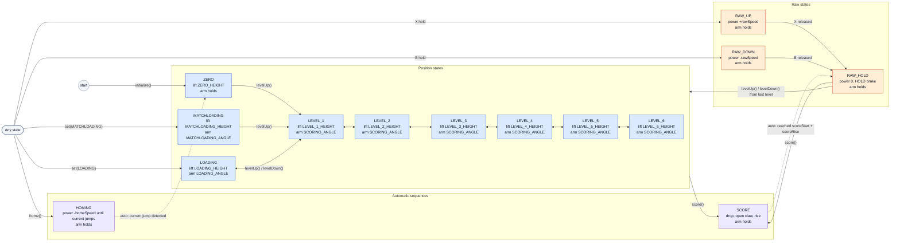

# Lift Mechanism PRD

|                       |            |
|:----------------------|:-----------|
| **Document status**   | DRAFT      |
| **Document owner**    | TBD        |
| **Designer**          | TBD        |
| **Technical writers** | TBD        |

## ▲ Objective

- The lift system carries game objects between the loading height and six scoring levels, and places them, during both driver control and autonomous operation. It combines three actuators: a string-winch lift driven by one motor, a pivoting arm driven by a second motor, and a pneumatic claw that grips and releases the object.
- The lift must reach the same heights every time regardless of battery level, hold them against gravity, and respond to a new command within one control cycle. The driver needs one-press height presets, fine manual control, and a one-press score, and none of these may stall the drive.
- Because three actuators must agree on what the mechanism is doing, and two operations (scoring and homing) are multi-step sequences, the lift is implemented as a **finite state machine (FSM)**, the same pattern as the Intake. Each state defines the lift height and the arm angle together, so the two can never be commanded into conflicting poses.

## ▲ Success Metrics

|  **Goal**                                                                                    |  **Metric**                                                                                                                      |
|:---------------------------------------------------------------------------------------------|:---------------------------------------------------------------------------------------------------------------------------------|
| The lift reaches and holds each named height when commanded                                  | `ZERO`, `MATCHLOADING`, `LOADING`, and `LEVEL_1`–`LEVEL_6` drive the lift to their height constant and hold it with P control    |
| The arm moves to the angle that matches the lift state                                       | `MATCHLOADING` → `MATCHLOADING_ANGLE`, `LOADING` → `LOADING_ANGLE`, every `LEVEL_N` → `SCORING_ANGLE`; other states hold the last angle |
| The driver can step between scoring levels with one press per level                          | `levelUp()` / `levelDown()` move exactly one level per press and keep working after raw control or scoring                       |
| The driver can move the lift freely and have it hold where released                          | `RAW_UP` / `RAW_DOWN` drive at `rawSpeed` while held; releasing switches to `RAW_HOLD`                                            |
| One press scores a game object                                                               | `score()` drops `scoreDrop`, opens the claw, rises to `scoreRise` above the start, then holds; each move is bounded by a timeout   |
| The lift can find its true bottom without a limit switch                                     | `home()` detects the motor-current signature of the string re-winding and zeroes the height sensor                               |
| The lift and arm never drive past their ends of travel                                       | Soft limits zero any power that pushes past `MIN_POSITION` / `MAX_POSITION` or `PIVOT_MIN_ANGLE` / `PIVOT_MAX_ANGLE`              |
| The control loop runs on a dedicated background task and does not block the main program     | `liftControl()` runs in its own PROS task at 100 Hz, and every public method returns immediately                                 |

## ▲ Implementation Assumptions

- The lift hangs on a string wound around an axle that one motor (`liftMotor`) turns. There is no hard stop at the bottom: driving down past it unwinds the string and then winds it the other way, which raises the lift again.
- The lift is at the bottom and the arm is in its starting pose when the program starts. `liftControl()` zeroes both rotation sensors when its task starts, so every height and angle is measured from that pose.
- Heights and angles come from rotation sensors (`liftRotation`, `pivotRotation`), not the motor encoders. Port sign handles direction: `LIFT_ROTATION` is `-18` (reversed) so the lift's reading increases as it rises.
- The claw piston reads `true` when open. If the plumbing is reversed, constructing it as `ez::Piston claw(CLAW, true)` flips the output without changing any lift code.

## ▲ Roadmap

[Note to LLM: IGNORE. This section will be handled separately.]

## ▲ Requirements

|  **Requirement**                                  |  **Importance**  |  **Notes**                                                                                                   |
|:--------------------------------------------------|:-----------------|:-------------------------------------------------------------------------------------------------------------|
| Finite state machine with fourteen states         | HIGH             | Position states `ZERO`, `MATCHLOADING`, `LOADING`, `LEVEL_1`–`LEVEL_6`; raw states `RAW_UP`, `RAW_DOWN`, `RAW_HOLD`; automatic sequences `SCORE`, `HOMING` |
| Dedicated background control task                 | HIGH             | `liftControl()` runs in its own PROS task so lift commands never block driver control or autonomous           |
| Closed-loop position control for lift and arm     | HIGH             | Proportional (P) control on rotation-sensor feedback, clamped to a maximum power                             |
| Arm angle tied to lift state                      | HIGH             | Each position state sets the matching arm angle, so the driver never positions the arm separately            |
| One-press level stepping                          | HIGH             | `levelUp()` / `levelDown()` step through `LOADING` and `LEVEL_1`–`LEVEL_6`                                    |
| Raw manual control with hold                      | HIGH             | Hold a button to move at `rawSpeed`; release to hold position with the motor's HOLD brake                    |
| One-press score sequence                          | HIGH             | `score()` drops, opens the claw, rises, then holds                                                           |
| Soft limits on lift and arm travel                | HIGH             | Power that would push past a limit is set to zero; power back toward the range is allowed                    |
| Current-based homing                              | MEDIUM           | `home()` finds the bottom without a limit switch. Implemented; not yet mapped to a driver button             |
| Pneumatic claw integration                        | MEDIUM           | The driver toggles the claw directly; `SCORE` opens it automatically                                         |
| Autonomous use through the same API               | MEDIUM           | Routines call the same `set()` and `score()` as driver control; there is no built-in wait helper yet         |

## ▲ Lift Control Decision Matrix

The lift went through three control designs this season. The table compares them on what matters during a match.

|  **Approach**                  |  **Blocks the Drive?**                                                              |  **Height Feedback**                                                  |  **Driver Override**                              |  **Code Complexity**                                                      |
|:-------------------------------|:------------------------------------------------------------------------------------|:----------------------------------------------------------------------|:--------------------------------------------------|:--------------------------------------------------------------------------|
| Blocking timed macros          | Yes. Each macro called `pros::delay()` inline and stalled `opcontrol()`, up to 2850 ms for `lower()` | None. Moves were timed (`MACRO_TIME_MS = 1300` for full travel)        | None until the macro returned                     | Low                                                                       |
| Non-blocking scripted macros   | No. A background task walked a script of steps                                      | None. Same timings as the blocking version                            | Manual input cancelled the running macro          | High: step scripts, a `pros::Mutex`, `cancel()`, `busy()`, `waitUntilDone()` |
| **Sensor-based FSM (chosen)**  | No. `set()` writes a state and returns; a background task does the work             | Rotation sensor, with P control to named heights                      | Any new state replaces the old one immediately    | Medium: one `switch` in one loop                                          |

**Our Choice: Sensor-based FSM**

Both macro designs were open loop: they ran the motor for a fixed time and assumed the lift arrived. A timed move covers less distance when the battery is low or the claw is carrying an object, so the same macro can end at a different height from one match to the next. The scripted version solved the blocking problem but kept the timing, and needed a mutex and cancel logic to coordinate the driver with the running script. The FSM measures the lift with a rotation sensor and drives to a target height, so the same command ends at the same height. It also removes the macro bookkeeping: the driver or a routine writes one state, and one loop turns it into motor power every 10 ms. The two behaviors that still need sequencing, scoring and homing, became states with their own internal phases.

## ▲ State Diagram

**Diagram Instructions:**
Create a state transition diagram with fourteen state nodes in three groups, plus one helper node:

- **Position states** (center column, stacked bottom to top in order of height): **`ZERO`** at the bottom, marked as the initial state with an entry arrow labeled "initialize()"; **`MATCHLOADING`** beside `ZERO`; **`LOADING`** above them; then **`LEVEL_1`**, **`LEVEL_2`**, **`LEVEL_3`**, **`LEVEL_4`**, **`LEVEL_5`**, and **`LEVEL_6`** at the top.
- **Raw states** (left column): **`RAW_UP`** at the top, **`RAW_HOLD`** in the middle, **`RAW_DOWN`** at the bottom.
- **Automatic sequences** (right column): **`SCORE`** upper right, **`HOMING`** lower right.
- **"Any state"** helper node (far left, small): stands for "from every state", so the diagram doesn't need fourteen copies of the same arrow.

Draw these arrows (solid = a command from `opcontrol()` or a routine, dashed = an automatic transition the loop makes itself):

- Up the center column: `ZERO` → `LEVEL_1`, `MATCHLOADING` → `LEVEL_1`, `LOADING` → `LEVEL_1` → `LEVEL_2` → `LEVEL_3` → `LEVEL_4` → `LEVEL_5` → `LEVEL_6`, labeled "levelUp()".
- Down the center column: `LEVEL_6` → `LEVEL_5` → `LEVEL_4` → `LEVEL_3` → `LEVEL_2` → `LEVEL_1` → `LOADING`, labeled "levelDown()".
- From "Any state": to `LOADING` labeled "set(LOADING)", to `MATCHLOADING` labeled "set(MATCHLOADING)", to `RAW_UP` labeled "X held", to `RAW_DOWN` labeled "B held", to `HOMING` labeled "home()".
- `RAW_UP` → `RAW_HOLD` labeled "X released"; `RAW_DOWN` → `RAW_HOLD` labeled "B released".
- From the position-state group and from `RAW_HOLD` to `SCORE`, labeled "score()".
- Dashed `SCORE` → `RAW_HOLD`, labeled "auto: reached scoreStart + scoreRise".
- Dashed `HOMING` → `ZERO`, labeled "auto: current jump detected".
- `RAW_HOLD` → the position-state group, labeled "levelUp() / levelDown() from the last level".

Inside each node, list the lift target and the arm target:
- `ZERO`: lift `ZERO_HEIGHT`, arm holds its last angle
- `MATCHLOADING`: lift `MATCHLOADING_HEIGHT`, arm `MATCHLOADING_ANGLE`
- `LOADING`: lift `LOADING_HEIGHT`, arm `LOADING_ANGLE`
- `LEVEL_1`–`LEVEL_6`: lift `LEVEL_N_HEIGHT`, arm `SCORING_ANGLE`
- `RAW_UP` / `RAW_DOWN`: power +`rawSpeed` / −`rawSpeed`, arm holds
- `RAW_HOLD`: power 0 (HOLD brake), arm holds
- `SCORE`: drop → open claw → rise, arm holds
- `HOMING`: power −`homeSpeed` until the current jumps, arm holds

Use color coding: blue for position states, orange for raw states, purple for automatic sequences, grey for the "Any state" node.
Add annotations: "Every position state except `ZERO` sets the arm angle; every other state holds the last angle", "Dashed arrows are the only transitions the loop makes on its own", "`levelUp()` / `levelDown()` step from the last position state picked, not from the current state".

## ◎ Out of Scope

- The intake is a separate subsystem with its own task and is covered in the Intake documentation. The lift never commands the intake.
- Outside of scoring, the lift does not decide when the claw opens or closes. The driver toggles it directly from `opcontrol()`.
- Chassis motion is covered in the Chassis entries. Autonomous routines sequence lift states and drive motions themselves.
- Game strategy, such as which level to score on or when to matchload, is decided by the driver and the autonomous routines, not by the FSM.
- Heights are stored and tuned in rotation-sensor degrees. Converting them to inches of lift travel is not part of this system.
